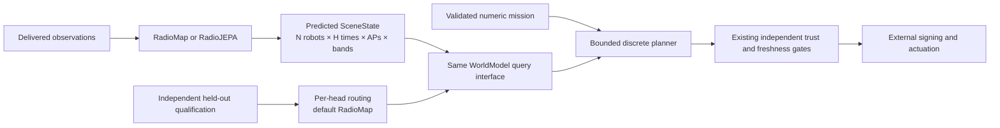

# RadioJEPA / WirelessJEV prediction boundary

This is an opt-in research implementation. RadioMap remains the application
default. No existing simulator, gate, intent reader, signer or hardware command
was changed.

The interface has explicit action identities and array axes. A scene is a
**predicted** RF field, not a private `World`. It cannot carry mission text or
actuation handles. Inputs and outputs own immutable array storage. A learned
outage head and receipt references can be carried in the scene; neither can
approve that head. External promotion controls choose per-head routing, which
defaults to RadioMap.

`RadioMapAdapter.query(state, actions, horizon, timescale)` currently supports
association/stay, band and fixed-MCS candidates. Unsupported MLO mechanisms,
power, width, route and arbitrary handover mechanisms are rejected. Same-AP
band changes retain the native zero-cost assumption; that is not a measured
NIC capability. Roaming uses the explicitly supplied association outage.

For default AP candidates, the adapter reproduces the existing
`closed_loop.control.OutageUtility` integrals and scores exactly. It uses the
existing ns-3-derived PHY curves and native gamma-fading, three-retry and
blockage surrogate. Explicit MCS uses that same assumed law. The historical
6 GHz table remains the existing 5 GHz error-curve and doubled-rate
approximation. None of these are calibrated real-device packet probabilities.

During a declared switch, sampled outage is one and rate is zero. The outage
integral handles the switch boundary exactly; trapezoids over the returned
coarse samples alone need not reconstruct that discontinuity. Rate is a PHY
success-times-rate proxy, not a CSMA/queue goodput forecast. Unknown silence
and latency distributions remain unknown. The requested horizon is bound to
the outcome, preventing an 8-second integral from being priced as 30 seconds.

The typed mission compiler accepts a strict numeric schema, not arbitrary
operator text or a general STL language. Missing, unknown and invalid fields
are rejected. Probability and silence constraints can be requested, but they
fail closed when the required externally qualified bound is absent. A silence
request cannot be satisfied by pretending the switch duration bounds all
future silence.

The first planner slice evaluates a bounded prefix of discrete candidates,
holding one action over its multi-horizon forecast. It is a one-action
receding-horizon proposal, not a multi-step CEM/MPPI implementation. Depths
above one are rejected until an action-conditioned transition model is
validated. The same cost and planner code works with either world model.

The planner checks its deadline before and after synchronous query calls and
discards late results. It cannot preempt a blocking call, so this is not a hard
real-time guarantee. The caller must charge **both** scene construction
(encoder/filter/map work) and query/render work in its full compute budget.
The existing forecast-age/capture/delivery contracts remain outside this
interface. A proposal always requires the independent existing gate, never
authorizes actuation, and reports no feasible action when required heads are
unknown. There is no claim that a physically safe connectivity action always
exists.

The conformal utility implements an exact one-sided split-conformal order
statistic on scalar overprediction errors. Calibration units have explicit
unique identities and an exact head/site/device scope. Its finite-sample
marginal interpretation assumes exchangeability; unique IDs do not prove that
assumption. Too few samples produce an uninformative bound and require
fallback. It does not turn a Bernoulli residual into a calibrated conditional
SLA probability. The rolling coverage monitor is an empirical veto, not a
coverage guarantee under arbitrary drift. No new head has been qualified on
real data by these software tests.

The proposed further capabilities—joint fleet assignment, active sensing,
multi-step latent dynamics, route advisories, MLO transitions and protocol
timestamp-derived handover distributions—are not implemented by this slice.
Each needs an actual predictive head, intervention support and its own
qualification before it can be claimed.

Verification uses analytic and software fixtures: exact old utility parity on
100 robots and 16 APs, PHY/MCS consistency, unsupported-action rejection,
immutable boundaries, missing calibration, partial head fallback, conformal
order/scope behavior, candidate limits and late-result rejection. These are not
warehouse service results or hardware trials.
