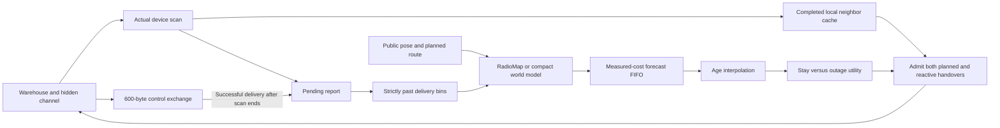

# Warehouse forecasting with delivered observations

This study addresses the missing feedback between the world model and its
radio actions. Its frozen protocol is
[`artifacts/closed_loop/protocol.json`](../artifacts/closed_loop/protocol.json).
No model weights change. The compact forecaster and the strong learned-prior
RadioMap receive the same observation and controller mechanisms.
The existing bulk-upload mission fixes the controller knobs. Mission readers
and the original RadioJEV E1–E5 model weights are unchanged.

The local controller sees current-link pilots and completed noisy scans. It
cannot query all neighboring APs' hidden RSSI at a decision. Current pilots
freeze while the radio is scanning or handing over. Actual cadence-triggered
scans use the packet simulator's fading and blockage, with 1.5 dB receiver
noise, a top-eight cap and a −90 dBm threshold. Unheard entries carry a proper
censoring bound only when a scan actually happened.

[`DeliveredScans`](../src/wirelessjev/closed_loop/telemetry.py) separates local
scan completion from remote delivery. A completed scan is useful on the
device immediately; the fleet model receives its report only after an
existing control frame succeeds. The report reserves at most 128 bytes of
the modeled 600-byte frame, reducing available application payload. The model
does not add an uncharged extra frame. This requires a telemetry-capable
bidirectional control exchange; separate uplink/ACK loss is not modeled.

Each delivered observation retains its measurement position. It is stored in
its delivery-second bin and is visible only in a later decision. An absent
report remains absent. Model context and fleet statistics use delivery bins,
so latency changes recency and available information. Motion plans and pose
are still supplied outside the radio link. The shared sixty-second history
is a conditional warm start rather than a tested cold deployment.

[`SinglePredictor`](../src/wirelessjev/closed_loop/runtime.py) executes exactly
one frozen forecasting family. It accepts `Observations`, public `Geometry`
and a planned route, with no simulator truth argument. A single FIFO charges
measured full prediction costs, never below the earlier cadence-five p95
envelope, plus the declared 500 ms processing delay. Results are unavailable
before completion. The controller interpolates their age and continues its
fast local control while waiting. A source-sealed validation calibration
precedes development and test. Scanner encoding, controller scoring and
network transport still lack independent CPU/latency measurements.

The new controller compares expected time without service. With frozen
three-retry PHY surrogate `p_i(t)` for AP `i`, horizon `H`, current AP `c`
and physical handover outage `T`, it uses

\[
L_{stay}=\int_0^H p_c(t)\,dt,\qquad
L_{move,i}=T+\int_T^H p_i(t)\,dt.
\]

It selects the least-loss alternative and admits a switch only for a strictly
positive expected saving. Linear interpolation includes the exact fractional
endpoint at `T`; a 30 ms outage does not discard the rest of the first second.
The same rule checks reactive proposals. A confidence Boolean no longer
stands in for admission of a physical interruption. This heuristic omits
contention, queue dynamics, map uncertainty and joint band failures. It is
not a calibrated endpoint deadline probability or safety certificate.

The old controller proposes a high-SNR AP first and then checks its outage
budget. The new controller selects candidates using the loss budget itself.
Four development sites choose one shared 10- or 30-second horizon across
both models. Eight untouched seeds then compare independent model reports,
delivered model reports and delivered reports with utility, at both four-second
and 30 ms handovers. The independent-report reference keeps the new observable
local controller, isolating model-report availability within this study.

The primary comparison is utility versus the delivered-report reference
within the compact model at four-second handovers. Model superiority and
fast-handover effects are secondary. Paired intervals resample sites rather
than treating commands as independent training runs. All previous study
archives, their source kernels and checkpoints remain unchanged.

Run `bash scripts/run_closed_loop.sh`. Results and limitations are in
[`CLOSED_LOOP_RESULTS.md`](CLOSED_LOOP_RESULTS.md); raw delivery events,
forecast hashes, FIFO records, packet counters, source capsules and weight
identities are archived under `artifacts/closed_loop/`.
