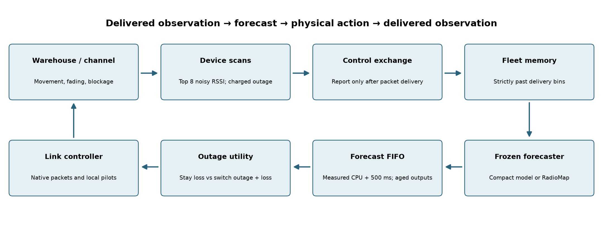
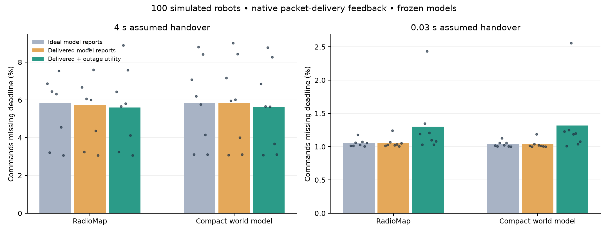

# Delivered-telemetry warehouse confirmation

Eight untouched seeds, 100 simulated robots each, 60 seconds per run. Four stationary and four drifting mean fields share the existing CAD family. Twenty-four development runs selected one shared utility horizon; 96 fresh test runs compare two frozen forecasters, three configurations and two handover costs. No additional models were fitted. The existing bulk-upload mission fixes controller knobs; mission readers and original RadioJEV E1–E5 weights are unchanged.

## What is now coupled

Only actual cadence-triggered scans produce runtime observations. RSSI includes the same hidden channel process as packet transmission plus receiver noise. Local neighbor knowledge uses completed scans; pilots freeze during outages. Reports reach fleet memory only after a successful control-frame delivery and become usable in a strictly later decision bin. The forecaster never receives a hidden channel array. Missing scans do not become invented below-threshold readings.

A reserved 128 bytes in each existing 600-byte control frame carries at most eight scan entries and pose metadata. Total simulated packet size is unchanged; application payload capacity is correspondingly reduced. This assumes a telemetry-capable bidirectional control exchange and does not measure separate uplink ACK loss. Initial history is a shared conditional warm start; positions and routes remain out-of-band inputs.

One shared **30-second** utility horizon was selected using both models on four separate development sites. Utility integrates the frozen PHY failure surrogate over the route and includes the complete physical outage. At fractional endpoints it includes the remaining partial interval. Both planned and reactive moves require admission. The surrogate omits MAC/queue uncertainty; it is not a calibrated deadline probability.

## Assumed handover: 4 seconds

| Forecaster | Forecast reports / controller | Misses per million | Mean roams / fleet | Bulk Mbps | Forecast RMSE dB |
|---|---|---:|---:|---:|---:|
| RadioMap | Ideal model reports | 58269.79 | 41.5 | 474.04 | 8.48 |
| RadioMap | Delivered model reports | 57140.62 | 40.2 | 475.52 | 8.54 |
| RadioMap | Delivered + outage utility | 56026.04 | 39.1 | 479.22 | 8.54 |
| Compact world model | Ideal model reports | 58289.58 | 34.6 | 460.30 | 6.65 |
| Compact world model | Delivered model reports | 58492.71 | 33.1 | 455.88 | 6.70 |
| Compact world model | Delivered + outage utility | 56346.88 | 30.9 | 459.73 | 6.70 |

RadioMap, utility minus delivered-reference: **-1114.58 ppm**, paired-site 95% interval [-2392.71, 189.61] ppm; 5/8 site wins.

Compact world model, utility minus delivered-reference: **-2145.83 ppm**, paired-site 95% interval [-3044.79, -1162.50] ppm; 6/8 site wins.

Compact model minus RadioMap with delivered reports and the same utility controller: 320.83 ppm, interval [-1853.13, 2777.08] ppm.

## Assumed handover: 0.03 seconds

| Forecaster | Forecast reports / controller | Misses per million | Mean roams / fleet | Bulk Mbps | Forecast RMSE dB |
|---|---|---:|---:|---:|---:|
| RadioMap | Ideal model reports | 10525.00 | 135.2 | 526.82 | 8.48 |
| RadioMap | Delivered model reports | 10575.00 | 135.0 | 526.84 | 8.54 |
| RadioMap | Delivered + outage utility | 13021.88 | 160.8 | 517.21 | 8.54 |
| Compact world model | Ideal model reports | 10360.42 | 142.2 | 527.53 | 6.65 |
| Compact world model | Delivered model reports | 10353.12 | 140.2 | 527.59 | 6.70 |
| Compact world model | Delivered + outage utility | 13181.25 | 179.0 | 521.24 | 6.70 |

RadioMap, utility minus delivered-reference: **2446.87 ppm**, paired-site 95% interval [616.64, 5342.79] ppm; 0/8 site wins.

Compact world model, utility minus delivered-reference: **2828.12 ppm**, paired-site 95% interval [871.88, 6087.50] ppm; 0/8 site wins.

Compact model minus RadioMap with delivered reports and the same utility controller: 159.38 ppm, interval [-293.75, 606.25] ppm.

## Confirmation and limits

The prespecified primary utility comparison **passes** the criterion that the upper confidence endpoint is below zero. The primary tests the controller change within the compact model; model comparisons and fast-handover results are secondary. Confidence intervals resample eight sites, not individual robot packets. They do not include additional model-training variability.

The improvement is limited to the slow-handover comparison: the compact model loses 5.849% → 5.635% of commands (3.67% fewer misses), with six site wins and two ties. RadioMap with the new utility controller is 5.603%; the model comparison spans zero. Compact forecast RMSE is 6.70 versus 8.54 dB, without corresponding demonstrated control superiority. Remaining losses are still too high for deployment.

At 30 ms handovers the same utility controller worsens every test site for both models. Compact loss rises 1.035% → 1.318%, while mean fleet roams rise 140.25 → 179.0 and bulk throughput falls. This regression rejects universal use of the selected slow-handover profile. Its secondary interval also excludes zero in the harmful direction. The original application default is unchanged; selecting a cost-dependent router after seeing these tests would need another independent confirmation.

The native cause ledger attributes 2,704 of the compact fast-profile's 2,715 additional missed commands to weak-link or blockage conditions, and ten to additional no-radio-up misses. That diagnoses a link-choice problem worth testing with immediate-link constraints and native packet-supervised risk, without establishing either proposed remedy.

Ideal model reports isolate the earlier independent scan stream while retaining the new observable local controller. Thus its numbers should not be substituted for historical study numbers. Delivered-report and utility runs share mechanisms but generate different observations because their actions differ; that feedback is intended.

All timing costs are assumed or CPU-microbenchmarked, not measured on a SmartCar. The new full single-family cost is charged at least the old cadence-five p95 envelope plus 500 ms; radio control continues until each FIFO result is ready. Scan-report selection/serialization and controller scoring still lack separate CPU deadlines. The Python native packet abstraction uses archived ns-3 curves, not a full ns-3 run per case. The fixed CAD, precomputed motion, MLO/pilot assumptions, shared warm start, reserved telemetry payload and modeled PHY remain transfer limits. No safety qualification, physical-car success, universal world-model win or SOTA claim follows.

Reproduce with `bash scripts/run_closed_loop.sh`. Source/weight identities, latency, the development-only selection, delivery events, forecast hashes, raw per-robot packet counters and read-only verification are archived under `artifacts/closed_loop/`. Earlier study archives are unchanged.
