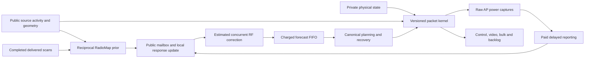

# Measured RF response to fleet service

The earlier 77.1% Bayesian response-error reduction did not establish better packet delivery. This study tests that missing link in complete 100-robot trajectories using the native procedural warehouse and archived ns-3 NIST curves. It is not 100-robot ray tracing or physical SmartCar evidence.

The [completed results](CONTINUAL_PACKET_RESULTS.md) retain all 224 main cases
and six exact replays. Neither adapter passes the registered service gate.

Private coupling and true sensing masks never enter the predictor. Individual gains need identifiable individual exposure directions; a known synchronized sum cannot invent them. Unknown/stale gains retain the prior. Dedicated monitoring, reciprocal channels, stationary managed coupling and reliable reserved reporting are explicit simulator assumptions.

Sensed sources cause domain deferral. Hidden power is conditioned on the remaining transmission window, avoiding duplicate charging for deferral and RF overlap. All managed-study slots use the same corrected per-band retry allocator. Only managed_probes=None preserves predecessor reproduction. AP-assisted sensing and average-power error curves remain approximations.

The [registered protocol](../artifacts/continual_packet/registration/protocol.json) fixes eight arms, 32 development and 192 confirmation runs, 100 robots, 80 seconds and two handover costs. The scanner-protection mission preserves native power-control politeness. Development selects only the registered compute charge. No neural fitting or confirmation tuning occurs.

No-probe and schedule-matched ignored-response controls separate information from physical scheduling. Whole-site uncertainty and fixed service/timing vetoes determine claims. Original requested video, bulk backlog/overflow and pending endpoint commands remain visible. Null or harmful outcomes are retained.

The separate opt-in [durable journal](DURABLE_EXECUTION.md) and [spawned proposal worker](PROCESS_ISOLATION.md) address local crashes and stuck inference. They change no physical-radio default or authorization. Hardware capability, physical deadlines, risk calibration and deployment qualification remain separate requirements.

## What this adapter leaves unrepresented

The implemented correction uses estimated carrier-sense busy time to compute residual RF, but does not pass a typed future airtime/resource state into the planner. The kernel still charges actual busy time. This is an RF forecast correction, not a learned MAC scheduler.

The public managed-source plan changes every 100 ms, while RadioMap uses integer-second forecast horizons and delayed completion. Sparse RF samples are subsequently age-interpolated. Identifying a gain therefore does not establish that its fast effect reaches the right control decision. These are source-level limitations of this registered model, not permission to retrofit its held-out results.

A time- and resource-aware replacement would need its own causal interface, measured compute budget, action trace and fresh registered validation. Current packet counts and diagnostic cause flags cannot certify indefinite stability or prove a particular miss was inevitable.
