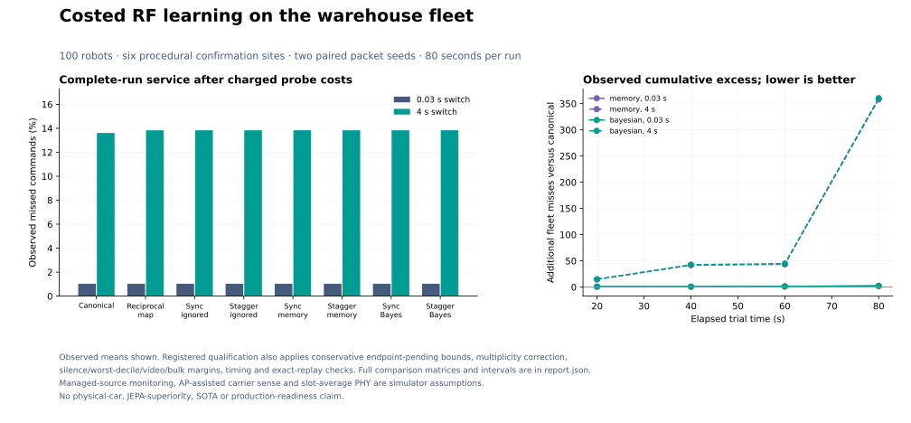

# Costed continual RF learning: final packet results

**Neither the response-memory nor Bayesian RF adapter passes the registered packet-service gate.** No primary or independent-information comparison establishes superiority, including before conservative endpoint sensitivity. RadioMap remains the application default; no candidate is promoted.

All **224 main evaluations** (32 development and 192 confirmation) and **six exact verification replays** completed. Each run contains 100 simulated robots and 80 seconds of packet generation. Confirmation uses six procedural site instances, two paired packet seeds and two assumed handover costs. Sites share the warehouse CAD; they are not six physical warehouses. No new neural fitting occurred in this round.

## Complete-run command service

The following are observed confirmation means, including probe, report and forecast-computation costs. Lower command loss is better. These are new managed-interference conditions and cannot be compared directly with earlier studies' loss percentages.

| Arm | Command loss: 30 ms handover | Command loss: 4 s handover |
|---|---:|---:|
| Canonical RadioMap | 1.0289% | 13.6070% |
| Reciprocal-map prior | 1.0303% | 13.8324% |
| Staggered response memory | 1.0303% | 13.8309% |
| Staggered Bayesian update | 1.0303% | 13.8321% |

The [immutable full report](../artifacts/continual_packet/report.md) includes all eight arms, every primary comparison, conservative endpoint bounds and original video/bulk delivery. The [machine-readable report](../artifacts/continual_packet/report.json) retains every site's accounting, cumulative checkpoints, measurement ages and timing.



[Standalone PDF](../artifacts/continual_packet/figures/fleet-service.pdf). The cumulative curves are descriptive observed excess misses; finite 80-second runs do not establish bounded long-horizon residual loss.

## Registered decision

| Estimator | Primary comparisons | Independent-information contrasts | Engineering margins | Integrity/replays/timing | Experimental service gate |
|---|---|---|---|---|---|
| memory | Fail | Fail | Fail | Pass | Fail |
| bayesian | Fail | Fail | Fail | Pass | Fail |

All **12 primary** and **four information** contrasts fail their registered superiority rules, even on observed outcomes. At 30 ms, both staggered estimators have the same observed mean command loss as the reciprocal-map/ignored-response controls. At four seconds, their tiny improvements over that prior do not establish superiority; their means remain worse than canonical. The worst-decile margin fails for both estimators at both costs and both references. Maximum-silence, original-video and bulk margins pass. No development or confirmation runtime overrun was recorded, and all six replays match exactly.

At four seconds, canonical has **13.6070%** mean command loss and **42.5583%** worst-decile loss; staggered memory has **13.8309%** and **42.7875%**. Even a relative gain on another metric would not qualify this fleet for deployment.

Six sites are the independent bootstrap units after paired packet-seed averaging. The analysis uses 20,000 fixed-seed bootstrap draws; packet seeds, robots and replays are not additional independent sites. All twelve primary comparisons use multiplicity-adjusted one-sided bounds. Four information contrasts separately test whether staggered observations help beyond their schedule-matched ignored-response controls. Positive claims must survive conservative assignment of unresolved endpoint commands, worst-decile/silence/video/bulk margins and timing/integrity/replay vetoes. These empirical gates are not production or safety certification.

Source and thresholds were registered in commit `3ae4ef0` before development or confirmation data access. Development selected only the registered extra head-compute charge: **100 ms**. All estimator, controller and acceptance choices remained frozen through confirmation. All negative and null comparisons are retained; no post-confirmation refitting or selection occurred.

## What the experiment isolates

The eight arms comprise canonical RadioMap, a reciprocal-map prior, synchronized/staggered probes whose reports are ignored, and both schedules with bounded response memory or Bayesian updates. Ordinary managed-source traffic is zero in all probe slots for all arms, preventing apparent benefit from suppressing scheduled traffic during capture. Raw noisy receiver measurements reach estimators only after paid delayed reporting. The kernel alone holds the private managed-source coupling.

The earlier real-Sionna-RT study's **77.1% Bayesian response-error reduction** remains a measurement-design result. This packet study uses the procedural native simulator and archived ns-3 NIST link curves. It adds AP-assisted carrier sense, conditional hidden RF and a common per-band retry allocator to every managed-study arm. It is not 100-robot Sionna RT, a measured SmartCar trial or a new JEPA result.

Identification and packet delivery are separate. The memory requires individual source directions before using nonlinear carrier-sense classifications; a synchronized sum cannot invent those gains. Unknown or stale directions retain the reciprocal-map prior. A Bayesian update is not proof of calibrated service risk.

## The remaining representation gap

This adapter supplies estimated concurrent RF corrections to the existing forecast/controller path. It computes estimated busy airtime but retains that quantity only in diagnostics; it does **not** pass a typed future airtime/resource state to the planner. The native kernel still debits actual deferral and report resources. Learning power coupling can therefore leave the active MAC bottleneck unrepresented.

Public managed activity changes every 100 ms; forecast horizons sample integer seconds and become available after charged delayed computation. Sparse values are subsequently age-interpolated. Better gain identification alone does not establish that a fast interference effect reaches the relevant AP/band decision.

Archives expose per-robot delivery traces, forecast identities and report events. They do not record native AP/band action traces, and diagnostic loss-cause flags are not causal proofs. Equal packet counters or roam counts cannot establish identical actions or inevitable losses.

A future active candidate needs an explicit timestamped airtime/resource interface, action traces and a fresh registered comparison. Those changes were not retrofitted into this held-out study. The two managed sources provide a known future activity plan. Dedicated monitoring, reliable fixed-rate reporting, reciprocity, stationary managed coupling, AP-assisted sensing and slot-average PHY remain simulation assumptions. Hardware timing, risk calibration, different layouts and longer operation remain unqualified.

## Separate execution-reliability work

The opt-in [durable execution journal](DURABLE_EXECUTION.md) persists issue intent and unresolved reservations using real SQLite WAL/FULL synchronization. Process restart never automatically resends an ambiguous command. It journals transaction obligations, not learned response memory. Tests cover real process exits around the send/persistence boundary; they do not certify power-cut behavior or exactly-once physical execution.

The opt-in [spawned proposal worker](PROCESS_ISOLATION.md) bounds requests and passive IPC, discards late output and supports terminate/kill/reap before explicit restart. Regular supervision is required. It is proposal-only, starts with cold model state and is not a security sandbox, hard real-time guarantee or total-RSS limit. Neither component migrates existing thread services or activates physical commands. They are separate from the frozen packet experiment and are bound independently in the final source manifest.

## Verification and reproduction

The full software suite completed with **697 passed, one expected fork-misuse warning**, with no skips. This includes real SQLite process-crash tests, real spawned-process timeout/kill/reap tests and actual native simulator/RadioMap integration. The result is software verification, not hardware qualification. An [independent read-only audit](../artifacts/continual_packet/verification/independent-audit.json) checked all 230 archives and recomputed all primary, information, engineering and cumulative comparisons without new simulations.

[Verification manifest](../artifacts/continual_packet/verification/manifest.json), [test log](../artifacts/continual_packet/verification/full-tests.txt), [source/protocol registration](../artifacts/continual_packet/registration/source.json), [exact replays](../artifacts/continual_packet/replay_validation.json) and [raw cases](../artifacts/continual_packet/cases/) bind the evidence. Previous PR #17's 284 source and 148 evidence hashes remain unchanged.

With the frozen environment and preregistration Git history available, verify all cases, reproduce the frozen report arithmetic and check the final source/document/evidence manifest without running simulations:

```bash
OPENBLAS_NUM_THREADS=1 OMP_NUM_THREADS=1 MKL_NUM_THREADS=1 \
  uv run --frozen python scripts/verify_continual_packet.py
```

`--write-manifest` explicitly refreshes derived verification metadata; ordinary verification preserves it. [The design](CONTINUAL_PACKET_DESIGN.md) documents the information flow and [the protocol](../artifacts/continual_packet/registration/protocol.json) fixes the complete experiment. No hardware, production, architectural-novelty or SOTA claim follows.
