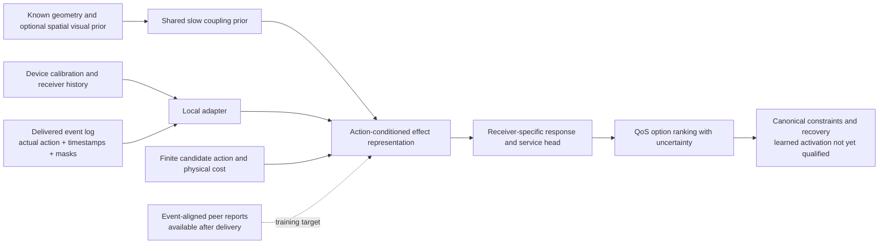

# Continual radio learning through controlled action effects

**This broader design is not a completed continual-learning control system.**
The [registered response experiment](CONTINUAL_RADIO_RESULTS.md) now tests a
subset: six fits on 24 RT blocker contexts in one warehouse. Response JEPA
loses to its supervised and numerical controls; independently staggered
observations improve Bayesian response estimation. That experiment does not
test packet control, online backbone updates or new-warehouse transfer. The
[bounded local memory](CONTINUAL_MEMORY.md) implements delivered-observation
assimilation. Cross-robot representation learning and the broader comparisons
below remain proposals. Runtime recovery fixes are not production qualification.

The candidate shift is to learn **what a controllable radio action changes at
other receivers**, then preserve the distinctions that matter for a finite QoS
decision. It should earn its place against simple system identification and a
matched supervised learner. It is not a claim that action-conditioned JEPA,
causal representations, value-equivalent models or federated adaptation are new.

## One hypothesis

> With the same causal observations, action budget, encoder capacity and
> optimization budget, event-aligned intervention-response learning improves
> low-sample receiver-response estimation and QoS-action ranking over
> full-future-latent JEPA and the identical supervised model, while preserving
> canonical recovery behavior.

This has two separable questions: whether effect targets help representation
learning, and whether shared learning helps a new device adapt. A representation
win does not establish a fleet-control or continual-learning win. Keep the
two-static-pose pilot's claims within its simulator and activity/power
compositions; reserve broader claims for independent scenes and temporal data.

## Estimand and causal observations

For receiver \(r\), the scalar interference approximation is

\[
I_r(t)=\sum_j P_j(t)G_{jr}(t)a_j(t)\eta_{jr}(t),\qquad
\gamma_r(t)=\frac{S_r(t)}{N_r(t)+I_r(t)}.
\]

Keep the receiver and transmitter identities attached to each product. Averaging
activity separately from coupling can lose which transmitter is active. A
learned encoder could compute the right products before pooling, but must
demonstrate that ability; a generic pooled embedding does not guarantee it.

For a controlled activity change of transmitter \(j\), with the other terms
fixed,

\[
\Delta I_r=P_jG_{jr}\eta_{jr}\Delta a_j.
\]

This response vector over receivers is a concrete first target. Subsequent
experiments may independently vary power, AP or probe choice. Varying them
jointly identifies only the joint intervention, not their separate effects.
An AP change can also change contention, association outage and future
observations; it is not merely a new path-gain index.

Record intended action, actual transmitted activity/power, receiver/antenna
identity, frequency/bandwidth, spectral-overlap assumptions, capture timestamp,
availability timestamp and packet context. A transmit request is not evidence
that the PHY transmitted: carrier sensing, scheduling or a failed command may
change actual activity. Acknowledgment and measurement provenance therefore
belong in the event, not in a post-hoc reconstruction.

The model may use only observations available at decision time. True Sionna
couplings \(G\), unreceived reports and future outcome labels are **not inference
inputs** when the task is to learn unknown coupling. Use true \(G\) as an oracle
or training/evaluation label. If it is supplied to the numerical predictor,
the scalar response is already determined analytically; that is a different
calibrated-physics-residual task with less learning headroom.

## Identifiability before architecture

At a fixed pose, receiver observations can be written schematically as
\(y=A g+\epsilon\), where the columns of \(A\) contain logged power/activity/
overlap excitation for particular transmitters. Separate coupling coefficients
require sufficient independent excitation and an adequate noise/device model.
Transmitters always switched together produce inseparable columns. Receiver
motion alone can co-vary geometry, orientation, blockage and load; it is not
an instrument that automatically identifies each cause.

Use independently randomized or single-target interventions in the simulator,
observational controls and paired comparisons with common nuisance conditions.
Document what is held fixed and what changes. Common random numbers improve
paired comparison precision; they do not prove real-world causal transfer.
Unknown external transmitters remain an incomplete-inventory uncertainty.

[CITRIS](https://arxiv.org/abs/2202.03169), §§2–3, provides close prior art for
intervention-sensitive representations. Its original identifiability theorem
requires stationary first-order Markov dynamics without instantaneous effects,
independent noises, a bijective observation model and diverse known intervention
targets. Variables always intervened on jointly cannot generally be separated.
Partial RSSI/packet observations and effectively instantaneous RF interactions
do not automatically satisfy those assumptions. The official source is pinned
at `95f6c90b9ff769ef0250d3a5434b9352853f4302`, BSD-3-Clause-Clear.

[Radio tomography](https://doi.org/10.1109/TMC.2009.174), §§2/4, already uses
baseline calibration, geometry-conditioned operators and received-power
differences, while explicitly treating inversion as ill-posed. Its coordinated
transmissions avoid collisions, so it is not evidence that our contention
externalities have been identified.

## Candidate representation and teacher

The slow/shared component is a prior over geometry-dependent response, not
ground-truth geometry recovered from an image. Local adapters carry receiver
gain/noise/antenna offsets and current activity history. The split is a modeling
hypothesis: movable racks, antenna changes or moving robots can make coupling
change rapidly; device calibration can drift slowly. Measure those timescales
rather than hard-coding “geometry slow, activity fast” as a law.

An event-aligned peer teacher summarizes measured response at named receivers
to the same controlled event, with baseline, uncertainty and missingness. It
must not compare unrelated histories or label a missing peer report zero effect.
Capture and delivery clocks remain distinct. A later report may supervise a
past action during training; it cannot be inserted into that past policy's
available input. Teacher disagreement can indicate bad synchronization, sensor
offsets, hidden interference or model error, rather than automatically indicating
epistemic uncertainty.

The action-effect JEPA variant should predict a learned encoding of this
response, with a separate native-unit response/service head. A matching
full-future objective and an identical supervised model isolate whether the
pretext contributes. Frozen, stopped-gradient or EMA teacher choices must be
specified and ablated, with target variance and task probes retained. Do not
force representation spread as the primary success criterion.

The [value-equivalence principle](https://arxiv.org/abs/2011.03506), §3, already
formalizes that models may be equivalent for selected policies/value functions
without reproducing every state distinction. Our weaker finite-action proposal
is to retain differences that change relevant response or QoS ranking. Similar
rankings on one action/mission set do not prove equivalence for unseen deadlines,
power ranges, radio modes or policies. Keep mission parameters explicit and
expand the evaluation family before making broader claims.

## Strong baselines and matched ablations

| Comparator | Purpose |
|---|---|
| Exact-coupling numerical oracle | Establish whether the stated scalar task has any remaining learning headroom. Never label it deployable when coupling is hidden. |
| Batch nonnegative least squares and online RLS | Test whether excitation plus calibration already solves response estimation. Specify regularization/forgetting and account for computation. |
| Numerical prior with local calibration | Separate shared propagation information from device gain/noise correction. |
| Same supervised encoder/head | Isolate representation pretraining from architecture and native outcome supervision. |
| Full-future JEPA versus effect-target JEPA | Isolate target choice with the same observation, label, action and optimization budget. Report additional teacher/pretraining resources. |
| Local-only versus shared-plus-local | Test the benefit of fleet information under an explicitly equal target-device sample budget. Report added source data/communication separately. |
| Frozen, local-update, pooled and federated variants | Determine which update mechanism helps, and whether old conditions regress. |
| Dense visual+RF versus geometry+RF/RF-only | Test incremental perception information; do not assign a CAD or oracle-material advantage to the visual backbone. |

All comparisons retain absolute signal/noise/power where relevant. In particular,
channel-shape foundation models using per-window RMS normalization need an
absolute calibration path. A model trained to ignore amplitude can discard a
service-critical difference even while its normalized channel score improves.

## What would make learning continual

The first pilot is static-pose, intervention-composition learning. Continual
learning additionally needs an ordered stream containing declared shifts,
bounded updates and evaluation after each update on both recent and old
conditions. Separate gradual drift, sudden changes and recurring conditions.
Keep an immutable deployed model and a candidate update; do not mutate the
active encoder in place while changing its calibration and acceptance thresholds.

Begin with bounded local calibration/RLS and compare frozen models before
federating. A shared update must state which parameters are exchanged, the
server/client version, source/device contribution, age and compatibility. Replay,
regularization and rehearsal budgets count as additional data/compute, and
neither replay nor a proximal term guarantees retention.

[FedProx](https://arxiv.org/abs/1812.06127), §3, is a concrete MIT-licensed
heterogeneous-client baseline. Its local objective
\(F_k(w)+\frac{\mu}{2}\|w-w^t\|^2\) anchors an update to the current global model
and permits unequal local work. Its convergence assumptions concern an
aggregate objective; they do not guarantee drift tracking, adaptation delay
or protection against catastrophic forgetting. Official code pin:
`d2a4501f319f1594b732d88315c5ca1a72855f50`.

LWM-CDE's [source-selection work](https://arxiv.org/abs/2605.24077) motivates
measuring compatibility before pooling every client's data. Its refined
distance fails cross-band transfer in the paper; a small embedding distance is
not evidence that an update preserves service. Check old/new task performance
and physical calibration directly.

## Active information must justify its service cost

A probe is useful only when information arriving after capture, transport and
compute can change a feasible QoS decision enough to justify its cost. Compare
the resulting decision risk with and without the information, using the same
available actions. High uncertainty alone is not a reason to scan during a
deadline-critical interval; an uncertain quantity may be irrelevant to the
current decision or impossible to resolve in time.

This is a proposed value-of-information policy, not a new principle or an
implemented scheduler. The numerical controller and outage bounds retain
authority. Real-radio experiments would additionally need actual device
capabilities and a controlled physical test; this design specifies simulation.

## Gates and explicit failure criteria

Preregister sample budgets, independent training seeds, fixed evaluation
compositions, noise/offset regimes, calibration method, action set and physical
costs before fitting. A two-pose pilot may hold out activity/power compositions;
it cannot claim unseen-warehouse or temporal transfer. Later split whole
warehouses/sessions before constructing windows and keep a final untouched set.

Reject or narrow the hypothesis when:

- RLS/NNLS or the calibrated numerical baseline matches or beats decision
  efficiency under the matched budget.
- Auxiliary/effect prediction improves without native-unit response or
  QoS-action ranking improvement.
- Gains depend on true coupling at inference, future peer reports, hidden
  transmitter inventory or improperly synchronized labels.
- Gains disappear under independently varied activity, receiver/device offsets,
  held-out compositions or specified missing-input conditions.
- Updates regress old conditions, cause unstable switching, or exceed the
  registered memory, communication and latency budget.
- Any active-policy test worsens deadline/outage tails or canonical recovery
  beyond predefined margins. Offline ranking alone does not qualify control.

Report response error in native units, sign/ranking errors, calibration, sample
efficiency, update/communication cost, retained old-task performance and actual
packet outcomes when a valid closed loop exists. A successful two-pose
simulation would justify a larger experiment, not establish production
reliability, causal identifiability in arbitrary RF environments or global SOTA.
