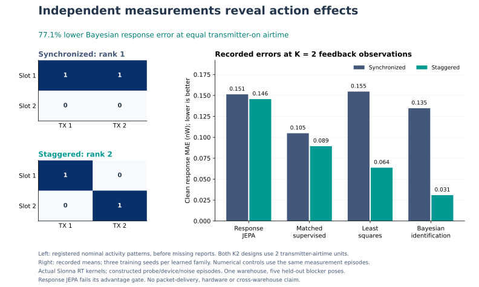

# Continual radio response: bounded RT-backed identification study

The six-run experiment does **not** establish a JEPA advantage. The matched supervised model is better at the two-feedback task, and explicit Bayesian system identification is substantially better than either learned model. The useful result is that independent local measurements reveal information that repeated synchronized measurements cannot supply.

The [PDF figure](../artifacts/continual_radio/figures/response-identification.pdf)
is generated directly from the registered patterns and retained summary by
`scripts/plot_continual_radio.py`; its receipt binds inputs and outputs. It adds
no model fit or evaluation. Bars show means rather than uncertainty intervals.

The experiment uses 24 actual Sionna RT kernels in one warehouse and explicitly constructed probe/noise/device episodes. Five held-out contexts are new blocker poses in the same scene, not new warehouses or hardware measurements. There are no test-time backbone weight updates; local learning means conditioning or Bayesian assimilation of received feedback.

The original 2,048-sample/depth-two RT attempt failed coverage on three links before any model fit. That attempt is preserved. A separately committed collection amendment applies 32,768 samples, depth four and 65,536 maximum paths uniformly to all 24 contexts, with every model and training choice unchanged.

Six matched fixed-final-epoch fits completed: three JEPA effect-teacher models and three supervised models, 30 epochs each. True coupling is never an unmeasured model input. Only training contexts determine units and numerical priors.

| Probe design / feedback budget | JEPA clean MAE mW | Supervised | Bayesian | Least squares |
|---|---:|---:|---:|---:|
| synchronized-K0 | 2.23989e-07 | 1.90971e-07 | 2.16314e-07 | 4.39138e-07 |
| synchronized-K1 | 1.47799e-07 | 1.04041e-07 | 1.34678e-07 | 1.546e-07 |
| synchronized-K2 | 1.51283e-07 | 1.04837e-07 | 1.34678e-07 | 1.546e-07 |
| staggered-K0 | 2.23989e-07 | 1.90971e-07 | 2.16314e-07 | 4.39138e-07 |
| staggered-K1 | 1.59704e-07 | 1.08339e-07 | 1.50923e-07 | 3.36979e-07 |
| staggered-K2 | 1.45606e-07 | 8.93932e-08 | 3.08885e-08 | 6.3693e-08 |

At staggered K2 these errors are **0.146 / 0.0894 / 0.0309 / 0.0637 nW**, respectively. The Bayesian estimate has 4.71 times lower error than JEPA and 2.89 times lower error than the supervised model. Its error decreases by 77.1% relative to synchronized K2 at equal total transmitter-on airtime. The training-mean and free-space controls remain at 2.16314e-7 and 2.58383e-7 mW; the true-coupling label oracle has zero clean error and 2.10712e-8 mW error against the independently noisy target.

Each seed is retained. Staggered clean response MAE in training-normalized units is:

| Family / seed | K0 | K1 | K2 |
|---|---:|---:|---:|
| JEPA / 0 | 0.113769 | 0.069712 | 0.058991 |
| JEPA / 1 | 0.111034 | 0.065722 | 0.073344 |
| JEPA / 2 | 0.138162 | 0.120015 | 0.100039 |
| Supervised / 0 | 0.102766 | 0.053916 | 0.044133 |
| Supervised / 1 | 0.117126 | 0.063832 | 0.060719 |
| Supervised / 2 | 0.100183 | 0.063521 | 0.045083 |

The preregistered JEPA-specific conjunction **does not pass**. It requires beating the matched supervised model and every non-oracle numerical reference at staggered K1 and K2. Intervals resample five held-out contexts and three paired training seeds; repeated probe episodes are not independent warehouses.

For staggered K2, the JEPA-minus-supervised normalized error difference is +0.02748, with crossed-bootstrap interval [0.00107, 0.06409]. Against Bayesian identification it is +0.06053 [0.03284, 0.09745]. At K1 the difference against supervised is +0.02473 [-0.00165, 0.06021]; this interval includes zero. These are small, same-scene diagnostic intervals, not a generalization guarantee.

The JEPA teachers did not exactly collapse: the three fixed-action target embeddings have effective ranks 2.04, 2.04 and 2.01, and respond to the future effect with L2 sensitivities 1.91, 2.17 and 1.73. Their nonzero variance does not make the representation useful for the prediction task. The result concerns the registered auxiliary-plus-variance objective; it does not isolate which auxiliary component caused the degradation or show that all JEPA architectures fail.

The equal-airtime K2 rank comparison is separate: synchronized on/off probes are rank one, whereas staggered probes are rank two and recover the actual noiseless 2x2 kernel to numerical precision. More collinear data cannot excite the missing contrast direction. This is system identification and does not establish a JEPA advantage. K1 designs have different transmitter-on airtime.

Per-receiver unknown gains, calibrated floor, Gaussian noise and missing feedback are assumptions. Powers are incoherent averages; this is not coherent waveform addition, packet-loss validation, active hardware probing, certified risk, general continual learning or SOTA. Teacher rank/variance and response-sensitivity diagnostics do not establish representation usefulness by themselves.

The bounded task therefore supports keeping an explicit local posterior for identifiable response parameters. It does not support replacing that update with this JEPA model. Whether a learned representation helps when the dynamics are nonlinear, partial, time-varying or have much longer histories remains untested here. Perfect configured blocker geometry is an input assumption, rather than a validated perception pipeline.

All metrics, per-context comparisons, normalisation and source/data hashes are in `artifacts/continual_radio/summary.json`.

The archived v2 model and runner independently regenerated byte-identical summary and completion receipts without new fits. `artifacts/continual_radio/completion/archived_source_reproduction.json` records checkpoint hashes and verification of both collections and immutable source capsules.
