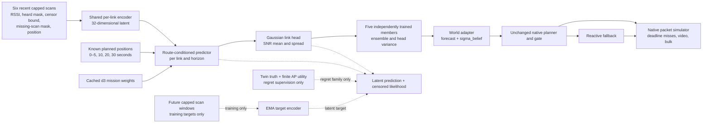

# Device JEPA: the implemented model and training boundary

Each fit has **12,578 train-time parameters**, including the EMA target encoder.
The deployed encoder/predictor/head has 9,890 parameters per member. This is a
small warehouse research model trained from scratch, not a broadly pretrained
wireless foundation model or an official reproduction of RAN-JEPA/LatentWave.



The context has one 48-feature vector per link: six observations with eight
features each. Eight is a **cap on reported BSSs per scan**, not eight complete
channel measurements per AP. Known AP geometry, per-band noise and planned
positions are declared inputs. No hidden shadow field, twin physics parameter,
future scan or true SNR is passed through `DeviceInputs`.

The shared encoder and a mean-pooled link context allow variable AP counts:
16 sites/48 links in the warehouse; six sites/18 links in the yard. The future
predictor consumes the context, planned AP-relative position, horizon, geometric
prior and nine numerical intent weights. The no-route family replaces future
route/geometry with the current values while retaining a horizon code.

The EMA target encoder sees future **censored** windows only during training.
The latent objective follows the existing, attributed V-JEPA L1/EMA adaptation;
a variance term discourages context collapse. The link head uses measured
values for heard links and a Gaussian upper-censoring likelihood for unheard
ones. Missing scans contribute neither an invented measurement nor a bound.

The regret family changes per-AP loss weights according to the change in exact
finite AP-score regret after correcting one AP's prediction. It also uses a
soft finite-choice regret term. This local score matches the native planner's
SNR/load/roam-threshold criterion, using the `ho` and `fair` intent knobs. Other
mission dimensions condition the predictor and native controller, but they do
not turn this surrogate into a complete cross-layer, named-robot packet-utility
objective. Twin truth is permitted supervision for this family, not an inference
feature. The comparison therefore tests a concrete, limited decision-aware loss.

Each member predicts a mean and Gaussian spread. Ensemble disagreement adds to
the mean head variance; a development-only multiplicative factor calibrates
marginal near-horizon residuals. The gate receives the current-position per-link
spread exactly through its existing interface. This is not a calibrated
physical failure probability or a conditional safety certificate.

## Reproduce the completed protocol

```sh
uv sync --frozen
OPENBLAS_NUM_THREADS=1 OMP_NUM_THREADS=2 uv run --frozen python -m wirelessjev.contracted.train
OPENBLAS_NUM_THREADS=1 OMP_NUM_THREADS=1 uv run --frozen python -m wirelessjev.contracted.evaluate --workers 3
uv run --frozen python scripts/report_contracted_results.py
uv run --frozen python scripts/audit_contracted_results.py
uv run --frozen python scripts/audit_contracted_prior_art.py
```

Training skips completed fit receipts and resumes an unfinished fit from its
last epoch. Dataset caches are accepted only with matching generating-source
hashes. Evaluation skips complete scene receipts. The training and evaluation
source capsules preserve what actually ran; re-running after source changes is
a new experiment, not a way to overwrite the frozen evidence. Copies of the
original source capsules, checkpoints, every closed-loop report and checksums
are portable in `artifacts/contracted/`. The large regenerable datasets and
downloaded papers remain under `/workspace/training/contracted-world-models/`.

The scans are exogenous simulated observations at one-second intervals; their
collection is not a qualified physical scan-duty-cycle experiment. Native
fallback/attached-link measurements retain the existing simulator's idealised
access. The Bayesian reference pools a longer fleet survey than one JEPA local
context. No deployment, on-device training or hardware switch has been performed.
