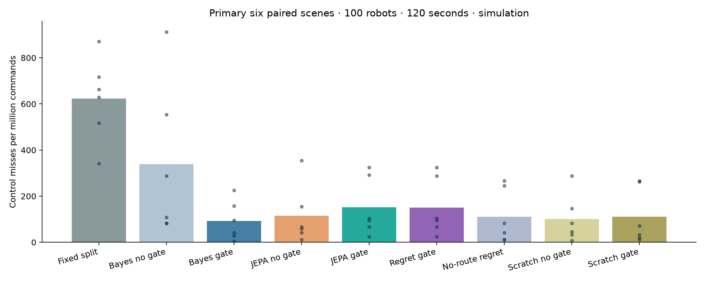
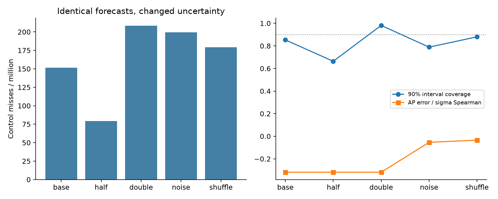
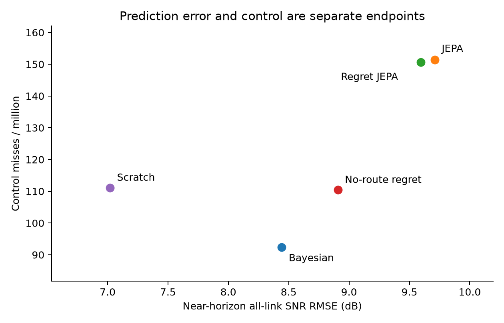

# Contracted world-model study: completed results

All **20 model fits, 24 fresh scenes and 366 native rollouts** completed. This is simulation evidence. Completing the implementation does not establish the proposed papers’ novelty or hypotheses.

The contract was not necessary for JEPA to beat the fixed rule; uncertainty scale changed control despite identical rankings; regret training did not establish a robust control advantage. RadioMap remains the default.

The model, protocol, derivation and literature review are in [CONTRACTED_MODEL.md](CONTRACTED_MODEL.md), [CONTRACTED_WORLD_MODELS.md](CONTRACTED_WORLD_MODELS.md), [CONTRACTED_THEORY.md](CONTRACTED_THEORY.md) and [CONTRACTED_PRIOR_ART.md](CONTRACTED_PRIOR_ART.md). The default native system remains RadioMap + WirelessJEV.

## What was built and executed

- A causal six-scan context, explicit heard/censored/missing masks, future-route conditioning, EMA target encoder and per-link Gaussian head at the nine native horizons.
- Five independently trained seeds each for JEPA, regret-weighted JEPA, no-route regret and scratch: 24 randomised training twins, six development twins, twelve epochs per fit. Checkpoints are selected using development censored likelihood only.
- A five-member uncertainty ensemble with development-only residual scaling; typed inference inputs exclude future observations and truth labels. An adapter supplies the existing forecast and uncertainty fields without changing the planner.
- Matched gate/no-gate runs, four uncertainty-only interventions, three-way objective comparison, five-seed control robustness, held-out mission readings, route ablation, 10-robot/stress/yard generalisation and a verified literature pass.

## Primary endpoint: six paired warehouse scenes

100 robots × 120 seconds × 20 commands/second = **240,000 commands per scene and 1,440,000 per arm**. Packets share scene conditions and are not independent replicates. All rows use the bulk-upload mission reading.

| Arm | Missed / sent | Misses per million | Near-horizon all-link RMSE (dB) | 90% interval coverage |
|---|---:|---:|---:|---:|
| Fixed split | 897 / 1,440,000 | 622.92 | — | — |
| Bayesian, ungated | 487 / 1,440,000 | 338.19 | 8.44 | 31.4% |
| Bayesian, gated | 133 / 1,440,000 | 92.36 | 8.44 | 31.4% |
| JEPA, ungated | 165 / 1,440,000 | 114.58 | 9.71 | 85.3% |
| JEPA, gated | 218 / 1,440,000 | 151.39 | 9.71 | 85.3% |
| Regret JEPA, gated | 217 / 1,440,000 | 150.69 | 9.60 | 85.4% |
| No-route regret, gated | 159 / 1,440,000 | 110.42 | 8.91 | 85.4% |
| Scratch, ungated | 145 / 1,440,000 | 100.69 | 7.02 | 88.4% |
| Scratch, gated | 160 / 1,440,000 | 111.11 | 7.02 | 88.4% |



The Bayesian reference pools a 60-second fleet survey. Each JEPA inference sees six recent scans from one robot, plus known geometry/route and cached intent weights. This is a strong-system reference with unequal new-site information budgets; the JEPA versus regret and gate versus no-gate contrasts are matched.

## Paper 1: test the contract, do not assume necessity

Gated JEPA beats the fixed rule in **6/6** scenes. Ungated JEPA also beats it in **6/6**. The gated-minus-ungated difference is 36.81 misses/million; its six-scene paired bootstrap interval is [-20.139, 95.139]. Lower is better.

The proposed necessity claim is **rejected**: ungated JEPA already wins on at least five scenes.

The uncertainty interventions below hold mean forecasts bit-identical. Half and double preserve rankings exactly, so changed control outcomes cannot be attributed to changed forecast RMSE or uncertainty ordering.

| Uncertainty | Misses / million | 90% coverage | AP error–spread Spearman | Changed miss-count scenes |
|---|---:|---:|---:|---:|
| base | 151.39 | 85.3% | -0.318 | 0/6 |
| half | 79.17 | 66.4% | -0.318 | 6/6 |
| double | 208.33 | 98.1% | -0.318 | 6/6 |
| noise | 199.31 | 78.9% | -0.054 | 5/6 |
| shuffle | 179.17 | 88.0% | -0.034 | 5/6 |



**Rank correlation alone is insufficient.** The executable two-decision counterexample proves this even at perfect ranking. The derived gain-envelope bound requires coverage assumptions; its empirical audit is not an ex-ante safety guarantee. Multiplying uncertainty by 0.5 is a diagnostic intervention, not a policy selected for deployment from these test results.

## Paper 2: decision-regret training

The ensemble regret-minus-JEPA difference is **-0.694 misses/million**, with paired-scene 95% bootstrap interval [-2.083, 0.000]. It improves on 1/6 scenes. The crossed five-training-seed/six-scene comparison is **-1.250**, interval [-5.556, 1.806].

These are separate uncertainty summaries: one compares the deployed five-member ensembles across scenes; the other pairs individual trained members and resamples both scene and training-seed axes. A tiny mean difference or an interval spanning zero does not establish a robust control advantage.

The loss uses finite native AP-score regret, directly involving roam and load intent knobs. It is not an exact cross-layer deadline-loss objective. Other intent dimensions condition the predictor/controller, but complete named-robot packet utility is not the training oracle.



## Generalisation, held-out missions and routes

| Condition | Fixed ppm | Bayesian gate ppm | JEPA ungated ppm | JEPA gated ppm | Regret gated ppm |
|---|---:|---:|---:|---:|---:|
| small | 625.00 | 83.33 | 69.44 | 111.11 | 111.11 |
| stress | 8455.56 | 10901.39 | 10581.94 | 15251.39 | 15268.06 |
| yard | 384.72 | 156.94 | 397.22 | 368.06 | 363.89 |

Each generalisation panel has six fresh scenes at 60 seconds: 10 robots for `small`, 100 for `stress` and `yard`. The yard has six AP sites and perimeter routes with separate analytic propagation; it is another synthetic environment, not an outdoor measurement.

| Held-out cached mission | Bayesian gate ppm | JEPA gate ppm | Regret gate ppm |
|---|---:|---:|---:|
| protect_teleop | 104.86 | 168.06 | 166.67 |
| protect_worst | 128.47 | 189.58 | 188.89 |

The route-conditioned regret family minus its no-route ablation is 40.28 misses/million, interval [15.972, 65.972]. The no-route ablation is a separately trained family, not a test-time mask.

The two held-out readings were excluded from world-model training. Four cached d3 readings do not demonstrate arbitrary new mission-language transfer.

## Literature and claim readiness

Eighteen open full texts were retrieved and their relevant methods inspected. Uncertainty-based learned/conventional switching already appears in IEEE TVT (open preprint 2401.13206); Telecom World Models includes intent, uncertainty, guardrails and fallback; coupled robot/wireless JEPA models appear in 2609.04851. Decision-focused losses, value-equivalent models and selective prediction also have established prior art.

Therefore the broad architecture/contract novelty claim is not supported. The direct IEEE index page returned HTTP 418, so an exhaustive authenticated index search is not represented as complete. The reviewed open sources are enough to demonstrate substantial overlap.

## Boundaries and audit

- Simulation only; no physical car/RAN testbed.
- 24 randomised training sites and six development sites; not broad vertical pretraining.
- One five-member ensemble per family; the primary JEPA/regret comparison also crosses five individual training seeds.
- Bayesian baseline pools 60 seconds of fleet scans; each JEPA context is six recent scans from one robot.
- Native reactive fallback retains its idealised uncapped measurement model.
- Finite AP-score regret is not exact packet-loss regret.
- Four cached d3 mission readings; held-out weights do not establish general semantic transfer.
- Marginal residual calibration does not certify conditional gain coverage.
- One-step theorem is not a cumulative packet-delivery or safety certificate.
- Selective fallback and intent-aware world-model planning already exist in prior art.

Raw reports, checkpoints, calibration, source capsules, figures and source/output hashes are in [artifacts/contracted](../artifacts/contracted/). [summary.json](../artifacts/contracted/summary.json) contains every aggregate, interval and seed matrix. Audit without retraining:

```sh
uv run --frozen python scripts/audit_contracted_results.py
```

The archive audit checks all 20 finite, distinct fits, checkpoint selection, all 366 raw counter reports, disjoint scene splits, source/output hashes and forecast invariance during the uncertainty interventions. No simulation was relabelled as a hardware result.

The raw native `sigma_map` field records the base generator’s synthetic map-error injection setting, not learned forecast accuracy. Use `forecast_metrics` and the table above for actual learned error and coverage.
