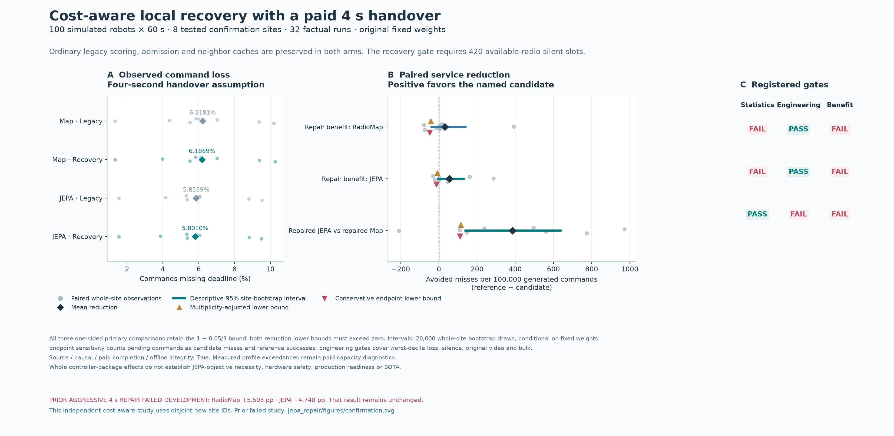
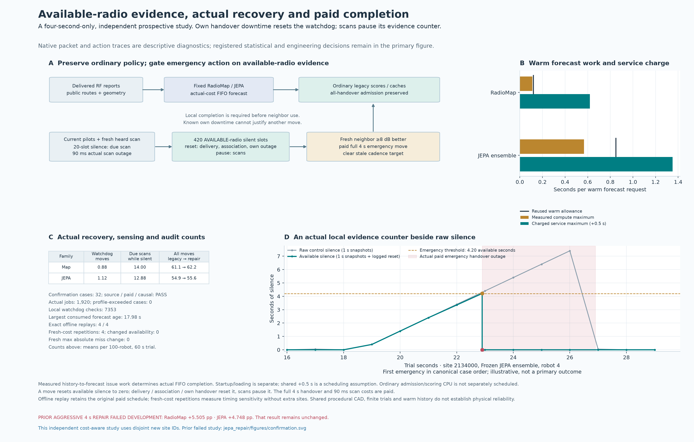

# Cost-aware recovery: completed four-second results

**The sustained-recovery controller reduced the observed longest silences relative to each forecaster's own legacy controller, but none of the three registered comparisons qualified as experimental benefit.** Its mean-loss improvements over legacy were not statistically confirmed. Repaired JEPA beat repaired RadioMap on mean command loss under the registered statistical test, but its longest silence was **10.03 seconds versus 8.34 seconds**, failing the engineering gate. This is a fixed-weight simulated controller study; it does not establish JEPA-objective superiority or production reliability.

The [machine-readable report](../artifacts/costaware_recovery/report.json), [report summary](../artifacts/costaware_recovery/report.md), [protocol](../artifacts/costaware_recovery/protocol.json), [development seal](../artifacts/costaware_recovery/development.json), [completion receipt](../artifacts/costaware_recovery/completion.json) and [independent audit](../artifacts/costaware_recovery/verification/independent-audit.json) retain and verify the evidence.

## What changed and what was compared

This study was registered after observing the earlier aggressive controller's four-second development failure. Its [design](COSTAWARE_RECOVERY_DESIGN.md) preserves ordinary outage-utility scoring, confidence behavior and admission for both planned and reactive handovers. The additional local watchdog can start an already-due scan after the existing 200 ms silence threshold. It can initiate an emergency handover only after **420 primary-radio-available silent slots**, with a poor current pilot and a completed, heard, recent neighbor at least 8 dB better. Successful control delivery, association change and known handover unavailability reset the evidence; scans pause it. All 90 ms scans and four-second handovers remain charged.

The threshold is at least **4.2 seconds of available-radio silence**, followed by a possible **four-second interruption**. This can extend a gap to roughly 8.2 seconds before packet/slot alignment. Elapsed failure is not an estimate of how much longer the old link will remain unusable. The rule is a cost-derived heuristic, not a continuity guarantee or an optimal-stopping result.

There were **eight development evaluations on two new sites**, followed by **32 confirmation evaluations on eight additional new sites**: strong RadioMap and the original frozen three-member FleetJEPA ensemble, each with legacy and repaired control. Every trial used 100 simulated robots for 60 seconds, the same actual-cost forecast queue and no new model fitting or timing recalibration. Four explicit offline replays and four separate fresh measured-cost repetitions covered all arms on the first confirmation site; repetitions add no independent sites.

The confirmation cohort is `2134000…2134007`. The earlier parent study's fast results used `2124000…2124007` and remain [separate evidence](JEPAREPAIR_RESULTS.md), with their original six-comparison budget. Neither the new slow results nor their three-comparison budget retroactively replaces the parent's slow development veto. Absolute metrics across these different cohorts are not paired cost comparisons.

## Confirmation service results

Command loss is the fraction of generated commands missing their deadline. Worst-decile loss is the mean loss of the worst decile of robots. Entries are site means except maximum silence, which is the maximum across all robots and eight sites. Original video excludes duplicated traffic; bulk throughput is the fleet aggregate.

| Forecaster | Controller | Command loss | Worst-decile loss | Maximum silence | Original video | Bulk Mbps |
|---|---|---:|---:|---:|---:|---:|
| RadioMap | Legacy | 6.21813% | 16.74792% | 23.24 s | 90.9125% | 451.669 |
| RadioMap | Sustained repair | 6.18688% | 16.23438% | 8.34 s | 90.9029% | 453.135 |
| Frozen FleetJEPA | Legacy | 5.85594% | 16.61354% | 19.03 s | 90.3638% | 456.603 |
| Frozen FleetJEPA | Sustained repair | 5.80104% | 15.95729% | 10.03 s | 90.6966% | 457.131 |

Each arm generated 960,000 commands across its eight trials. JEPA's repair produced **55,690 misses versus 56,217** for its legacy controller: 527 fewer, or a **0.9374% relative reduction**. RadioMap's repair produced **59,394 versus 59,694**: 300 fewer, or a **0.5026% relative reduction**. These observed mean reductions did not satisfy the registered statistical superiority tests.

Repaired JEPA produced **3,704 fewer misses** than repaired RadioMap, a **6.2363% relative reduction** and a **0.385833-percentage-point** difference. The registered statistical test passed, including conservative pending-command sensitivity. Its longer maximum silence nevertheless disqualified this contrast: 10.03 seconds exceeds RadioMap's 8.34 seconds by 1.69 seconds, well beyond the 0.05-second margin. Mean deadline loss and the worst continuity event are different endpoints.

### Statistical and engineering decisions

Whole sites are the independent units. The three fixed one-sided comparisons share the `1 − 0.05/3` upper bound using 20,000 paired whole-site bootstrap draws. The descriptive 95% intervals are not multiplicity-adjusted confidence intervals. No robots, packets, ensemble members or repetitions are counted as additional independent sites.

Differences below are **candidate minus reference, in percentage points**; negative favors the candidate. The conservative endpoint counts pending commands as misses for the candidate and successes for the reference. Both observed and conservative upper bounds must be negative.

| Four-second contrast | Mean difference | Descriptive 95% interval | Three-test upper bound | Conservative endpoint upper bound | Statistics / engineering / benefit |
|---|---:|---:|---:|---:|---|
| Repaired RadioMap − legacy RadioMap | −0.031250 pp | [−0.140521, +0.039271] pp | +0.042917 pp | +0.048229 pp | **Fail** / pass / **fail** |
| Repaired JEPA − legacy JEPA | −0.054896 pp | [−0.132604, +0.006458] pp | +0.008958 pp | +0.012813 pp | **Fail** / pass / **fail** |
| Repaired JEPA − repaired RadioMap | −0.385833 pp | [−0.640523, −0.137049] pp | −0.114781 pp | −0.110483 pp | Pass / **fail** / **fail** |

Both within-family repairs passed the registered worst-decile, maximum-silence, original-video and bulk-delivery engineering gates. JEPA's repair also passed every zero-margin check against its own legacy controller. RadioMap's original-video ratio decreased slightly, so its zero-margin video diagnostic failed while its declared tolerance passed. In the repaired-JEPA versus repaired-RadioMap contrast, the declared failure was maximum silence; zero-margin diagnostics also reject the small video decrease.

The longest observed silence improved from **23.24 to 8.34 seconds for RadioMap**, and **19.03 to 10.03 seconds for JEPA**, relative to each one's legacy controller. This is meaningful descriptive tail improvement, not a finite or indefinite safety bound. The experiment does not show that every robot or every site improved.

[Confirmation figure: SVG](../artifacts/costaware_recovery/figures/confirmation.svg) · [PDF](../artifacts/costaware_recovery/figures/confirmation.pdf)

## Development permission was not success qualification

The fixed development gate permits confirmation unless either family's mean repair-minus-legacy command loss is worse by more than one absolute percentage point, or mechanical/paid-cost checks fail. It is not an improvement test or the final engineering gate.

| Two-site development | Legacy command loss | Repair command loss | Difference | Maximum silence, legacy → repair |
|---|---:|---:|---:|---:|
| RadioMap | 7.80833% | 7.83208% | +0.023750 pp | 4.30 → 8.30 s |
| Frozen FleetJEPA | 6.97542% | 7.00167% | +0.026250 pp | 4.30 → 8.30 s |

The single registered four-second cost passed the severe-regression permission. There was no post-development tuning. The development tail worsening remains visible, and the separate confirmation tails above must be interpreted from their own cohort. The earlier aggressive study's roughly doubled slow command loss remains an unchanged negative result.

## Physical forecasts and actual recovery actions

Archived RF diagnostics use issued forecasts at their issue-time horizons, not latency-adjusted forecasts at consumption. These are means of the eight per-site metrics for each repaired arm, in dB. AP-choice regret and route-delta error are RF proxies, not measured packet-level counterfactual gains. The fixed forecasters retain their distinct native observation/map pipelines, so these values do not isolate a JEPA training objective.

| Repaired forecaster | SNR RMSE | Route-delta RMSE | AP-choice regret |
|---|---:|---:|---:|
| RadioMap | 7.65499 | 3.83998 | 0.40677 |
| Frozen FleetJEPA | 5.30691 | 3.54227 | 0.35718 |

The completed confirmation action logs contain **7,353 watchdog checks, 16 emergency handovers and 215 already-due emergency scans**:

| Repair arm, eight trials | Watchdog checks | Emergency handovers | Emergency scans | All handovers, legacy → repair |
|---|---:|---:|---:|---:|
| RadioMap | 3,688 | 7 | 112 | 489 → 498 |
| Frozen FleetJEPA | 3,665 | 9 | 103 | 439 → 445 |

These are executed-event counts, not counts of proven averted failures. Ordinary and emergency actions interact, so their net handover-count differences need not equal emergency counts. Completed local observations remain distinct from central reports, which still require successful control transport.

## Runtime and reproducibility boundaries

All fresh arms charge `max(reused allowance, predictor elapsed, measured issue-path elapsed) + 0.5 s`. The issue path includes history snapshot, forecast validation/storage and hashing. Actual FIFO completion and forecast consumption are checked. The common half-second delay remains an assumption for scheduling/other work; admission/scorer CPU is not individually scheduled and startup/loading is separate.

The 32 confirmation cases issued **1,920 jobs** and recorded **1,648 consumption events**. Measured compute summed to **511.260 seconds**, charged compute to **986.240 seconds**, and charged service to **1,946.240 seconds** across the separate trial queues. These are not wall-clock study duration. There were **zero profile-exceeded jobs and zero paid-cost or causal-history failures**. The maximum consumed forecast age was **17.98 seconds**; this is not a freshness guarantee.

For repaired RadioMap the maximum measured warm compute was **0.111394 seconds**, below its reused 0.120-second allowance; maximum charged warm service was 0.620 seconds. Repaired JEPA's corresponding values were **0.561803**, 0.850 and 1.350 seconds. No new timing profile was selected from these outcomes. Earlier timing vetoes remain unchanged.

All **four offline replays** exactly reproduced recorded native outcomes, forecasts, delivered observations, action/decision/admission traces, consumption and original charged schedules. Their new computation is diagnostic, not a freshly measured deadline claim. All **four fresh measured-cost repetitions** passed paid-cost checks and happened to retain the same readiness, charges, consumption and packet results. Equality was not required for these sensitivity repetitions, and they add no sites.

The protected scientific source is commit **`6f931a01a5bbc68ffeb128418a4762cce4198bc1`**, with **422 sealed source/input entries**. The [registration receipt](../artifacts/costaware_recovery/registration/source.json) explicitly records the earlier observed parent development results. Its inherited closure binds the protected parent source, completed parent development seal and exactly twenty parent development receipts; ongoing parent confirmation receipts are excluded. The [preflight test archive](../artifacts/costaware_recovery/logs/preflight-tests.txt) records **1,245 passing software tests and one warning in 172.87 seconds**. Software tests validate mechanics, not warehouse effectiveness.

The [independent audit](../artifacts/costaware_recovery/verification/independent-audit.json) passed raw source/receipt, actual-cost FIFO/consumption, local payload/capture and logged 420-slot evidence checks. It reproduced all three bootstrap and conservative-pending decisions plus the report, and confirmed the 422/386/230/80-entry child/parent/selected/semantic source closures remain preserved. Full recurrence of the available-silence counter across every 10 ms slot is covered by source inspection and software tests; the audit did not independently reconstruct it for all slots. The audit receipt SHA-256 is `f352089aeb3f1a713302eb5eef461bda5de98a82d1094a80e7dc763e735719d4`.

[Available-radio recovery and cost figure: SVG](../artifacts/costaware_recovery/figures/available-radio-recovery-and-cost.svg) · [PDF](../artifacts/costaware_recovery/figures/available-radio-recovery-and-cost.pdf) · [figure source/input/output receipt](../artifacts/costaware_recovery/figures/receipt.json)

## Claim supported by this study

The sustained local recovery rule reduced observed long gaps relative to both legacy controllers and preserved the registered engineering margins within each family, while its small mean command-loss improvements remain statistically uncertain. The fixed JEPA package showed lower mean command loss than repaired RadioMap, but worse maximum silence prevented overall qualification. **`all_three_experimental_benefits` remains false.**

This remains a procedural warehouse simulation with shared CAD, assumed routes/localization/scanning, fixed pretrained weights, conditional warm histories and finite sixty-second trials. There is no physical-car validation, default activation, production or complete-stack timing qualification, arbitrary-warehouse transfer, guaranteed cumulative residual bound, JEPA-objective necessity or SOTA claim. `production_qualified`, `hardware_qualified` and `activated` remain false.
