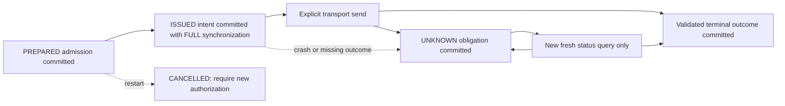

# Opt-in durable execution obligations

[`DurableExecution`](../src/wirelessjev/execution_journal.py) adds a real local
SQLite journal around the existing execution-v2 ledger, issue and reconciliation
functions. It persists issue intent before calling a transport and reconstructs
unresolved ownership/reservations after restart. It changes no default, policy,
historical evidence or hardware adapter. No real radio or SSH command was run.

This establishes a narrowly tested software protocol. It does **not** provide
exactly-once physical execution, hardware authorization, latency qualification
or a production release. Use it outside the fast packet/control path.

## Ordering and recovery

`prepare()` validates through the existing ledger, then commits the immutable
admission payload. `execute(transaction_id, transport)` commits ISSUED **before**
entering the existing execution API. A database failure at that boundary sends
nothing. Once issue intent exists, any crash before durable terminal outcome is
ambiguous, including a crash before the transport was actually entered.

On reopen, durable ISSUED becomes UNKNOWN; UNKNOWN remains UNKNOWN. Its original
car ownership, domain reservation and single-send flag are reconstructed.
Calling `execute()` again sends nothing. `reconcile()` can issue only a new
status query, using the existing strict connected/interface/role/BSSID checks.
A valid old/new association can settle ABORTED/COMMITTED and release its
reservation; missing, stale or unrelated status leaves it held.

Old PREPARED work is conservatively CANCELLED on reopen, releasing its unused
reservation. Its stale authorization is never resumed. A new action needs a
new transaction identity and fresh authorization/context from the caller. The
journal itself does not evaluate a mission, qualify a model or verify a device
capability. All mutation attempts governed by this protocol must go through the
wrapper; calling private internals or a different transport path bypasses it.

## Durable state and identity

The connection uses SQLite WAL, `synchronous=FULL` and an explicit transaction
for each admission/transition. Initial database creation also synchronizes the
parent directory. The fixed configuration binds schema version, execution
semantics version, execution-source SHA-256, budgets and capacity limits.
An incompatible configuration or source change refuses reopen.

Each immutable payload has a checksum and contains only transaction/car IDs,
old/new BSSID, expected client interface/role, domain, airtime and the fixed
credential-free request fields `action`, `ssid`, `bssid`, `security`. Arbitrary
request fields, including secret or underscore-prefixed additions, are rejected
before journaling. Wi-Fi/SSH credentials belong in a separate transport layer
and are never needed by this wrapper.

The journal checks current durable identity against its admitted ledger
snapshot. Outcome persistence uses the private ledger state and canonical
outcome, rather than trusting mutable public `Transaction.state/outcome` fields.
Returned transaction objects remain mutable compatibility objects; callers must
not modify their admitted identity/request.

Any journal read/write/validation failure closes admission and issue for that
instance. A terminal-persistence failure after a successful reply is not treated
as safely forgotten: the owner is poisoned, and reopening reconstructs the old
durable UNKNOWN/ISSUED obligation and its reservation. The state cannot be used
for new work merely because the failed owner's memory had already settled it.
Corrupt or existing empty databases are rejected, never silently initialized as
fresh journals. Explicit close releases ownership so a new owner can inspect
and recover valid state.

## Ownership, bounds and clocks

A lifetime nonblocking POSIX `flock` on a stable sidecar file provides exclusive
cooperative ownership for one resolved journal path. Symlink paths resolve to
the same target; hard-linked database aliases are rejected. A PID check occurs
before acquiring the wrapper mutex, so an inherited object rejects child use
even if another parent thread held that mutex during fork. Do not fork while a
journal is open: inherited descriptors can delay lock release until the child
exits. The lock is local coordination, not global authority over a radio or
protection against other programs bypassing the protocol.

Admission preserves the existing finite budget, one-unresolved-operation-per-car
and in-flight count bounds. `max_records` bounds retained transactions, including
terminal identities. Payloads are limited to 4 KiB and configuration supports
at most 128 domains. Capacity exhaustion refuses admission rather than deleting
duplicate history. There is no automatic pruning, journal rotation or migration;
starting a new journal to evade capacity would discard replay obligations.

The wrapper serializes all methods, including explicit transport I/O, and can
wait for SQLite synchronization or a transport. It is not a nonblocking packet
callback or a hard real-time interface. Transport timeouts remain necessary.
SQLite checkpoint/WAL behavior depends on readers and the filesystem; the
checkpoint/size settings are not a universal hard disk-byte bound under external
readers or failure.

No monotonic timestamp is persisted as freshness evidence. After reboot,
reconciliation uses a new status request and the current process clock. Any
optional `observed_at_monotonic` must refer to that current clock/epoch; an old
saved receipt is not a valid fresh read. Untimestamped legacy status still
depends on the transport actually performing its promised fresh query.
Reconstructed `Transaction.history` is cleared: rebuilding private guards must
not fabricate new issue timestamps or pretend original event times survived.
This is an obligation-state journal, not a complete physical-event audit log.

## Verification and remaining limits

The tests use real SQLite files and real child-process exits in three windows:
after durable intent but before a send analogue, after an fsynced offline send
marker, and after a successful reply but before terminal persistence. Reopen
retains UNKNOWN and reservations, and duplicate execution never sends again.
Other tests cover terminal/reconciliation commit failures, exclusive ownership,
fork with a locked parent mutex, private outcome authority, configuration and
payload corruption, read-only failure, capacity and reservation reconstruction.
The transport implementations in those tests only return scripted local data
or write temporary markers. They are not radio performance evidence.

Durability assumes a supported local filesystem and storage/VFS implementation
that honors SQLite synchronization. These process-crash tests are not power-cut,
media-failure, network-filesystem or distributed-failover certification. Checksums
detect accidental inconsistency; they are not signatures against an actor that
can rewrite the journal. The existing core semantics infer a matching current
association from status, not a complete historical account of physical effects.
An ambiguous operation may remain unresolved indefinitely. Hardware capability,
fresh policy authorization, measured deadlines, operator recovery and deployment
qualification remain separate requirements.
