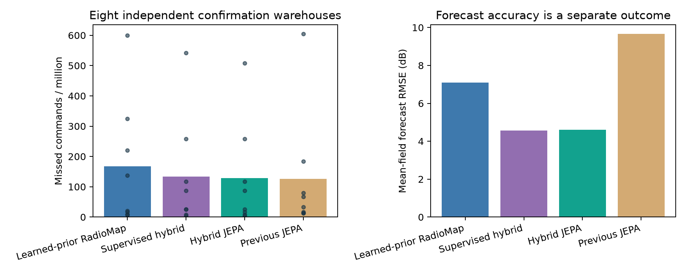

# Independent warehouse confirmation

On eight additional warehouses, the fixed supervised hybrid produces **133.33** missed commands per million versus **167.19** for learned-prior RadioMap. The paired difference is **-33.85 ppm**, 95% site-bootstrap interval **[-68.75, -5.73]**; wins 5/8.
The preregistered primary reduction criterion passes.

This candidate was chosen from the first eight warehouses, then frozen before these eight new sites. These results are separate from the original study and do not replace its development-selected standalone model. No model, gate or controller was retuned.

| Method | Misses | Misses / million | Forecast RMSE (dB) | AP-choice regret (dB) |
|---|---:|---:|---:|---:|
| Learned-prior RadioMap | 321 | 167.19 | 7.09 | 0.246 |
| Supervised hybrid | 256 | 133.33 | 4.57 | 0.171 |
| Hybrid JEPA | 246 | 128.12 | 4.60 | 0.169 |
| Previous JEPA | 242 | 126.04 | 9.66 | 0.222 |

100 robots per site, 120 seconds per run, 1,920,000 commands per arm. All four arms use the same 30 ms native handover and reactive-rescue controller.

## Interpretation

Mean-field forecast accuracy, control outcomes and the value of the JEPA objective are distinct questions. The supervised hybrid is the primary candidate; the JEPA hybrid and previous model are secondary comparisons. All paired comparisons, traffic metrics and interval coverage are in `summary.json`. A win for the supervised hybrid does not establish that JEPA pretraining is necessary.

## Reproduction and limits

Run `uv run --frozen python -m wirelessjev.fleet_confirmation --workers 4`. Source capsules, frozen selection, checkpoint hashes, discovery-case hashes and all confirmation counters are archived in `artifacts/fleet_confirmation`. Audit with `uv run --frozen python scripts/audit_fleet_confirmation.py`.

Simulation only, canonical warehouse layout with varied propagation/routes/traffic, idealised reactive observations, known localisation/CAD and a 30 ms handover assumption. The models use synthetic mean-field supervision and the hybrid still requires RadioMap fitting. Forecast error includes planned-versus-realised route mismatch; policies share precomputed trajectories. Physical scanning, on-car inference and stock-car switching remain unqualified.
