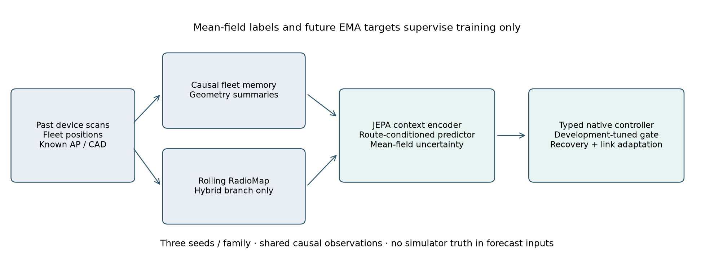
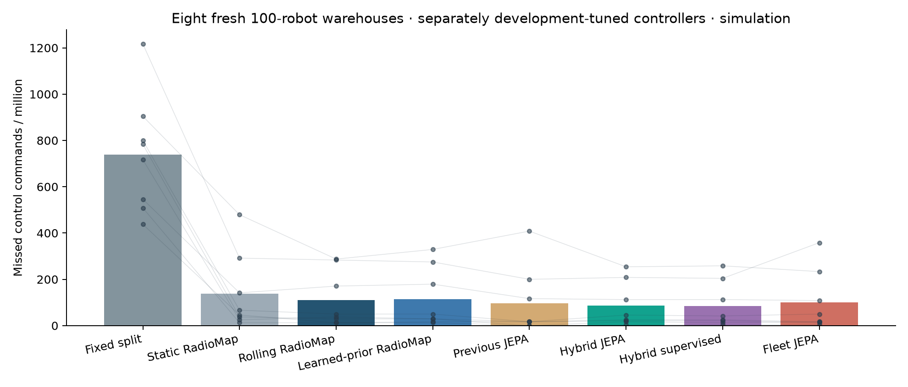
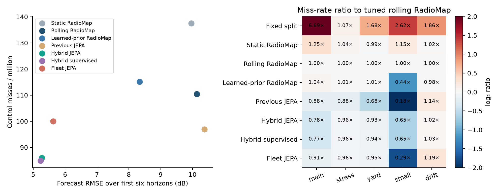

# Fleet world-model results

The model chosen on development scenes was **Fleet JEPA**. On eight fresh primary scenes it produces **100.00** misses per million, versus **115.10** for **Learned-prior RadioMap**, the RadioMap reference chosen on development scenes.
The paired difference is -15.10 ppm, with a 95% scene-bootstrap interval [-48.45, 19.27] and 5/8 wins. The interval does not establish a primary-condition reduction.

## What was built

- A 28,346-parameter per-member model pooling six causal robot scans, a sixty-second fleet memory, known rack geometry and a planned route.
- A hybrid that corrects rolling RadioMap forecasts, plus a standalone fleet JEPA with no dependence on per-BSS RadioMap predictions.
- A supervised hybrid ablation with the same architecture and inputs but no EMA/JEPA objective.
- True mean-field training targets, horizon weighting and AP-score regret, separating forecast-mean uncertainty from noisy scan spread.
- Matched censored rolling RadioMap, updated every twenty seconds from the trailing minute, with its own controller tuning.
- A stronger RadioMap using the existing forty-site learned foundation prior, with its own development tuning and a separate pre-test comparison seal.
- Nine real model fits on 32 sites, six distinct validation sites and twelve closed-loop selection sites. The choice was sealed before 32 fresh test sites.

## Primary results

Eight warehouses, 100 robots each, 120 seconds per warehouse. RadioMap and world-model arms share the same native hardware and 30 ms handover assumptions. Fixed split retains the original default-MLO policy and its 60 ms handover setting.

| Method | Misses / million | Forecast RMSE (dB) | AP-choice regret (dB) |
|---|---:|---:|---:|
| Fixed split | 739.06 | — | — |
| Static RadioMap | 137.50 | 9.96 | 0.375 |
| Rolling RadioMap | 110.42 | 10.13 | 0.333 |
| Learned-prior RadioMap | 115.10 | 8.34 | 0.348 |
| Previous JEPA | 96.88 | 10.38 | 0.279 |
| Hybrid JEPA | 85.94 | 5.27 | 0.242 |
| Hybrid supervised | 84.90 | 5.23 | 0.241 |
| Fleet JEPA | 100.00 | 5.63 | 0.301 |

Forecast RMSE and AP-choice regret describe mean-field prediction, not actual packet-loss regret. Lower forecast error can still produce worse control decisions. The split error metrics use positive versus nonpositive mean SNR; they are not observed-versus-unheard scan labels (the raw case kernel uses older audible/unheard key names for that split).

## All fresh conditions

| Condition | Fixed split | Static RadioMap | Rolling RadioMap | Learned-prior RadioMap | Previous JEPA | Hybrid JEPA | Hybrid supervised | Fleet JEPA |
|---|---:|---:|---:|---:|---:|---:|---:|---:|
| main | 739.06 | 137.50 | 110.42 | 115.10 | 96.88 | 85.94 | 84.90 | 100.00 |
| stress | 17662.50 | 17073.61 | 16456.94 | 16591.67 | 14506.94 | 15808.33 | 15761.11 | 15800.00 |
| yard | 511.11 | 300.00 | 304.17 | 306.94 | 206.94 | 281.94 | 284.72 | 288.89 |
| small | 1236.11 | 541.67 | 472.22 | 208.33 | 83.33 | 305.56 | 305.56 | 138.89 |
| drift | 555.56 | 304.17 | 298.61 | 293.06 | 341.67 | 305.56 | 306.94 | 355.56 |

The condition table reports misses per million. Primary has eight sites; other conditions have six. Small has ten robots. Generalisation runs last sixty seconds.

Primary traffic and stop-time metrics (scene means):

| Method | Bulk Mbps | Video on time | Video delivered / requested | Safety-stop fraction |
|---|---:|---:|---:|---:|
| Fixed split | 554.92 | 0.9758 | 0.9758 | 0.000296 |
| Static RadioMap | 553.59 | 0.9778 | 0.9777 | 0.000229 |
| Rolling RadioMap | 553.53 | 0.9777 | 0.9776 | 0.000177 |
| Learned-prior RadioMap | 553.60 | 0.9778 | 0.9777 | 0.000209 |
| Previous JEPA | 554.56 | 0.9783 | 0.9781 | 0.000178 |
| Hybrid JEPA | 553.55 | 0.9781 | 0.9780 | 0.000129 |
| Hybrid supervised | 553.54 | 0.9781 | 0.9780 | 0.000129 |
| Fleet JEPA | 553.82 | 0.9777 | 0.9776 | 0.000170 |

## JEPA ablation and held-out mission

The supervised hybrid is the test of whether the EMA/JEPA objective adds value to the same information and architecture. Full paired comparisons and held-out teleoperation-mission results are in `summary.json`; the development-best designation is never changed using test results.

## Compute and reproducibility

Study prediction timings include input construction and the neural head but exclude map refits. The separate runtime benchmark below times the actual API, including any initial or refresh fit. Each call predicts nine horizons for 100 robots. It uses one CPU thread on this host and four warm calls; these are microbenchmarks, not hardware latency guarantees. Checkpoint loading is recorded separately in `runtime_benchmark.json`. Each member has 23,546 inference parameters; the reported 28,346 total also includes the frozen EMA teacher.

| Method | Initial call (ms) | Warm call (ms) | Refresh call (ms) |
|---|---:|---:|---:|
| Hybrid JEPA | 829.90 | 381.80 | 848.99 |
| Hybrid supervised | 822.82 | 422.77 | 897.01 |
| Fleet JEPA | 192.49 | 191.20 | 186.11 |
| Rolling RadioMap | 766.21 | 212.06 | 703.82 |
| Learned-prior RadioMap | 769.82 | 213.27 | 729.10 |

Run `bash scripts/run_fleet_research.sh` to reproduce the core study, stronger-reference amendment, independent forecast replay, reports, audit and tests sequentially. Dataset receipts hash the deterministic training caches; the caches are rebuilt locally. Checkpoints, histories, all native counters and source capsules are archived under `artifacts/fleet_world_model`. Audit with `uv run --frozen python scripts/audit_fleet_world_model.py`.

## Limits

- Simulation only; no physical smartcar qualification.
- Warehouse seeds share the canonical rack/AP layout and randomise propagation, routes and traffic; arbitrary warehouse-layout transfer is not tested.
- Stress, yard and drift examples appear in training; their fresh-site tests do not establish transfer to entirely unseen environment families.
- All native controllers retain the same idealised reactive measurement model and 30 ms handover assumption.
- Known AP positions, perfect robot localisation, CAD rack geometry and configured noise floors are assumed.
- Targets use realised future mean SNR while inputs contain planned positions; route mismatch contributes to forecast error, so this is not pure fixed-position map reconstruction.
- All policies share precomputed robot trajectories; safety-stop time is measured without resimulating robot motion.
- Forecasts are generated causally but supplied to the simulator offline; measured inference/refit time is not charged to packet deadlines.
- Training uses synthetic mean-field truth for all links; real device-only training has not been established.
- The hybrid depends on RadioMap fitting; its neural-head time is not an end-to-end compute advantage.
- The standalone fleet model uses reports-only geometric summaries; its results must be assessed separately.
- Three training seeds are ensembled; site intervals do not quantify retraining variance.
- Forecast inputs pool scans from fixed simulated trajectories rather than a resource-constrained hardware scan scheduler.
- Drift is an explicitly constructed intervention; the changing attenuation schedule is hidden from forecasters.
- No safety certificate or universal Earth/environment/protocol generalisation is established.
