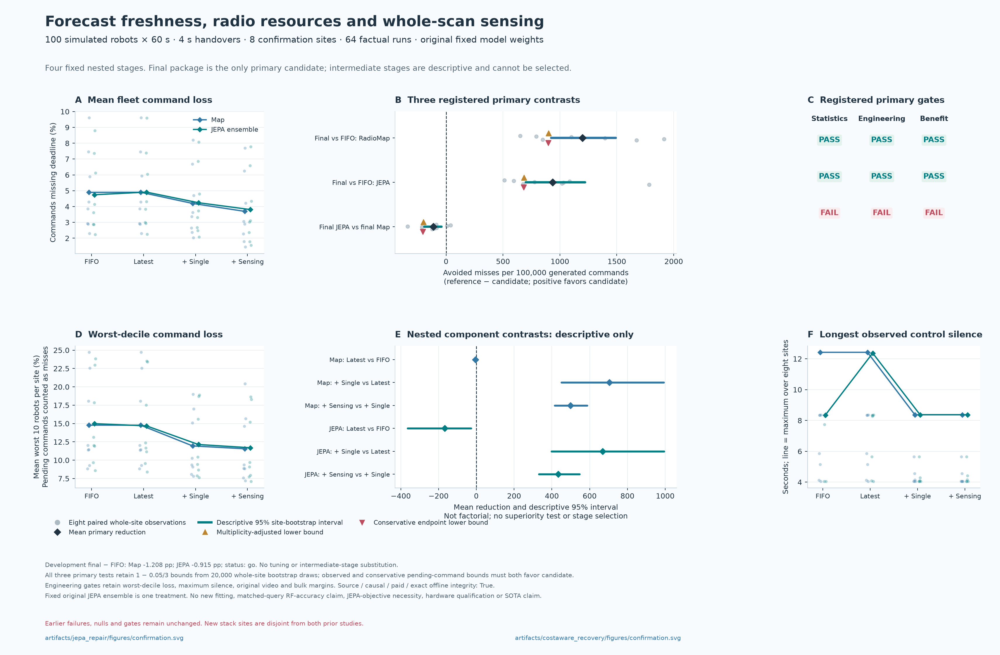
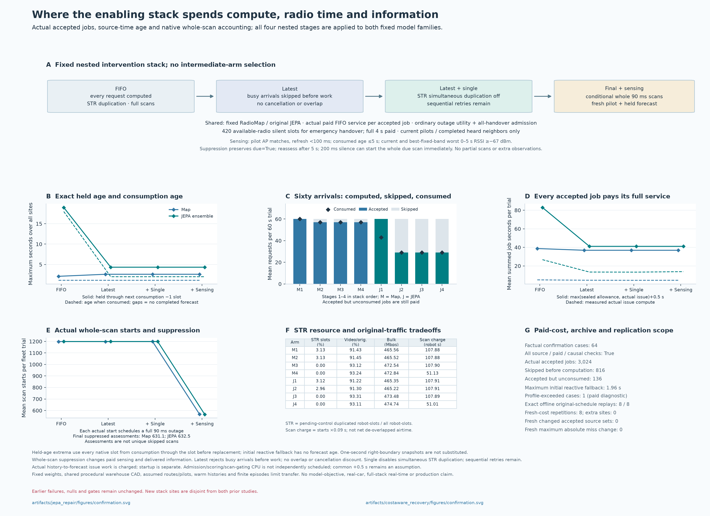

# Freshness, radio resources and sensing: completed results

**The final stack reduced deadline misses by 19.71% for fixed FleetJEPA and 24.47% for RadioMap relative to each one's FIFO baseline, passing both registered within-family statistical and engineering checks. JEPA did not beat RadioMap with the same final stack:** command loss was **3.8100% versus 3.6980%**, and JEPA failed the cross-model worst-decile engineering check. Both final arms still exhibited an **8.37-second maximum control silence**. This is an enabling-stack result in simulation, not JEPA-objective superiority or production qualification.

The [report](../artifacts/freshness_stack/report.json), [summary](../artifacts/freshness_stack/report.md), [protocol](../artifacts/freshness_stack/protocol.json), [development seal](../artifacts/freshness_stack/development.json), [completion receipt](../artifacts/freshness_stack/completion.json) and [independent audit](../artifacts/freshness_stack/verification/independent-audit.json) retain and verify the evidence.

## Fixed comparison and completed matrix

The [design](FRESHNESS_STACK_DESIGN.md) specifies four nested stages around the same original frozen three-member FleetJEPA ensemble and strong RadioMap:

| Stage | Forecast admission | Simultaneous STR control duplication | Ordinary due whole scan |
|---|---|---|---|
| `fifo` | Every request joins the paid FIFO | Enabled | Existing behavior |
| `latest` | Reject busy arrivals before forecast work | Enabled | Existing behavior |
| `latest_single` | Latest-only admission | Disabled; sequential cross-link retries remain | Existing behavior |
| `latest_single_sense` | Latest-only admission | Disabled; sequential cross-link retries remain | Deferral only under the registered observation checks |

All arms retain the same outage-utility controller, ordinary all-handover admission and 420-primary-radio-available-slot recovery watchdog. Neural weights are fixed; normal causal RadioMap fitting and memory updates continue. No neural fit, distillation, member selection or timing recalibration occurred.

The completed matrix contains **16 development cases on two sites, 64 confirmation cases on eight additional sites, eight offline replays and eight fresh measured-cost repetitions**. Each trial used 100 simulated robots for 60 seconds at assumed four-second handovers, after conditional 60-second warm history. The confirmation cohort is `2144000…2144007`; earlier `2124…` fast and `2134…` slow studies remain separate, with their original criteria and negative outcomes. Their absolute metrics are not paired cost comparisons or extra sites for this analysis.

Development permitted the fixed final package: its mean loss differences versus FIFO were −1.2075 percentage points for RadioMap and −0.915417 for JEPA, with mechanical checks passing. This gate only excludes severe regression above one absolute percentage point; it was not final success qualification or permission to select an intermediate stage.

## Confirmation service outcomes

Command loss is the fraction of generated commands missing their deadline. Worst-decile loss averages the worst decile of robots. Values are site means except maximum silence, which is the maximum across all robots and eight sites. Video counts original delivered content, excluding duplicated traffic; bulk is aggregate fleet throughput.

| Forecaster | Stage | Command loss | Worst-decile loss | Maximum silence | Original video | Bulk Mbps |
|---|---|---:|---:|---:|---:|---:|
| RadioMap | FIFO | 4.89625% | 14.76354% | 12.42 s | 91.4285% | 465.565 |
| RadioMap | Latest | 4.90115% | 14.75938% | 12.42 s | 91.4450% | 465.518 |
| RadioMap | Latest + single | 4.19698% | 11.93646% | 8.37 s | 93.1186% | 472.542 |
| RadioMap | Final | 3.69802% | 11.55208% | 8.37 s | 93.2365% | 472.836 |
| FleetJEPA | FIFO | 4.74521% | 14.96771% | 8.35 s | 91.2168% | 465.349 |
| FleetJEPA | Latest | 4.91250% | 14.66771% | 12.37 s | 91.2995% | 465.223 |
| FleetJEPA | Latest + single | 4.24302% | 12.13333% | 8.37 s | 93.3078% | 473.478 |
| FleetJEPA | Final | 3.81000% | 11.69063% | 8.37 s | 93.1079% | 474.745 |

Each arm generated 960,000 commands. Final JEPA produced **36,576 misses versus 45,554** for its FIFO baseline: 8,978 fewer, a **19.7085% relative reduction**. RadioMap produced **35,501 versus 47,004**: 11,503 fewer, a **24.4724% relative reduction**. Final JEPA had 1,075 more misses than final RadioMap.

### Three registered primary decisions

Whole sites are the independent units. The three fixed one-sided tests use 20,000 paired whole-site bootstrap draws and the `1 − 0.05/3` upper bound. The descriptive 95% intervals below are not multiplicity-adjusted confidence intervals. Ensemble members, robots, packets and repetitions do not increase the independent-site count.

Differences are **candidate minus reference, in percentage points**; negative favors the candidate. The conservative endpoint counts pending commands as misses for the candidate and successes for the reference. Both observed and conservative upper bounds must be negative.

| Primary contrast | Mean difference | Descriptive 95% interval | Three-test upper bound | Conservative endpoint upper bound | Statistics / engineering / benefit |
|---|---:|---:|---:|---:|---|
| Final RadioMap − FIFO RadioMap | −1.198229 pp | [−1.491250, −0.922885] pp | −0.900587 pp | −0.897835 pp | Pass / pass / **pass** |
| Final JEPA − FIFO JEPA | −0.935208 pp | [−1.222396, −0.701143] pp | −0.685000 pp | −0.681875 pp | Pass / pass / **pass** |
| Final JEPA − final RadioMap | +0.111979 pp | [+0.038646, +0.191771] pp | +0.200000 pp | +0.204792 pp | **Fail** / **fail** / **fail** |

RadioMap passed every zero-margin engineering check against its FIFO baseline. JEPA's maximum silence rose from 8.35 to 8.37 seconds: this passed the declared 0.05-second margin but failed the zero-margin silence diagnostic. Its other within-family engineering checks passed. Against final RadioMap, JEPA's conservative worst-decile loss was 11.696875% versus RadioMap's observed 11.552083%, exceeding the allowed 0.083333-percentage-point margin. Equal maximum silence did not rescue that contrast. `all_three_experimental_benefits` remains **false**.

## Six descriptive nested component contrasts

The adjacent-stage contrasts below use paired-site descriptive 95% intervals, without primary superiority decisions. They are conditional on the preceding interventions and their fixed order. This is not a factorial decomposition, independent component ranking or permission to select an intermediate winner.

| Forecaster | Conditional change | Mean loss difference | Descriptive 95% interval |
|---|---|---:|---:|
| RadioMap | Latest − FIFO | +0.004896 pp | [−0.002083, +0.016667] pp |
| RadioMap | Single − latest | −0.704167 pp | [−0.992604, −0.450721] pp |
| RadioMap | Sense − single | −0.498958 pp | [−0.587396, −0.414688] pp |
| FleetJEPA | Latest − FIFO | +0.167292 pp | [+0.027703, +0.362917] pp |
| FleetJEPA | Single − latest | −0.669479 pp | [−0.993333, −0.398021] pp |
| FleetJEPA | Sense − single | −0.433021 pp | [−0.545833, −0.331771] pp |

Freshening alone did **not** improve JEPA service: the `latest` arm had 1,606 more misses and maximum silence rose to 12.37 seconds. Its forecasts became fresher while fewer were consumed. The subsequent STR and scan changes improve the conditional point estimates, but this experiment does not identify all interactions or establish which mechanism prevents each missed packet.

[Service and nested-stage figure: SVG](../artifacts/freshness_stack/figures/confirmation-and-nested-stages.svg) · [PDF](../artifacts/freshness_stack/figures/confirmation-and-nested-stages.pdf)

## Actual work, consumption and freshness

All accepted jobs pay `max(original allowance, actual predictor time, actual issue-path time) + 0.5 s`. The issue path includes history snapshot, validation, storage and hashing. Busy arrivals are rejected before this work starts; already computed work is never discounted. The following totals cover each arm's eight confirmation trials and 480 original arrivals. Measured forecast work is elapsed wall time; work and charges are summed across separate trial queues, not processor utilization or campaign duration.

| Forecaster / stage | Accepted | Skipped before work | Consumed | Accepted but unconsumed | Measured compute s | Charged compute s | Charged service s |
|---|---:|---:|---:|---:|---:|---:|---:|
| RadioMap / FIFO | 480 | 0 | 480 | 0 | 39.668 | 69.721 | 309.721 |
| RadioMap / final | 456 | 24 | 456 | 0 | 36.234 | 66.800 | 294.800 |
| FleetJEPA / FIFO | 480 | 0 | 344 | 136 | 213.707 | 423.440 | 663.440 |
| FleetJEPA / final | 232 | 248 | 232 | 0 | 110.606 | 212.640 | 328.640 |

Across all 64 confirmation cases, 3,840 arrivals yielded 3,024 accepted jobs, 816 pre-work skips and 2,888 consumptions. The 136 accepted jobs unconsumed before trial end all belong to JEPA FIFO; their actual work remains paid. There were zero undercharge/early-consumption or causal-history failures. One RadioMap FIFO job exceeded its reused profile and paid the extra measured cost; this is a capacity diagnostic under the prospectively declared actual-cost contract, not a waiver of older timing vetoes.

| Forecaster / stage | Maximum source age when consumed | Exact maximum age while held |
|---|---:|---:|
| RadioMap / FIFO | 1.13 s | 2.11 s |
| RadioMap / any latest stage | 1.13 s | 2.61 s |
| FleetJEPA / FIFO | 17.98 s | 18.97 s |
| FleetJEPA / any latest stage | 2.01 s | 4.34 s |

Held age covers every simulated slot after the first consumption, reconstructed from original source timestamps and consumption boundaries. A logged second-boundary snapshot or scan-assessment age is not the exact all-slot maximum. Forecast source age is also not the age of underlying radio measurements: measurements have their own capture, completion and delivery clocks.

Latest admission reduces JEPA from 43 consumed forecasts per trial to 29. Lower age and lower computation therefore accompany a lower callback count; neither proves improved packet service on its own. The shared serialized half-second scheduling/other-work allowance remains an assumption. Startup/loading is separate, and admission/scoring/scan-gating CPU is not independently scheduled, so this is not a complete-stack real-time benchmark.

## Whole scans and existing pilots

The final gate uses the existing lagged pilots of the associated AP, checks their actual capture association and refresh clock, and reads an actually consumed forecast. It tests **six native points from zero through five seconds**, requiring one fixed band's current-pilot-anchored prediction to be at least the declared threshold at those points. This is not a continuous-time lower bound or a new sensing capability.

The current gap must be below 200 ms, current pilot RSSI at least −67 dBm, its available refresh clock less than 100 ms old with matching capture association, forecast source age at most five seconds, and another five seconds inside forecast support. A refresh does not rewrite the measurement's capture time. Unknown or stale evidence permits the full original scan. Suppression leaves the scan due and ordinary reassessment occurs after five seconds; the existing silence watchdog can start it sooner. Every performed scan retains its actual whole 90 ms outage, capture and completion. Postponement creates no radio observation or central report.

| Forecaster, eight trials | Whole scans: FIFO | Whole scans: latest + single | Whole scans: final | Final assessments | Suppressing assessments |
|---|---:|---:|---:|---:|---:|
| RadioMap | 9,589 | 9,591 | 4,545 | 9,594 | 5,049 |
| FleetJEPA | 9,592 | 9,590 | 4,534 | 9,594 | 5,060 |

Suppressing assessments are not a count of unique scans avoided or proven prevented misses. Scan deferral changes both paid interruptions and information acquisition; equal sensing airtime is not claimed. Existing three-band pilots are inherited simulator assumptions, not demonstrated SmartCar hardware capability. Less frequent scans can also delay discovery of changed links. Sixty-second episodes initialized with warm histories do not establish a long-run sensing steady state or indefinite continuity.

## RF diagnostics do not isolate an accuracy gain

Truth-based RF metrics cover **accepted queries at their issued source times**, not latency-adjusted consumed forecasts. Latest admission changes query membership, and scan deferral changes future observations. The diagnostics therefore are not matched accuracy endpoints or proof of a JEPA-objective advantage.

| Forecaster / stage | SNR RMSE | Route-delta RMSE | AP-choice regret |
|---|---:|---:|---:|
| RadioMap / FIFO | 8.34569 dB | 4.88081 dB | 0.70994 dB |
| RadioMap / final | 8.26167 dB | 4.88743 dB | 0.76215 dB |
| FleetJEPA / FIFO | 6.82211 dB | 4.69070 dB | 0.64448 dB |
| FleetJEPA / final | 7.01182 dB | 4.72107 dB | 0.70260 dB |

JEPA's final RF point errors increased while its packet service improved over FIFO. Conversely, its lower SNR error than RadioMap did not produce lower final command loss. These observations reinforce the distinction between forecast metrics and the behavior of the whole control stack; they do not identify a separate causal effect of accuracy.

## Replay, audit coverage and source identity

All **eight offline replays** exactly reproduced native outcomes, forecast values, delivered observations, action/decision/admission traces, accepted/skipped arrival decisions, consumption and original charged schedules. Recomputed elapsed work in this mode is diagnostic; it does not establish freshly measured deadlines. All **eight fresh measured-cost repetitions** passed actual-paid checks and happened to retain the original accepted source sets, availability, charges and packet results. Equality was not required for these descriptive sensitivity repetitions, and neither mode adds independent sites.

The protected scientific source is commit **`5493d425538046b79bff6c4b06202892fe35d8dc`**, with **446 sealed source/input entries**. The [publication receipt](../artifacts/freshness_stack/registration/git.json) records publication before new evaluations and that earlier results had already been observed. The [preflight archive](../artifacts/freshness_stack/logs/preflight-tests.txt) records **1,489 passing tests and one warning in 184.62 seconds**. The audit verifies the 616 tested source/input entries and the preserved 446/422/386/230/80-entry new and inherited scientific closures. Software tests are evidence about mechanics, not warehouse performance.

The independent audit reproduced the complete 96-run matrix, all actual-paid/FIFO-or-latest/consumption ledgers, sparse source identities, exact held-age intervals, three primary and six descriptive contrasts, pending-command sensitivity and report contents without new worlds, fits, forwards or scientific timing. Its SHA-256 is `f2aafd4ad425a93fcea2b24df4581d606ac6ad76c17368974b8170e898661c93`.

The audit also checked logged pilot capture/AP/refresh metadata, scan-gate inputs and arithmetic, and postponement/start consistency. Its scope has specific limits:

- The saved current-AP 9×3 forecast slice cannot reconstruct the full forecast's hash by itself; extraction is backed by frozen source and exact replay.
- Private physical pilot values were not resimulated, and sampled logs do not reconstruct every due opportunity or successful control delivery.
- The available-silence counter's recorded events and snapshots were checked; full recurrence across every 10 ms slot remains covered by frozen source and software tests rather than reconstructed for all archived slots.

[Freshness/resource/sensing figure: SVG](../artifacts/freshness_stack/figures/freshness-resource-sensing-stack.svg) · [PDF](../artifacts/freshness_stack/figures/freshness-resource-sensing-stack.pdf) · [figure input/output receipt](../artifacts/freshness_stack/figures/receipt.json)

## Supported conclusion and limits

The fixed final stack improves both tested forecasters over their own FIFO baselines under the declared statistical and engineering criteria. It makes JEPA's information fresher and reduces accepted computation, but those two changes alone did not improve service. Shared resource and sensing changes matter, and the final RadioMap package has the lower command-loss point mean. This experiment does not establish that JEPA pretraining, its objective or architecture is necessary for the gain.

All earlier negative model and controller outcomes remain intact. The current evidence uses procedural shared CAD, assumed routes/localization/scanning, fixed neural weights, conditional warm histories and finite episodes. An 8.37-second observed gap is not a safe operating guarantee for a real fleet. `production_qualified`, `hardware_qualified`, `activated` and `all_three_experimental_benefits` remain **false**. No default promotion, physical-car validation, complete-stack timing qualification, arbitrary-warehouse transfer, long-run sensing guarantee, SOTA or indefinite residual-loss claim follows.
