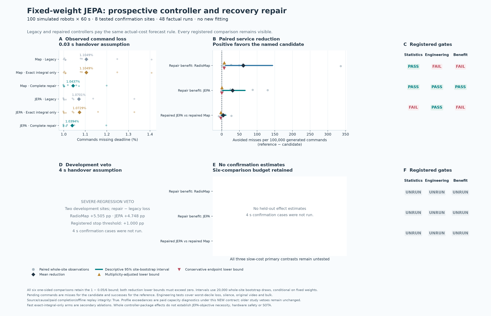
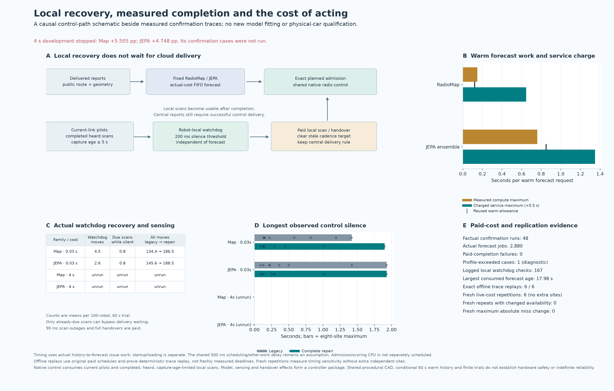

# Fixed-weight JEPA controller and recovery results

**The repaired controller reduced the original FleetJEPA ensemble's fast-handover command misses by 2.87%, passing the registered statistical and engineering checks. It did not establish superiority over repaired RadioMap. The four-second repair failed development and its confirmation cases were not run.** These are simulated controller-package results with unchanged forecaster weights, not a new JEPA training-objective result.

The [machine-readable report](../artifacts/jepa_repair/report.json), [report summary](../artifacts/jepa_repair/report.md), [protocol](../artifacts/jepa_repair/protocol.json), [development seal](../artifacts/jepa_repair/development.json) and [independent raw-archive audit](../artifacts/jepa_repair/verification/independent-audit.json) contain the complete evidence. The audit reproduced archive/source identities, paid computation and consumption, local scan payloads and ages, recovery thresholds and outages, bootstrap results, endpoint sensitivity, completion and report contents without generating worlds, fitting models or timing new forwards.

## What was tested

The study used the fixed original three-member FleetJEPA ensemble and strong RadioMap, with **100 simulated robots for 60 seconds per trial**. Both models used the same causally delivered observations and completion-safe forecast queue. The controller repair combined exact fractional-outage integration for planned admission, separation of planned admission from reactive recovery, and a robot-local watchdog using current pilots and completed, heard, recent local scans. Scan and handover outages remained charged. The [design](JEPAREPAIR_DESIGN.md) records the mechanics and assumptions.

There were **20 development cases on two sites**, followed by **48 fast-handover confirmation cases on eight sites**: two forecasters × legacy, exact-integral-only and complete-repair controllers × eight sites. Six offline trace replays and six fresh measured-cost repetitions covered all arms on the first confirmation site. Those repetitions add no independent sites. No new model fitting occurred.

The slow-cost development veto prevented all four-second confirmation cases. The eight confirmation world IDs were nevertheless generated and observed for the fast cases; they are not unopened worlds. The separately registered cost-aware recovery follow-up uses genuinely new `2133…` development and `2134…` confirmation IDs. Its outcomes must be reported separately; it does not replace this slow-cost failure.

## Fast-handover confirmation

Command loss is the fraction of generated commands missing their deadline. Values below are site means; maximum silence is the maximum over all eight sites and all robots. Video is delivered original content divided by requested original content, excluding duplicated traffic. Bulk is aggregate fleet throughput.

| Forecaster | Controller | Command loss | Worst-decile robot loss | Maximum silence | Original video | Bulk Mbps |
|---|---|---:|---:|---:|---:|---:|
| RadioMap | Legacy | 1.10490% | 1.96250% | 1.42 s | 96.7910% | 509.309 |
| RadioMap | Exact integral only | 1.10490% | 1.96250% | 1.42 s | 96.7910% | 509.307 |
| RadioMap | Complete repair | 1.04375% | 1.38333% | 1.90 s | 96.9911% | 510.091 |
| Frozen FleetJEPA | Legacy | 1.07010% | 1.62500% | 1.93 s | 96.9508% | 511.583 |
| Frozen FleetJEPA | Exact integral only | 1.07292% | 1.65312% | 1.93 s | 96.9508% | 511.583 |
| Frozen FleetJEPA | Complete repair | 1.03938% | 1.34375% | 1.93 s | 97.0809% | 512.292 |

FleetJEPA's complete repair produced **9,978 misses rather than 10,273**, out of 960,000 generated commands per arm: 295 fewer misses, a **2.8716% relative reduction**, or **0.030729 percentage points** of command loss. Worst-decile loss improved and maximum silence did not increase. All four registered engineering checks also pass with zero tolerance for deterioration.

RadioMap's repair avoided 587 misses (5.5341% relative), but maximum silence rose from 1.42 to 1.90 seconds, exceeding the registered 0.05-second margin. Its mean-loss improvement therefore does **not** qualify as experimental benefit. Repaired JEPA had 42 fewer misses than repaired RadioMap, but this small difference was not statistically confirmed.

### Registered inference and uncertainty

Whole sites, not robots, packets or ensemble members, are the independent units. All **six** planned one-sided primary comparisons retain the `1 − 0.05/6` bootstrap upper bound, even though three slow-cost comparisons were unrun. The analysis uses 20,000 paired whole-site bootstrap draws. The descriptive 95% intervals below are not multiplicity-adjusted confidence intervals.

Differences are **candidate minus reference, in percentage points**; negative favors the candidate. The conservative endpoint treats pending commands as misses for the candidate and successes for the reference. Both observed and conservative upper bounds must be below zero.

| Fast contrast | Mean difference | Descriptive 95% interval | Six-test upper bound | Conservative endpoint upper bound | Statistical / engineering / benefit |
|---|---:|---:|---:|---:|---|
| Repaired RadioMap − legacy RadioMap | −0.061146 pp | [−0.143753, −0.010521] pp | −0.007188 pp | −0.006667 pp | Pass / **fail** / **fail** |
| Repaired JEPA − legacy JEPA | −0.030729 pp | [−0.065938, −0.002813] pp | −0.000485 pp | −0.000069 pp | Pass / pass / **pass** |
| Repaired JEPA − repaired RadioMap | −0.004375 pp | [−0.011875, +0.001458] pp | +0.002500 pp | +0.003021 pp | **Fail** / pass / **fail** |

The conservative JEPA repair bound is close to zero, so the positive conclusion is specific to this finite registered experiment. Exact-integral-only arms remain secondary diagnostics: RadioMap's observed miss count was unchanged, while JEPA had 27 additional misses. They do not provide an alternative candidate selected after confirmation, and the full package does not isolate the contribution of each recovery mechanism.

[Confirmation figure: SVG](../artifacts/jepa_repair/figures/confirmation.svg) · [PDF](../artifacts/jepa_repair/figures/confirmation.pdf)

## Four-second development failure

The preregistered severe-regression gate stops a handover cost when either family's repair-minus-legacy mean command loss exceeds **one percentage point**. Both families exceeded that threshold on the two development sites:

| Forecaster | Legacy command loss | Repair command loss | Repair − legacy | Decision |
|---|---:|---:|---:|---|
| RadioMap | 5.25542% | 10.76042% | +5.50500 pp | Severe-regression veto |
| Frozen FleetJEPA | 5.26583% | 10.01417% | +4.74833 pp | Severe-regression veto |

The repair approximately doubled deadline loss despite improving video and bulk delivery. This shows why reducing mean radio error or enabling more recovery actions does not automatically improve safety traffic when every handover costs four seconds. These development observations are not confirmation estimates or proof of one isolated causal mechanism. All three slow-cost primary comparisons remain explicitly **unrun after development veto**, with no effect estimates and no passes.

## Physical prediction and executed recovery

The report preserves raw RF diagnostics evaluated on the actual online histories. These measure issued forecasts at their issue-time horizons, not latency-adjusted forecasts as consumed by the controller. The table below averages the archived per-site diagnostics for each complete-repair arm; all values are dB and lower is better. Route-delta error and AP-choice regret are RF proxies, not packet-level counterfactual gains. The forecasters used their own original native observation/map pipelines, so this is not a matched JEPA-objective ablation.

| Complete-repair forecaster | SNR RMSE | Route-delta RMSE | AP-choice regret |
|---|---:|---:|---:|
| RadioMap | 7.29324 | 4.53775 | 0.58747 |
| Frozen FleetJEPA | 5.92445 | 4.40112 | 0.50132 |

The stronger RF point estimates did not establish repaired JEPA's service superiority over repaired RadioMap. Legacy and repaired JEPA RF errors were almost identical (legacy SNR RMSE 5.92442 dB), as expected from frozen weights with small observation-history differences. The observed service improvement is evidence for the controller/runtime package around JEPA.

Actual confirmation execution logs contain **167 watchdog checks, 57 emergency handovers and 12 already-due emergency scans**. The repair arms account for these events:

| Repair arm, eight confirmation trials | Watchdog checks | Emergency handovers | Emergency scans | All handovers, legacy → repair |
|---|---:|---:|---:|---:|
| RadioMap | 92 | 36 | 6 | 1,075 → 1,492 |
| Frozen FleetJEPA | 75 | 21 | 6 | 1,165 → 1,508 |

These are logged actions, not counts of independently proven prevented failures. Completed scan payloads, capture ages, heard masks and action thresholds were checked against the raw archives. Unheard placeholders cannot act as measured better neighbors, and cloud reports still require successful control transport.

## Paid runtime and replication

Every main and fresh repetition charges `max(sealed profile, measured predictor elapsed, measured issue-path elapsed) + 0.5 s` and records actual forecast consumption after that completion. The issue path includes history snapshot, forecast validation/storage and hashing. This is a new prospective accounting rule; the older study's timing veto remains unchanged.

Across the 48 confirmation cases there were **2,880 forecast jobs and 2,472 consumption events**, 732.276 seconds of measured compute, 1,479.387 seconds of charged compute and 2,919.387 seconds of charged service. These are sums over independent trial queues, not wall-clock study duration. No paid-cost, FIFO, consumption or causal-history checks failed. The largest consumed forecast age was **17.98 seconds**, which is a limitation rather than a freshness guarantee.

| Complete-repair forecaster | Reused warm allowance | Maximum measured warm compute | Maximum charged warm service |
|---|---:|---:|---:|
| RadioMap | 0.120 s | 0.147328 s | 0.647328 s |
| FleetJEPA ensemble | 0.850 s | 0.759949 s | 1.350000 s |

One RadioMap confirmation job exceeded its sealed capacity profile; its actual extra cost was paid. It is a capacity diagnostic under this study's new contract, with no retrospective waiver of any earlier result. Startup/loading is separate. Admission/scorer CPU is not independently scheduled, and the common 500 ms allowance for scheduling/other work remains an assumption.

All **six offline replays** exactly reproduced native outcomes, forecasts, delivered observations, action/decision/admission traces, consumption and the original paid schedule. New compute measured during offline replay is diagnostic; this establishes deterministic replay under recorded availability, not freshly measured deadlines. All **six fresh actual-cost repetitions** passed paid-cost checks and happened to retain the original readiness, charges, consumption and packet results. Equality was not required for those sensitivity observations and adds no independent sites.

[Recovery and cost figure: SVG](../artifacts/jepa_repair/figures/local-recovery-and-cost.svg) · [PDF](../artifacts/jepa_repair/figures/local-recovery-and-cost.pdf) · [figure input/output hashes](../artifacts/jepa_repair/figures/receipt.json)

## Preserved evidence and limits

The experiment's protected scientific source is commit **`c8348cdb1faaf57dd8338f6d82aca410b92f47d5`**, with a sealed **386-file source closure**. The independent audit confirms that earlier semantic-JEPA and selected-JEPA source/evidence manifests remain intact. Their negative architecture/objective comparisons and original timing rules are unchanged. The [original parent preflight log](../artifacts/jepa_repair/logs/preflight-tests.txt) records **1,111 passing software tests and one warning in 168.58 seconds**; software tests validate mechanics, not warehouse performance.

This remains a procedural warehouse simulation with shared CAD, assumed localization/routes and scanning, conditional 60-second warm histories, fixed original model weights and finite 60-second trials. There is no physical-car result, default activation, complete-stack real-time qualification, arbitrary-layout transfer, indefinite residual-error bound, production-safety or SOTA claim. `production_qualified`, `hardware_qualified`, `activated` and `all_six_experimental_benefits` remain **false**. The supported positive result is narrower: this fixed controller package improves the existing JEPA ensemble over its own legacy controller for the tested 30 ms handover setting.
