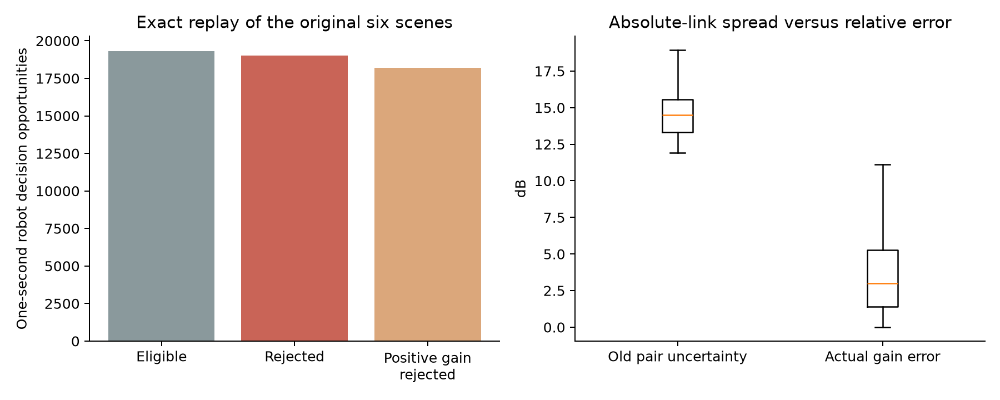
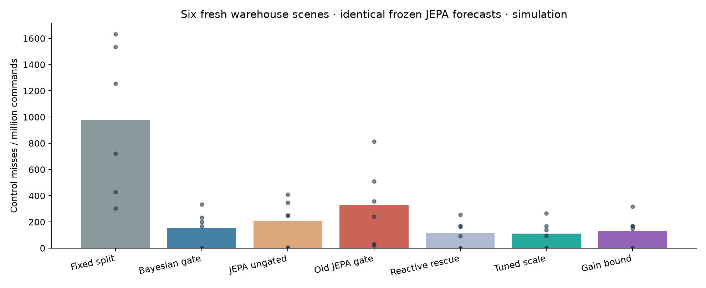

# JEPA gate repair: diagnosis and fresh-scene results

The development-selected **0.25× gate penalty** reduces primary misses from **329.17 to 111.11 per million** on six fresh warehouse scenes: **66.2% fewer**. The new gain-bound gate reaches 133.33. The five JEPA models and their forecasts are unchanged.

## Why the original gate was poor

Forensic replays reproduce all six original packet/roam counters exactly. Of **19,331 eligible decision opportunities**, the old gate rejected **19,012** (98.3%). **18,214 rejected opportunities had positive true AP-score gain and no reactive rescue**. These are repeated robot/second opportunities, not independent packets or distinct handovers.

The old pair uncertainty median was **14.49 dB**, versus **3.01 dB** median actual gain error. Its max-band rule gave 13.27 dB even when restricted to the band with highest predicted current SNR: the larger problem was the uncertainty target and scale, not merely which band was selected.

The planner compares a route-averaged *difference between two AP scores*. The JEPA head was trained on noisy future scan readings, whereas the gate needed uncertainty about the mean AP-score advantage. Its spread was calibrated over all links, including unheard links, then maximised over bands and combined across APs as if independent. That made the gate excessively reluctant to approve useful early moves. The reactive rule could not rescue them while its separate weak-link trigger remained false.

Ensemble member predictions also share offsets. Their paired gain spread is computed directly in the repair, preserving covariance instead of adding independent marginal variances. A small Ridge bias/scale model then calibrates one-sided gain-overprediction error. No twin truth enters the runtime gate; labels are added to recorded traces only after a rollout.



## What changed

- A simple gate penalty was selected from [0.25, 0.5, 0.75, 1.0] using new closed-loop development scenes. The choice was **0.25**, not a threshold chosen from the fresh test results.
- A decision-aligned gain bound was fit on four new sites, calibrated on two others and selected at empirical quantile **0.9**. It can still reject moves; it is not a renamed ungated controller.
- When no planned move is eligible, the gain gate explicitly defers to the reactive rule. The separate reactive-rescue ablation measures this routing benefit without an uncertainty filter.
- The optional simulator gate/trace interface receives forecasts and current decision state only. Tests reproduce the archived kernel exactly when the hook is unused and verify that tracing changes no result.
- Historical artifacts remain unchanged. The old report writer now refuses a changed execution kernel before rewriting any old output.

## Six fresh primary scenes

100 robots, 120 seconds per scene: 1,440,000 commands per arm. These are different scenes from the original 151.39-ppm study; before/after comparisons below use the same new scenes.

| Controller | Missed commands | Misses / million |
|---|---:|---:|
| Fixed split | 1410 | 979.17 |
| Bayesian gate | 224 | 155.56 |
| JEPA ungated | 302 | 209.72 |
| Old JEPA gate | 474 | 329.17 |
| Reactive rescue | 163 | 113.19 |
| Tuned scale | 160 | 111.11 |
| Gain bound | 192 | 133.33 |

Tuned scale minus old gate: **-218.06 ppm**, paired-scene 95% bootstrap interval [-384.03, -67.36]; wins 6/6. Gain bound minus old gate: **-195.83 ppm**, interval [-345.14, -65.28]; wins 6/6.

Tuned scale minus reactive rescue: -2.08 ppm, interval [-15.28, 6.94]. Gain bound minus reactive rescue: 20.14 ppm, interval [-6.25, 48.61]. Much of the improvement therefore comes from permitting useful planned moves and retaining reactive recovery; the added gain model is not the main-condition winner.



## Generalisation

| Condition | Fixed split | Bayesian gate | Ungated JEPA | Old gate | Rescue | Tuned scale | Gain bound |
|---|---:|---:|---:|---:|---:|---:|---:|
| main | 979.17 | 155.56 | 209.72 | 329.17 | 113.19 | 111.11 | 133.33 |
| stress | 13375.00 | 17411.11 | 16316.67 | 23691.67 | 15491.67 | 15284.72 | 15394.44 |
| yard | 495.83 | 237.50 | 322.22 | 543.06 | 240.28 | 202.78 | 156.94 |
| small | 611.11 | 277.78 | 111.11 | 416.67 | 55.56 | 55.56 | 69.44 |

Values are misses per million. Each condition has six fresh scenes. Generalisation runs last 60 seconds; `small` has 10 robots, others 100. The repaired methods improve the old gate but still lose to fixed split under stress. This is not universal controller superiority.

## Use the validated research profile

The simplest development-best profile is available explicitly; the RadioMap default is unchanged:

```python
from wirelessjev.jepa_control import controller
from wirelessjev.native.sim import simulate
policy, roam_gate, profile = controller()  # development-best, currently scale
result = simulate(world_with_jepa_forecasts, policy, roam_gate=roam_gate)
```

The helper checks the frozen checkpoint identities and limits its validated mission to `bulk_uploads`. For the gain-bound variant, pass `controller(bank, method="gain")`. The scale is an operational gate penalty, not a claim that the original 90% SNR prediction interval has been repaired. Neither profile is a hardware/safety qualification.

## Evidence and limits

The study contains **270 native runs**: 12 fit-trace runs, 90 development-selection runs and 168 fresh tests on 24 sites. Six additional historical diagnostic replays match the old counters and are not counted as fresh tests. The choice was sealed before test access. Development-best was determined from frozen development scores (scale), not test ranking.

- Simulation only; the native reactive fallback retains its idealised measurement model.
- Native handovers assume 30 ms; stock-car handover timing and field qualification remain pending.
- Bulk-upload mission only; no on-car inference or switching was qualified.
- The Bayesian reference was not retuned in this JEPA-focused repair.
- The absolute uncertainty still undercovers some links; the selected multiplier is a control penalty, not a corrected 90% signal interval.
- Gain residual quantiles are empirical and do not give a physical safety certificate.
- The gain model is not consistently better than the simpler reactive-rescue ablation.
- Neither JEPA model weights nor its mean forecasts changed between gate arms.
- The test stress condition still favors fixed split over the repaired JEPA.
- Old test scenes were replayed only after the new choice was sealed, solely for diagnosis and exact-counter compatibility.

All reports, raw eligible-decision traces, gain coefficients, selection receipts, source capsules and checksums are in [artifacts/gate_repair](../artifacts/gate_repair/). The original [contracted study](CONTRACTED_RESULTS.md) remains intact. Audit with `uv run --frozen python scripts/audit_jepa_gate_repair.py`.
