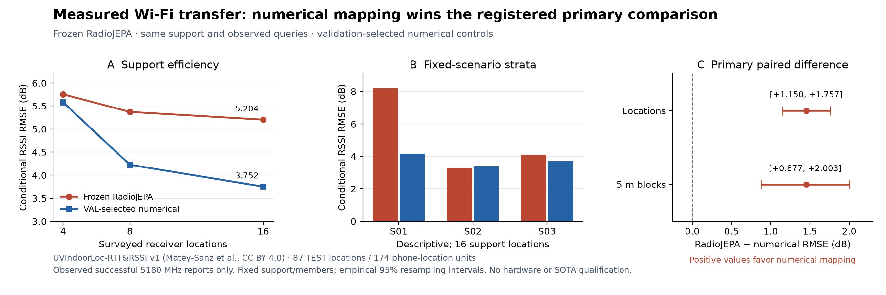

# Measured Wi-Fi transfer: numerical mapping wins

The three released RadioJEPA members **do not beat the validation-selected
numerical map** in the registered measured-RSSI assay. At the primary
16-location budget, their mean-member RMSE is **5.203916 dB**, versus
**3.752246 dB** for the selected RBF ordinary-kriging configuration. The
difference is **+1.451670 dB**, or 38.7% higher error relative to that control.
RadioMap + WirelessJEV remains the application default; RadioJEPA remains a
shadow experiment. No weights, deployment defaults or old results were changed.

## Registered results

All rows use the same observed queries and admitted support. Numerical
configurations were chosen on VAL/session01, independently per support budget.
The neural result averages **per-member RMSE**, not predictions. Errors below
use equal phone/location/scenario weighting.

| Surveyed locations per scenario/phone | VAL-selected numerical method | TEST01 numerical RMSE | TEST01 RadioJEPA RMSE | TEST02 numerical RMSE | TEST02 RadioJEPA RMSE |
| --- | --- | ---: | ---: | ---: | ---: |
| 4 | Matérn-3/2, length10 m / amplitude3 dB / noise1 dB | 5.579050 | 5.752641 | 5.716105 | 5.898217 |
| 8 | RBF, length20 m / amplitude12 dB / noise1 dB | 4.225447 | 5.372905 | 4.316997 | 5.492499 |
| **16 (primary)** | **RBF, length10 m / amplitude12 dB / noise4 dB** | **3.752246** | **5.203916** | **3.920643** | **5.300168** |

TEST02 is descriptive later-campaign transfer using the original session01
support and nuisance reference. Phone campaign dates differ; this is not a
causal robot trajectory or fresh calibration.

Primary paired difference, RadioJEPA minus the VAL-selected numerical model:

| Empirical resampling within fixed scenarios | 95% interval, dB |
| --- | --- |
| Whole locations, 20,000 draws / seed40517 | **[+1.149978, +1.756866]** |
| 5 m XY blocks, 20,000 draws / seed40518 | **[+0.876665, +2.003409]** |

There are 87 scored TEST locations and 14/8/8 occupied spatial blocks in the
three scenarios. Both intervals favor the numerical model. They condition on
these scenarios, fixed support and fixed members; they are not independent-site
or population uncertainty intervals.

## Coverage and uncertainty

The source has 944 measurement CSV files and 1,644,814 AP-result rows. The registered mask
retains 758,456 successful known-5180-MHz reports, summarized into 4,255 file/AP
statistics from 33,901 identity-selected reported values. All 174 planned
TEST location/phone units are present and supported in each session. There
are 1,188 observed AP summaries in session01 and 1,187 in session02, with the
same coverage for every method and budget. This does not make unheard or
failed links observed.

Support budgets count receiver locations, not packets. At budget 16 there can
be up to 128 summaries/1,024 selected reader reports per scenario/phone. A
missing S03 S24 Ultra file leaves 15 actual locations for that phone; no
substitute location is chosen. Actual summary/report costs are retained in
the report.

At budget 16, RadioJEPA's hierarchically weighted, member-averaged containment
inside ±1.96 working standard deviations is **69.45%** on TEST01 and **69.01%**
on TEST02. Mean working standard deviation is about 2.657 dB. These bands omit
uncertainty of the support-derived nuisance reference and are **not calibrated
95% confidence or packet-risk probabilities**. This is an additional reason to
keep neural predictions in shadow.

The first reader stopped before saving any summary or fitting/scoring a model:
it assumed successes could not exceed attempts. Eight source rows instead
report positive successes and zero attempts, five otherwise eligible. The
[original published protocol and failure](../artifacts/measured_radio/failure.json)
remain intact. A separately source-published repair preserves the raw counters
and flags the inconsistency; it changes none of the split, support, summary,
model, numerical-grid, selection or metric choices. No counters are clamped or
interpreted as independent physical packet counts.

## Interpretation and next work

This is transfer of fixed simulation-trained weights with partial inputs.
Absolute TX power and receiver calibration are unknown, so every method uses
the same support-only AP/phone reference. Public held-out query coordinates
and catalogue bounds are available. CAD is unavailable: two active CAD
features are zero-imputed. At a single carrier, the global physical basis has
rank at most two. The frozen selected members already have zero learned local
feature gates. These constraints limit the test's representational coverage;
the result does not isolate a single architectural cause.

The largest primary gap is in S01: **8.199429 versus 4.162483 dB**. S02 slightly
favors RadioJEPA (**3.302332 versus 3.403513 dB**) and S03 favors numerical
mapping (**4.109987 versus 3.690741 dB**). These are descriptive strata, not a
post-TEST selection rule. No scenario or neural member is dropped.

The earlier 2.70% sparse-RSSI advantage on registered Sionna layouts remains
valid for its original simulation endpoint. The NumPy software speed/memory
improvements also remain valid for their fixed workloads. Neither establishes
measured-device accuracy. This assay is not an evaluation of the portable
workflow's fixed default map configuration, real SmartCar switching, warehouse
packet service, interference reconstruction or SOTA neural baselines.

Further model work needs training/validation that explicitly handles missing
geometry, references and domain shift, plus calibration assessed on genuinely
reserved campaigns/sites. This opened TEST set cannot become a new independent
confirmation set after tuning. Production claims additionally require parked
car survey/shadow measurements, supervised switching, measured service outcomes
and matched external specialist references.

## Reproduction and independent evidence

- [Protocol and reproduction guide](MEASURED_RADIO_PROTOCOL.md).
- [Published source receipt](../artifacts/measured_radio_counterfix/registration/git.json):
  source commit `5faa3d4380eb0773772d407e58f06080e36e9fa7`;
  protocol SHA256 `37c9520331486a173e948b583278ad160245076a534ab0939d67160b98f9fdb0`.
- [Machine-readable report](../artifacts/measured_radio_counterfix/report.json),
  [VAL selection](../artifacts/measured_radio_counterfix/selection.json) and
  [53-file scientific seal](../artifacts/measured_radio_counterfix/verification/manifest.json).
- [Independent raw-source audit](../artifacts/measured_radio_review/audit_source.json):
  every summary/selected row, raw hashes, timestamps, joins, coordinate frames,
  splits and support rules verified without importing the production reader.
- [Independent outcome replay](../artifacts/measured_radio_review/audit_results.json):
  all 516 numerical VAL scores, selections, 60 TEST scores, 42 spread diagnostics,
  cohorts, costs, coverage, both intervals and seal verified with zero fits or
  model forwards.
- [Prior-closure audit](../artifacts/measured_radio_review/prior_closure_verification.json):
  all 10 previous manifests, 27,295 named files, external shards/capsule and
  the 118,688-byte PR29 ZIP remain unchanged. Original SERVICE holdout stays unopened.
- [Full software suite](../artifacts/measured_radio_review/software_suite_counterfix.json):
  **4,320 tests** across 170 modules pass, with unchanged hashes for 619 source,
  configuration and test files. The 182 focused measured-study tests are included
  in this total; they are not additional hardware evidence.

Data attribution: Miguel Matey-Sanz and colleagues,
[UVIndoorLoc-RTT&RSSI v1](https://doi.org/10.5281/zenodo.20051265) (2026),
[CC BY 4.0](https://creativecommons.org/licenses/by/4.0/). The repository retains
the official record and labels all prepared data as derived reported-RSSI
statistics rather than real SmartCar captures.
