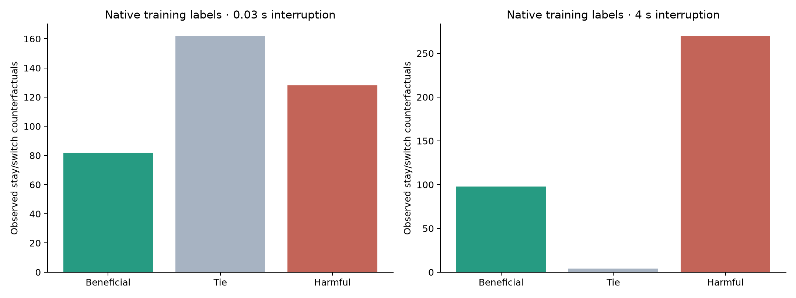
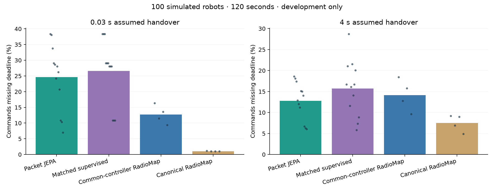
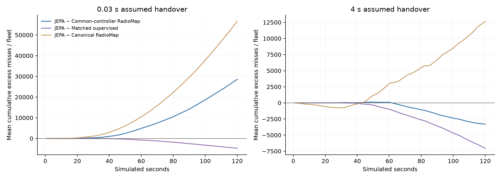

# Packet-action JEPA: native counterfactual evidence

This study tests an actual JEPA auxiliary objective against an otherwise matched supervised model and RadioMap. Native packet-state forks label one focal robot staying or switching once and committing for ten seconds. All methods share the same observable controller, scan mechanism and physical interruption costs.

The label corpus contains 930 observed action differences from 1,370 native packet runs, including 80 factual suffix replays. Label counts are reported separately for training and naturally sampled validation.

| Split | Handover seconds | Beneficial | Tie | Harmful |
|---|---:|---:|---:|---:|
| training | 0.03 | 82 | 162 | 128 |
| training | 4 | 98 | 4 | 270 |
| validation | 0.03 | 14 | 38 | 41 |
| validation | 4 | 13 | 0 | 80 |

An excluded pre-fitting pilot is preserved separately: **30 completed label cases, 1,021 recorded native runs and 691 action examples**. Its forced fast actions could remain pending ten seconds, while runtime proposals expire after one second. Its alternating robot counts also confounded density with drift, and both fork times used early history. These records are excluded from the final label, calibration, fit and confirmation counts. Before fitting or development/holdout access, an explicit protocol amendment aligned action expiry, balanced density across conditions and added a mature-history fork. Original pilot sources/data remain untouched.

## Rejected on development; confirmation not run

The label diagnostic passed and all six matched fits completed. The frozen controller was then rejected after all 64 development runs on 4 sites, 100 robots each and 120 seconds per run. **The original four primary comparisons and two additional promotion comparisons were NOT EVALUATED.** No confirmation confidence intervals are reported, no test source capsule exists and no holdout cases ran. This is a development rejection, not a failed independent confirmation.

Learned macro-controller suppresses necessary mobility; all learned policies are substantially worse than canonical RadioMap on development. Raw learned packet values also trail the numerical estimator. No fresh confirmation is warranted before a baseline-preserving controller contract is validated.

### Development: 0.03 second handover

| Method | Loss % | Mean roams / fleet | Worst-decile loss % | Max silence seconds |
|---|---:|---:|---:|---:|
| Packet JEPA | 24.598 | 10.08 | 65.492 | 100.49 |
| Matched supervised | 26.576 | 0.00 | 67.270 | 100.49 |
| Common-controller RadioMap | 12.698 | 51.25 | 55.514 | 100.49 |
| Canonical RadioMap | 1.045 | 275.00 | 1.369 | 1.89 |

Packet JEPA, all fitted seeds: 0: 265761.46 ppm, 1: 257970.83 ppm, 2: 214209.38 ppm.

Matched supervised, all fitted seeds: 0: 265761.46 ppm, 1: 265761.46 ppm, 2: 265761.46 ppm.

Packet JEPA: 135 eligible switch proposals among 13,200 committed robot decisions; 121 executed handovers. Validation corrections: 65.63, 82.26, 94.42 commands.

Matched supervised: 0 eligible switch proposals among 13,200 committed robot decisions; 0 executed handovers. Validation corrections: 74.10, 92.95, 113.10 commands.

Common-controller RadioMap: 507 eligible switch proposals among 4,400 committed robot decisions; 205 executed handovers. Validation corrections: 34.56 commands.

### Development: 4 second handover

| Method | Loss % | Mean roams / fleet | Worst-decile loss % | Max silence seconds |
|---|---:|---:|---:|---:|
| Packet JEPA | 12.780 | 56.00 | 30.712 | 33.65 |
| Matched supervised | 15.719 | 44.58 | 40.070 | 100.49 |
| Common-controller RadioMap | 14.158 | 46.00 | 41.654 | 51.10 |
| Canonical RadioMap | 7.515 | 120.75 | 18.513 | 29.02 |

Packet JEPA, all fitted seeds: 0: 133215.62 ppm, 1: 128423.96 ppm, 2: 121763.54 ppm.

Matched supervised, all fitted seeds: 0: 120626.04 ppm, 1: 153004.17 ppm, 2: 197925.00 ppm.

Packet JEPA: 712 eligible switch proposals among 13,200 committed robot decisions; 672 executed handovers. Validation corrections: 66.23, 82.15, 87.04 commands.

Matched supervised: 564 eligible switch proposals among 13,200 committed robot decisions; 535 executed handovers. Validation corrections: 77.64, 87.33, 89.67 commands.

Common-controller RadioMap: 203 eligible switch proposals among 4,400 committed robot decisions; 184 executed handovers. Validation corrections: 44.40 commands.

The failure exposes a control-interface problem: when empirical uncertainty corrections or the immediate-link guard reject a proposal, the new controller commits to staying and suppresses the canonical roaming policy. Its conservative rejection does not restore canonical recovery. Large missed-opportunity costs can therefore accumulate despite few executed switches. The same issue affects the numerical common-controller arm; development degradation cannot be attributed to JEPA alone. This mechanism is consistent with the observed counters; its individual causal contributions need a separate ablation.

The original controller, fits, calibration, sources and negative development trajectories remain unchanged evidence. A baseline-preserving rescue requires a separately versioned controller and acceptance record, development-only selection and a new pre-holdout seal. The unaccessed confirmation seeds are not successful tests of this rejected profile.

The stricter canonical-RadioMap criterion was committed before any fitting, development or holdout access in `acceptance_supplement.json` (Git commit `352c093`). It adds claim requirements without changing the controller, data or four original primary comparisons. Beating only the new shared-controller RadioMap cannot support a broad better-than-RadioMap claim.

## Validation diagnosis

This is a post-hoc explanation of development failure, not a newly selected controller or confirmation result.

| Handover seconds | Numeric MAE, commands | JEPA mean MAE | Supervised mean MAE |
|---|---:|---:|---:|
| 0.03 | 15.64 | 20.57 | 21.22 |
| 4 | 17.42 | 21.53 | 21.15 |

For JEPA seed zero at 30 ms, raw values and the immediate-link check admit 19 validation actions (11 beneficial, 8 neutral, 0 harmful). The unconditional +94.42-command correction leaves 0. This demonstrates suppression on those validation examples. It does not validate removing the correction or overriding canonical control.

The separate `ShadowPacketAdmission` interface returns the baseline mask unchanged and uses a bounded background worker. The qualification guard refuses this development-rejected profile. Neither safeguard activates learned switching or establishes a learned benefit; physical runtime deadlines remain unqualified. See `PACKET_VALUE_SAFETY.md`.

## Interpretation and physical limits

The one-radio, 90 ms scan and 50 ms command-deadline assumptions impose about one forced missed command per isolated scan. At five-second scanning this is approximately a 1% loss floor. Four-second handovers force 79–80 command misses when a complete interruption lies inside the evaluation interval. Overlapping scan and handover outages must not be counted twice. Raw absolute losses remain visible; this report subtracts no fixed floor.

Cumulative excess is a matched simulation comparison, not an online-observable counterfactual after policies diverge. A reservation ledger can account for modeled risk and known interruption exposure; it cannot undo earlier losses or guarantee realized regret. Ten-second commitment and immediate-link constraints are common to the numerical and neural methods, so their benefits alone do not establish JEPA necessity.

JEPA and supervised heads share the same inference graph and RadioMap route/physics assistance. The JEPA auxiliary target uses future observable local context only during training. Validation-only empirical corrections are heuristics, not proven conditional risk bounds. Inference and action-head queues are charged before proposals become visible. All physical scan/handover times remain assumptions.

These are native Python packet simulations using archived ns-3 PHY curves. The CAD family, precomputed motion, shared warm start, out-of-band pose/routes, reserved control-frame telemetry and modeled channels limit transfer. The corrected training corpus crosses stationary/drifting conditions with 24/100-robot densities and samples early and mature histories; it still covers only those two densities and the existing CAD family. No arbitrary-robot, protocol-agnostic, hardware, universal-JEPA, certified-risk or zero-loss claim follows.

The frozen design is in `PACKET_VALUE_DESIGN.md`; protocol, checkpoints, labels, per-robot trajectories, source capsules and weight identities are under `artifacts/packet_value/`. Earlier evidence trees are unchanged.
