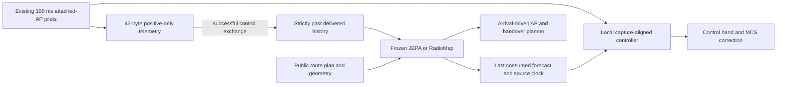

# Testing JEPA's route predictions and their use in local control

This study asks two separate questions: does the frozen JEPA forecaster predict
short route changes more accurately on identical inputs, and do better sensing
and forecast execution improve command delivery? An RF accuracy win does not
establish a command-delivery win.

## Why these changes

The completed freshness study found lower native route-delta error for JEPA,
but its models saw different delivered histories and queried at different times.
Its small mean bulk-throughput lead was uncertain, while RadioMap delivered
more commands. See [the passive diagnosis](JEPA_ADVANTAGES_DIAGNOSIS.md).

Two complementary changes address how either forecaster connects to the system:

1. **Positive pilot reports.** A successful modeled control exchange can carry
   43 bytes of existing attached-AP measurements within its existing 128-byte
   telemetry reservation. Capture time, position, AP and detected bands travel
   together. Unmeasured APs remain unknown. Reports enter the next usable
   history bin only after delivery; full scans take priority and replace whole
   rows, so measurements from different captures are never merged.
2. **Forecast-aware local execution.** At existing 100 ms pilot updates and new
   forecast arrivals, re-evaluate the last consumed forecast at its actual age.
   Anchor its current and future innovations to the measurement's actual capture
   time. Select a control band using the worst predicted SNR over the next five
   seconds, including interpolation corners. Reuse existing measurements and
   predictions; AP planning and costly handovers remain arrival driven.

The old controller already updates MCS, bulk bands and reflexes at 100 ms. This
change adds forecast-aware control-band selection and capture-aligned correction;
it does not introduce the first fast controller. Invalid or wrong-AP pilots hold
the previous band; valid pilots without a supported fresh forecast use a declared
myopic fallback. The original measured inference/issue costs remain charged.

## Frozen comparison

Both forecasters receive all four factorial arms: base, pilot reports, local
execution, and both together. Every arm retains the preceding study's latest-job
admission, single transmission with sequential retries, conditional full scans,
and paid four-second handovers. Neural weights stay fixed; causal map fitting
continues. No arm changes the default application or controls physical hardware.

Two development sites precede eight reserved confirmation sites, each with
100 simulated robots and 60 measured seconds after conditional warm history.
There are 96 native executions if development permits confirmation, including
eight exact offline and eight fresh measured-cost repetitions.

A separate offline test reuses one preselected public trajectory per site:
RadioMap with both upgrades. Each model receives identical canonical public
history prefixes, geometry and planned queries. Hidden unused observation
buffers are zeroed. Clean future labels live in a separate file and are loaded
after all 60 forecasts. Full predicted means and output hashes permit passive
metric recomputation. There are 22 matched sequences including two exact replays;
these do not add packet trials or independent sites.

## Decision rules

Four primary tests share a fixed familywise budget: combined versus base packet
loss within each family, combined JEPA versus combined RadioMap packet loss,
and matched JEPA versus RadioMap one-to-five-second route-delta SNR RMSE.
Whole-site bootstrap upper bounds use quantile 0.9875, not packet-level
pseudoreplicates. Packet claims also retain pending-command bounds and the
previous worst-decile, silence, video, bulk and mechanical gates. RF superiority
has its own accuracy flag and cannot substitute for packet qualification.

Development stops confirmation on a severe combined-arm loss regression or any
integrity failure. It does not select an arm or tune on RF outcomes. Four simple
effects, two main effects and one interaction per model remain descriptive.
Exact rules and seeds are in [the protocol](../artifacts/pilot_fastloop/protocol.json).

## Limits

Positive-only partial pilots are outside the frozen JEPA training distribution.
Control success and association select the observations. The hybrid JEPA and
strong RadioMap retain their original different fitting pipelines, so matched
results compare complete forecasters, not the necessity of the JEPA objective.
Three-band pilots, public position/plans and free intra-AP band changes remain
simulator assumptions. Local arithmetic is timed but not independently scheduled.
This study cannot establish hardware readiness, novel architecture, universal
advantage, lower inference cost or production safety.
