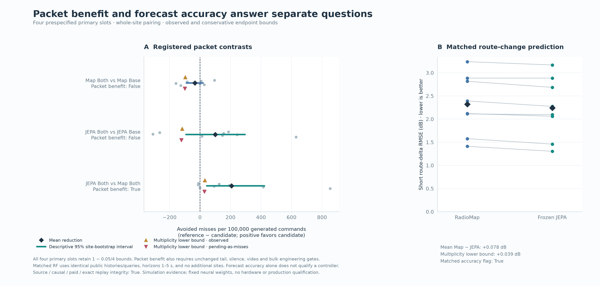
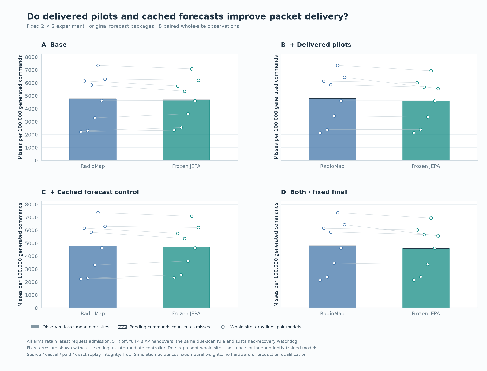
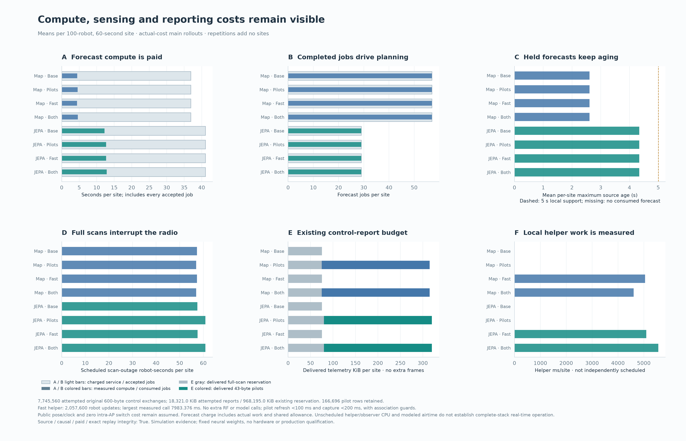

# JEPA's matched forecast and controller-package advantages

**The preselected combined JEPA package beats the equally augmented RadioMap package on the registered simulation service gate. JEPA also predicts short route changes more accurately on identical public inputs. Neither combined package qualifies as an improvement over its own base.** These are separate findings; the application default remains RadioMap.

## Qualified comparisons

Eight reserved procedural sites each contain 100 simulated robots, evaluated for 60 seconds after conditional 60-second warm history. Native handovers cost four seconds. Each native arm generates 960,000 commands across eight sites.

| Quantity | RadioMap | Frozen FleetJEPA | Interpretation |
|---|---:|---:|---|
| Combined-arm missed commands | 46,093 | **44,108** | **1,985 fewer; 4.31% relative reduction** |
| Combined-arm command loss | 4.801354% | **4.594583%** | Registered statistical and relative engineering gates pass |
| Matched 1–5 s route-delta RMSE | 2.318698 dB | **2.241152 dB** | **3.34% lower**, lower at all eight sites; separate primary passes |
| Matched absolute SNR RMSE | 6.691067 dB | 6.041932 dB | Descriptive secondary: 9.70% lower |
| Matched AP-choice regret | **0.428087 dB** | 0.477916 dB | Descriptive secondary favors RadioMap |

Four fixed primary tests share the full multiplicity budget: one-sided bootstrap upper quantile **0.9875**, 20,000 resamples of **whole paired sites**. Packets, robots, ensemble members and repetitions are not additional independent units. Packet tests also require the conservative pending-command endpoint and all predeclared engineering margins.

| Primary comparison, candidate minus reference | Mean difference | Adjusted observed upper | Adjusted pending upper | Engineering | Qualified result |
|---|---:|---:|---:|---|---|
| RadioMap combined − base | +0.034063 pp | +0.096771 pp | +0.100001 pp | Fails worst decile | No |
| JEPA combined − base | −0.099792 pp | +0.117095 pp | +0.122919 pp | Fails worst decile and silence | No |
| Combined JEPA − combined RadioMap | **−0.206771 pp** | **−0.031667 pp** | **−0.028021 pp** | Passes relative margins | **Simulation service benefit** |
| Matched short-route RMSE, JEPA − RadioMap | **−0.077546 dB** | **−0.039387 dB** | Fully observed | Separate RF endpoint | **Forecast accuracy advantage** |

The RF endpoint cannot qualify a controller. The cross-package service win also does not establish that adding the interventions improves either model. The report's all-four-primary flag is **false**; its cross-package packet and matched RF flags are **true**.

## What was built

Both forecasters receive the fixed 2×2 experiment: base, positive pilot reports, capture-aligned local forecast execution, and both together.

**Positive-only telemetry** serializes existing attached-AP measurements into 43 application bytes inside the already charged control exchange's 128-byte reservation. The decoded payload includes capture/refresh clocks, position, AP and heard-band identity. It adds no RF sampler or control frame. Payloads are frozen before delivery draws; only success populates the next usable history bin. Unmeasured links remain unknown. A later full scan replaces the entire pilot row rather than mixing captures. Legacy full scans retain their opaque reservation; no new on-air serialization claim is made for them.

**Local forecast execution** reuses the last consumed current-AP prediction at existing 100 ms simulation ticks and new forecast arrivals. Innovations use actual measurement capture time:

    near[h] = measured_pilot + f(source_age_now + h) - f(source_age_capture)
    current_MCS_correction = f(source_age_now) - f(source_age_capture)

The band choice uses the worst forecast SNR over the next five seconds, including every piecewise-linear interpolation corner. Invalid association/availability metadata holds the previous band; unsupported forecasts use a declared myopic fallback. AP planning and handover decisions remain arrival driven. Each correction is recomputed from a measurement and forecast, rather than integrated repeatedly. This clock alignment does not guarantee zero forecast error or bounded loss.

All arms retain latest-only inference admission, STR duplication off with sequential retries, conditional full 90 ms scans, ordinary handover admission and the sustained-available-silence watchdog. Existing faster MCS/reflex updates predate this feature. Neural weights remain fixed; causal map refits continue. See the [design](PILOT_FASTLOOP_DESIGN.md) and [frozen protocol](../artifacts/pilot_fastloop/protocol.json).

## Component results and engineering limits

| Native command loss | Base | Pilot | Fast | Combined |
|---|---:|---:|---:|---:|
| RadioMap | 4.767292% | 4.796667% | 4.771250% | 4.801354% |
| Frozen FleetJEPA | 4.694375% | 4.591146% | 4.696667% | 4.594583% |

Pilot-only JEPA has the lowest point mean, but it is not promoted after testing: the combined candidate was fixed beforehand. All 14 factorial simple/main/interaction contrasts remain descriptive. Fast reuse does not improve the recorded point means.

For combined JEPA versus combined RadioMap, conservative worst-decile loss is 12.964583% versus the reference's observed 13.639583%; maximum silence is 8.34 versus 8.36 seconds; original-video delivery is 90.991396% versus 90.953964%. Bulk is **462.03 versus 464.69 Mbps**, about **0.574% lower**. The 1% allowance passes, but zero deterioration fails. These absolute losses and silence levels do not establish acceptable robot service.

Against JEPA's own base, worst-decile loss rises 12.384375% → 12.959375%, and silence rises **8.24 → 8.34 seconds**, exceeding the 50 ms allowance. Lower mean command loss therefore does not qualify the intervention.

## Common-input forecasts and compute

Each site's reference is the preselected native RadioMap combined trajectory. Both forecasters receive identical strictly past canonical history prefixes, public geometry and planned queries at all 60 source times. Unused observation buffers are zeroed while preserving positive partial pilots. Private clean mean-field labels are separate and decoded only after each forecaster's complete sequence. Full predicted means and per-query standard-deviation hashes are retained. Labels follow the reference realized trajectory; plan/realization mismatch is shared.

This compares complete forecaster packages: the JEPA hybrid and strong RadioMap retain different map-fitting pipelines/priors. It does not isolate the self-supervised objective, establish map-free inference or prove arbitrary-layout transfer. Partial pilot masks/density are outside neural training distribution, and association/delivery selection bias remains.

Combined JEPA spends **12.870 s** of summed measured forecast elapsed work per trial versus RadioMap's **4.577 s**, about **2.81× more**, despite computing 29 rather than 57 forecasts. These sums are not CPU utilization or full-stack latency. Maximum held source age is 4.34 versus 2.61 seconds; source age differs from measurement age.

Local arithmetic is measured but not independently scheduled. The largest individual helper elapsed time is **7.983 s** in JEPA fast-only and **5.579 s** in combined JEPA. Wall times can include runtime/scheduling effects; 100 ms simulated invocation does not demonstrate real-time execution. The common 500 ms allowance, public pose and zero intra-AP band-switch cost remain assumptions. Forecast/issue work is fully measured and charged; all 2,752 accepted main-confirmation jobs are consumed, with no profile exceedance or causal/paid-cost failure.

## Verification and reproduction

All **96 native executions** are complete: 16 development, 64 confirmation, eight exact recorded-schedule offline replays and eight fresh actual-cost repetitions. All **22 matched streams** are complete: four development, 16 confirmation and two exact replays. Both offline replay sets are exact. Fresh-cost checks pass; seven fresh packet outcomes match and RadioMap base differs by two misses. Repetitions add no independent sites.

The [independent raw audit](../artifacts/pilot_fastloop/verification/raw_audit.json) reproduces native ledgers, pilot provenance, capture-aligned maximin/MCS arithmetic, inherited sensing/recovery/action checks, matched full-array metrics, replays, bootstrap results, engineering gates and reports. It runs no worlds, models, training or timing. Its explicit limits retain source/replay backing for full 10 ms recurrence, complete native forecast arrays and valid-pilot reflex operands unavailable in compact logs.

Scientific commit **f8821588456f4ca8873211d8157987f40e6a3928** seals 467 source/input files. Full preflight: **1,861 passed, one expected warning, 206.13 s**, with all 2,806 tested source/input identities unchanged.

A separate execution-only cache was published in **cc0199 / 8a01**, after development and before any completed confirmation case. Its **50 focused fixtures** pass. Original full development verification runs once per phase; every reuse checks original sources and all bound bytes/membership. Scientific source, models, criteria and paid schedules remain unchanged. Original launch, pause, resume, bootstrap and reuse receipts remain available. Independent raw auditing does not import the cache.

The [final verifier](../scripts/verify_pilot_fastloop.py) binds Git source, capsules, original evidence, actual test/launch receipts, raw audit, figures and documents. Recheck without running models:

    PYTHONPATH=src uv run --frozen python scripts/audit_pilot_fastloop.py
    PYTHONPATH=src uv run --frozen python scripts/verify_pilot_fastloop.py

Draft [PR #22](https://github.com/Danielfoojunwei/SDTH-submission-PreceptualAI/pull/22) is stacked on #21. RadioMap remains the default; no physical command or production activation is performed. Earlier cohorts/vetoes remain separate. This establishes no SOTA, architectural novelty, objective necessity, arbitrary-layout transfer or indefinite safety.

## Next experimental targets

1. **Decision and tail-risk training.** Improve AP-relative ranking/calibration and evaluate worst-robot losses and continuity alongside mean RF error. Worse matched AP regret is a diagnostic, not proof of what causes native losses.
2. **Delivered partial observations.** Train with the new masks, capture clocks and association/delivery selection; include a matched supervised comparator and identical numerical prior to isolate representation value.
3. **Bounded execution.** Profile/batch feature and control work, bound diagnostic logging, and measure latency tails before real-time claims. Lower inference work and hardware validation remain open.

These are next targets, not additional validated improvements.
