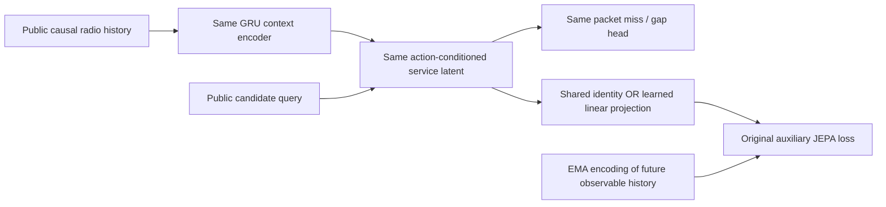

# A projection repairs future matching, without a consistent service gain

The preregistered six-fit experiment completed. A training-only linear projection
substantially improves JEPA's auxiliary future prediction while retaining target
variance and effective rank. **It does not consistently improve packet-service
prediction:** two of three seeds have higher validation miss and gap MAEs.
This repair is not qualified for control or deployment.

## The controlled change



The original packet objective is reused unchanged: service regression, likelihood,
directional term, auxiliary Smooth L1, context variance regularization and EMA.
The service head consumes its latent **before** projection. Projection executes
only during auxiliary training or explicit future-prediction diagnostics. It is
absent from evaluation-time service inference.

The projected variant adds a 48×48 linear weight and 48 biases: **2,352 additional
trainable parameters**, initialized to identity and zero bias. Both variants
retain **23,860 inference parameters**. The identity control has no extra learned
projection parameters, so training capacity is **not matched**. This experiment
does not isolate decoupling from additional auxiliary training capacity.

This is motivated by the established use of separate pretext/task representation
spaces. It uses no DINO/DINOv3 checkpoint, image embedding or visual features, and
makes no architecture-novelty or SOTA claim.

## Registration and execution

The exact [protocol](../artifacts/representation_repair/registration/protocol.json), training
implementation, runner and tests were committed as **`74c01c7` before the six
experimental fits**. The [preregistration manifest](../artifacts/representation_repair/preregistration.json)
then froze the source and data hashes before any experimental optimizer step.
Functional tests included a separate one-minibatch integration check; its weights
were discarded and never used by the experiment.

The registration now lives under `registration/` because this is explicitly a
**reuse study of existing exposed training/validation**, not an independent new
scene cohort. The older packet study's unchanged seed-integrity checks treat
top-level `artifacts/*/protocol.json` files as independent cohorts and correctly
reject overlapping scene identities there. Nesting this reuse registration
preserves every actual scene identifier and its meaning; it does not rename
data or claim an independent evaluation.

The [layout migration receipt](../artifacts/representation_repair/layout_migration.json)
records the move and the identical protocol SHA-256 before and after it. Original
preregistration, executed-source copies, six checkpoints, epoch logs, fit receipts
and completion remain byte-for-byte unchanged. The earlier verification is
preserved as [verification_at_execution.json](../artifacts/representation_repair/verification_at_execution.json):
its statement that then-current sources matched execution refers to that time.
The current archive-support runner and tests have since changed and are reported
as such; the model implementation remains byte-identical to execution.

- Original 744 training examples and 186 **already exposed validation** examples.
- Both variants retrained from matching common initialization and matching
  minibatch order for each fixed seed: 0, 1 and 2.
- Forty epochs, batch size 64, AdamW learning rate 0.001, weight decay 0.0001,
  gradient clip 5, original JEPA/variance weights and EMA momentum.
- **Fixed epoch 40** for every fit. Validation logs choose no checkpoint, seed,
  hyperparameter or extra run. These shared controls are newly trained final-epoch
  controls, not the older validation-selected checkpoint artifacts.
- Six real CPU fits, one Torch thread, **12.98 seconds total measured fit wall
  time**. Every fit retains its checkpoint, 40-row epoch log and detailed receipt.

All source and input identities remain verifiable. Original packet checkpoints,
input archives, receipts and archived source were not edited. No original
reserved holdout was read. All data is simulated warehouse traffic; no native
closed-loop control evaluation or physical SmartCar experiment was performed.

## Future matching improves without target collapse

The denominator is the error of the **final training EMA-target mean**, evaluated
on validation. A validation mean is never substituted. Each variant learns its
own EMA target, so raw cross-variant latent MSE by itself is not comparable.

| Seed | Shared future MSE / constant | Projected future MSE / constant | Projected/shared target RMS on validation | Projected/shared target effective rank on validation |
|---|---:|---:|---:|---:|
| 0 | 1.546 | 0.574 | 1.029 | 1.009 |
| 1 | 1.501 | 0.553 | 1.005 | 0.978 |
| 2 | 1.821 | 0.613 | 0.996 | 1.009 |
| Mean across the three fixed seeds | 1.623 | 0.580 | — | — |

All three seeds improve normalized future MSE. The preregistered guard requires
both target centered RMS and effective rank to remain at least 0.8× shared,
separately on training **and** validation. All seeds pass. Across both splits,
the lowest target-RMS ratio is 0.996 and the lowest rank ratio is 0.976.
Projected validation target effective rank remains **7.11–8.07**, with centered
RMS **0.791–0.851**. The lower error is therefore not explained by constant or
greatly shrunken EMA targets under this guard.

Smooth L1 also decreases for every seed: shared **0.436–0.470**, projected
**0.185–0.198**. Full context, service-action, projected-action and teacher
variance/rank statistics appear in the fit receipts.

## Packet-service prediction does not consistently improve

Positive differences below mean worse prediction after adding projection.
Metrics retain missed-command counts and gap seconds as separate units.

| Seed | Shared miss MAE | Projected miss MAE | Miss MAE change | Shared gap MAE, seconds | Projected gap MAE, seconds |
|---|---:|---:|---:|---:|---:|
| 0 | 24.842 | 26.118 | +1.276 | 0.725 | 0.764 |
| 1 | 22.907 | 22.922 | +0.015 | 0.753 | 0.763 |
| 2 | 22.218 | 22.089 | −0.129 | 0.730 | 0.703 |
| Mean across the three fixed seeds | 23.322 | 23.710 | +0.387 | 0.736 | 0.744 |

The preregistered descriptive service gate—both MAEs nonincreasing for every
paired seed—**fails**. Better future matching alone did not deliver the desired
service benefit. Small differences, especially seed 1, should not be treated as
statistically resolved harm; these are descriptive values on four exposed
validation scenes. Both handover-cost strata and RMSEs are retained in every
receipt, without selecting a favorable cost or seed.

The result narrows the diagnosis. The old joint latent could match future
observations much better with a separate auxiliary projection, but that target
space is not sufficient by itself to improve service decisions. The next useful
experiment should test whether predicting **decision-relevant physical state and
conditional service risk**, with explicit action-conditioned dynamics and known
physics anchoring, improves actual decisions. More future-latent accuracy or
more coordinate variance is not a substitute for that outcome.

## Verify the archive and reproduce original fitting

```bash
OPENBLAS_NUM_THREADS=1 OMP_NUM_THREADS=1 MKL_NUM_THREADS=1 \
  uv run --frozen python scripts/train_representation_repair.py
uv run --frozen python -m pytest tests/test_representation_repair.py -q
```

The **current runner is a read-only archive verifier**. It checks the original
registered source copies against both their frozen hashes and Git commit, checks
the unchanged data/receipts and all six checkpoints, recomputes every saved metric
exactly, and reconciles the epoch logs and final summary. It runs zero optimizer
steps and reuses the historical completed fits. It separately reports current
runner/test hashes instead of claiming these updated support files are the old
executed sources. An optional `--output` writes a new verification JSON while
protecting historical evidence from overwrite.
The [current verification](../artifacts/representation_repair/verification.json)
records these separate identities and the exact recomputation result.

To reproduce **optimizer execution** independently, use a clean checkout at
preregistration commit `74c01c7` with the original immutable packet data and no
generated repair outputs. That original committed runner, also retained under
`executed_source/`, creates its manifest before fitting. Current post-migration
support refuses to start a new experiment without that original layout rather
than silently retraining or replacing the archive.

The [completion record](../artifacts/representation_repair/completion.json)
links all six checkpoints and the fixed descriptive gates. Fit receipts under
`artifacts/representation_repair/fits/` include actual epoch histories, source and
input hashes, separate training/validation metrics, per-cost results, latent
statistics, wall times and explicit limits. Eight tests verify the auxiliary-only
graph, exact identity initialization, parameter accounting, original-loss gradient
flow with a frozen EMA teacher, finite fitting on real saved training examples,
native-unit metric reconciliation and the collapse guard. Seven additional
post-execution tests cover read-only archive verification, unchanged model source,
exact nested registration/data identities, tamper rejection, reserved-scene
rejection and refusal to start unregistered training: **15 current tests total**.
