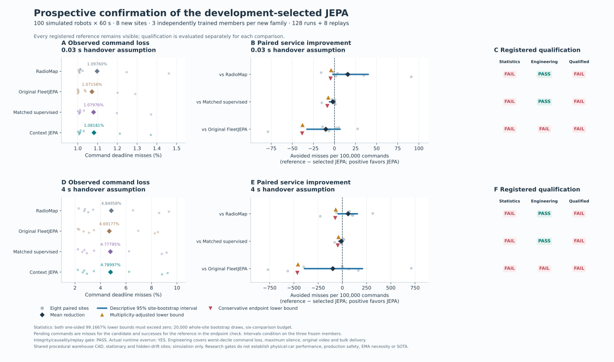
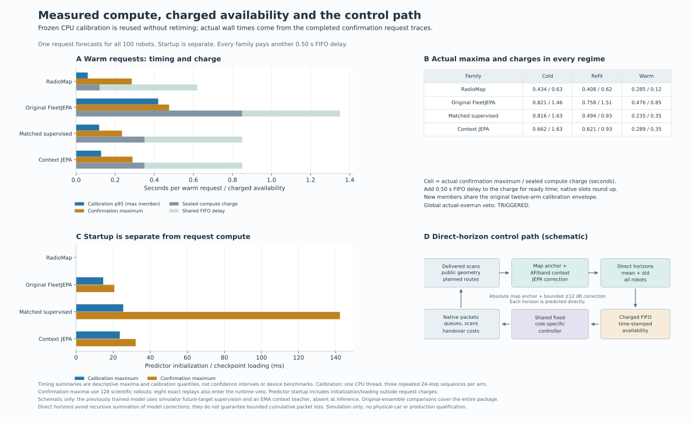

# Compact context JEPA: completed independent confirmation

**The new compact context-JEPA does not establish a service advantage.** Its mean command loss is slightly below RadioMap, but every registered statistical comparison fails. Matched supervised training and the original frozen JEPA ensemble have lower observed means. A measured timing overrun also triggers the prespecified global qualification veto. RadioMap remains the application default.

The work completes **12 fits across four families and three paired training seeds, 112 development evaluations, 128 fresh confirmation evaluations and eight exact replays**. Every evaluation has 100 simulated robots. These are procedural warehouse simulations, not physical SmartCar trials.

## What was fixed and built

The [model design](SEMANTIC_JEPA_DESIGN.md) retains AP and band identity, six causal scans, fleet memory, public geometry and planned routes. A compact radio-innovation branch complements the scan encoder. Each horizon is decoded directly around RadioMap with a bounded correction:

`mean[h, ap, band] = map_mean[h, ap, band] + 12 × tanh(head[h, ap, band])`.

Predicted residuals are never recursively summed. This prevents that particular accumulation mechanism; it does not bound the map's error or cumulative packet loss. All four trained families share **13,970 inference parameters**, common route/AP/forecast losses and paired initialization. Training-only teachers and projection heads do not run during forecasting.

Training observations come from actual native simulated scanning, outages, fading/blockage, successful report delivery and forecast queues. Future-context targets use genuine subsequent delivered histories. Every family also receives common simulator SNR supervision; the overall model is not label-free. The [original semantic-JEPA study](SEMANTIC_JEPA_RESULTS.md) preserves all four objective ablations and its negative result.

## Selection and fresh data boundaries

The original semantic candidate failed development at both costs, so its eight `2104000`–`2104007` reserved sites remain unused. A [separate selection](SELECTED_JEPA_DESIGN.md) chose context JEPA over semantic JEPA on the already observed development results, using an exact, equal-cost mean loss ratio to RadioMap. Supervised had the best development mean and remained a primary comparator. All three context-JEPA and supervised members were fixed; no best-seed selection occurred.

The new source, checkpoints, selection, timing profiles and [protocol](../artifacts/selected_jepa/protocol.json) were published in `f5c69d55cf110578f7c48de96899a5879bb9f106` before opening eight new sites, `2114000`–`2114007`. This registration precedes only the new confirmation, not the source training/development study. There was no additional fitting, timing calibration or controller tuning.

Each new site runs three separately acting context-JEPA members, three matched supervised members, RadioMap and the original three-member JEPA ensemble at both costs: **128 cases**. Members are averaged within site for analysis; this is not a new ensemble policy. The first site supplies **eight actual exact replays**, matching forecasts, telemetry deliveries, actions and packet results.

## Fresh command-delivery results

Lower loss is better. Means average eight whole sites after the paired training members are averaged within each site.

| Forecast family | Command loss: 30 ms handover | Command loss: 4 s handover |
|---|---:|---:|
| RadioMap | 1.097604% | 4.849583% |
| Original frozen JEPA ensemble | **1.071562%** | **4.691771%** |
| Matched compact supervised | 1.079757% | 4.777951% |
| Selected compact context JEPA | 1.081806% | 4.789965% |

The original ensemble has the lowest observed means in this cohort. Its difference includes data, model, map-prior and deployment configuration; this is not an isolated architecture or objective comparison, nor a post-test promotion of that reference.



[Standalone PDF](../artifacts/selected_jepa/figures/confirmation.pdf). Site points are the independent units. Descriptive 95% intervals and multiplicity-adjusted bounds have different meanings and remain separately labelled.

All six comparisons share the registered one-sided upper quantile `1 − 0.05/6`, using 20,000 whole-site bootstrap draws. Both observed and conservative unresolved-command contrasts must support improvement. The table below uses **percentage points**, with negative differences favoring context JEPA; its 95% intervals are descriptive, not the multiplicity-adjusted success rule.

| Handover | Reference | Mean difference, pp | Descriptive 95% interval, pp | Statistical gate | Engineering gate | Qualified |
|---|---|---:|---|---|---|---|
| 30 ms | RadioMap | −0.015799 | [−0.040069, +0.001944] | Fail | Pass | No |
| 30 ms | Matched supervised | +0.002049 | [−0.000347, +0.005972] | Fail | Pass | No |
| 30 ms | Original JEPA | +0.010243 | [−0.006632, +0.032708] | Fail | Fail | No |
| 4 s | RadioMap | −0.059618 | [−0.155174, +0.043924] | Fail | Pass | No |
| 4 s | Matched supervised | +0.012014 | [−0.005000, +0.034306] | Fail | Pass | No |
| 4 s | Original JEPA | +0.098194 | [−0.208510, +0.391042] | Fail | Fail | No |

Every descriptive interval already spans zero, and every multiplicity-adjusted observed and endpoint upper bound is positive. The experiment establishes neither superiority over RadioMap, matched-objective advantage nor improvement over the original JEPA. The [complete report](../artifacts/selected_jepa/report.md) and [machine-readable analysis](../artifacts/selected_jepa/report.json) retain adjusted bounds, individual members, crossed site/member intervals and cumulative losses.

Engineering margins pass against RadioMap and matched supervised at both costs. Against original JEPA, the 30 ms worst-decile check fails. At four seconds, maximum silence is **20.73 s versus 14.41 s**, and bulk delivery is **462.803 versus 469.286 Mbps**, failing the silence and 99%-retention margins. Finite silence and these empirical margins are not safety guarantees.

## Timing veto is retained

At site `2114005`, 30 ms handovers, RadioMap decision 10 took **284.938 ms** for a warm prediction against its sealed **120 ms** compute allowance. The simulation charged 620 ms including the separate common 500 ms delay. The registered overrun rule compares measured prediction time with the sealed compute allowance, and any main-run or replay overrun vetoes every qualification. The run remains in the evidence; its cause was not isolated.

All six statistical gates fail independently of this timing veto. A timing repair alone would therefore not rescue a superiority claim.



[Standalone PDF](../artifacts/selected_jepa/figures/timing-and-control.pdf). Warm compute charges are 120 ms for RadioMap, 350 ms for every new single member and 850 ms for the old ensemble, plus the common 500 ms delay. New-member cold charge is 1,630 ms, versus 630 ms and 1,460 ms respectively. Startup/loading is measured separately. The new model has a lower warm charge than the ensemble, but a higher cold charge and no demonstrated service superiority.

## Representation health across all validation sites

A separately derived, **post-hoc descriptive audit** now reads all **1,152 existing validation rows across six sites**, for context JEPA and supervised, all three seeds. It neither opens new sites nor changes weights, selection or qualification. It uses streaming population covariance over all valid tokens without subsampling or synthetic perturbations.

All measured context, radio, link and predictor streams are finite and nonconstant in every site/band/member group. For context JEPA, the following ranges cover **54 groups** per component: six sites × three bands × three training members.

| Component | Mean coordinate standard deviation | Centered entropy effective rank |
|---|---:|---:|
| Scan-context encoder | 0.235–0.491 | 3.19–5.58 |
| Two-coordinate radio branch | 0.371–0.596 | 1.65–2.07 |
| Combined link representation | 0.389–0.605 | 2.85–6.18 |
| Horizon predictor | 0.354–0.797 | 3.37–8.87 |
| Active EMA context teacher | 0.236–0.491 | 3.19–5.52 |

Supervised representations have similar ranges. These measurements rule out an all-constant representation on the audited inputs; they do not establish that all useful wireless distinctions survive. Geometry, AP identities, masks and horizons can produce variation, and a nonlinear embedding of two radio scalars need not have high effective rank. Validation was already used for checkpoint selection, tokens are correlated, and no RF-causal or global anti-collapse guarantee follows. The [full diagnostic](../artifacts/semantic_jepa/diagnostics/full_validation_representations.json), [receipt](../artifacts/semantic_jepa/diagnostics/full_validation_representations.receipt.json) and [audit code](../scripts/audit_semantic_representations.py) preserve the scope.

The service results do not support attributing the remaining failure solely to representation collapse. Better forecast/latent losses have not yielded robust service gains. Missing future MAC busy-airtime/resource state and delayed forecasts remain explicit limitations, not experimentally isolated causes.

## Reuse and verification

The actual research forecaster is `wirelessjev.semantic_jepa.runtime.Predictor(public_geometry, "context_jepa", training_seed=0)`. Its `step(delivered_past, planned_xy)` accepts public observable history and returns SNR mean, spread, fit regime and measured compute time. It has no future-truth argument and does not activate a controller. Spread is not a calibrated packet-risk probability.

The full repository suite passes **895 tests**, with one expected fork-misuse warning. The original study's archived pre-data suite has 838 passing tests. These are software checks, not model or hardware qualification. Verify the completed reports and manifests without new simulation or fitting:

```bash
uv run --frozen python scripts/verify_semantic_jepa.py
uv run --frozen python scripts/verify_selected_jepa.py
```

The source commits must be present locally. Optional `--verify-caches` on the original verifier checks existing local NPZ bytes; it never rebuilds data. The [selection record](../artifacts/selected_jepa/selection.json), [completion receipt](../artifacts/selected_jepa/completion.json), [raw archives](../artifacts/selected_jepa/cases/) and [figure receipt](../artifacts/selected_jepa/figures/receipt.json) retain the actual evidence.

Shared procedural CAD, conditional warm starts, privileged simulator labels, assumed scan/handover capabilities and finite one-minute episodes limit transfer. No physical car was commanded. Hardware, production, SOTA, novelty, protocol transfer and indefinite cumulative-loss guarantees remain unestablished.
