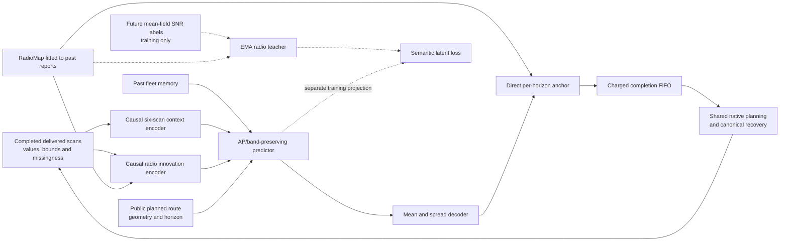

# Decision-aligned radio JEPA

This opt-in research model builds on the fleet forecaster, the implemented JEPA line with the strongest previous warehouse-service evidence. Its task is direct prediction of the future AP × band SNR field from causal scans, a radio-map anchor and planned motion. A successful auxiliary loss is insufficient: evaluation measures actual simulated command delivery after sensing, reporting, handover and inference costs.

## Architecture and information boundaries

The compact encoder preserves AP and physical band identity, pools bands within an AP, and retains a masked fleet summary. The radio path encodes the latest genuinely heard reading among six past timestamps. Where none exists it uses the map for its semantic estimate; the original scan/heard masks remain explicit. Imputation does not create an observed measurement.

The teacher receives two quantities: `(truth − map_mean)/10` and `(truth − 5 dB)/10`. The latter is a fixed absolute SNR representation anchor, not an AP-switching gain or calibrated PHY risk. Known geometry/horizons enter the predictor query, not the radio-only teacher. All families receive these same simulator SNR labels in their supervised loss. No additional actual future position enters the semantic teacher. This is **privileged supervised semantic JEPA**, not observation-only or label-free pretraining.

The online radio encoder participates in ordinary inference and learns through the forecast head; its EMA teacher therefore tracks an actually trained encoder. Separate projection prevents the service decoder's coordinates from being forced to equal teacher coordinates. Common supervised losses cover mean-field SNR, spread, route changes and AP scores. Band-conditioned variance regularization applies equally to every family and skips unsupported or constant-radio groups. Rank and sensitivity diagnostics are evidence to inspect, not collapse guarantees.

Every horizon is decoded directly:

`forecast[h, ap, band] = RadioMap[h, ap, band] + 12 × tanh(head[h, ap, band])`.

There is no recurrence that sums earlier predicted corrections into later outputs. The correction is pointwise bounded by 12 dB; the map's error is not bounded by that fact. Closed-loop cumulative missed commands and distribution shift can still worsen. No indefinite stability or safety bound follows.

## Matched experiment

Four families share the same inference graph, initialization, common losses, training examples and minibatch order for each paired seed:

| Family | Additional training target |
|---|---|
| Supervised | No auxiliary prediction |
| Context JEPA | EMA embedding of the future six-scan context |
| Semantic auxiliary | Direct regression to the two radio-semantic quantities |
| Semantic JEPA | EMA embedding of those radio-semantic quantities |

All auxiliary coefficients are fixed at 0.1 before data, with three independent training seeds and twelve fits. Checkpoint selection uses the same validation criterion. Semantic regression separates the benefit of a useful clean target from the semantic-JEPA training package; this experiment cannot isolate EMA necessity from all target-parameterization differences.

Training observations are collected using the native numerical controller, actual simulated scan completion, radio outages, channel fading/blockage, reporting and forecast FIFO. Collection lasts thirty seconds beyond the queried training interval so the context-JEPA control has genuine future observations. Its fixed collection compute profile is a declared data-collection policy, not measured hardware qualification. Training is balanced across costs; the six validation collections have four fast and two slow runs. Collection follows a fixed numerical behavior policy, so learned-policy observation shift remains possible. The shared sixty-second warm start and public localization/plans remain assumptions. Simulator mean-field truth is appended separately as a label only after input construction.

Evaluation uses 100 simulated robots, actual delivered reports, and separately timed single-member forecasts. All twelve new members share one conservative measured cold/warm/refit envelope, sealed before development. The optimized learned-prior RadioMap and original frozen three-member fleet model receive their own measured costs; the latter retains its original API/map prior as a secondary practical comparator. Model startup is reported separately. Forecasts become available only after their charged FIFO completion and are advanced by age.

The fixed controller uses the existing outage-budget admission at 30 ms and the thirty-second outage-utility surrogate at four-second handovers. Both retain canonical recovery and share settings across methods. The fast admission rule has its historical coarse horizon integration; it is not an exact fractional-outage calculation. The experiment holds the MAC model fixed and adds no new busy-airtime forecast to planning.

## Claims and stopping

The [protocol](../artifacts/semantic_jepa/protocol.json) fixes fresh training, validation, calibration, development and confirmation sites. Development is a descriptive veto: a candidate must improve mean loss over RadioMap and supervised, be no worse than the other controls, and satisfy declared service/timing margins before that cost's reserved confirmation opens. The runner recomputes this verdict from verified raw archives rather than trusting an editable success flag.

Confirmation uses whole sites after averaging the three paired training members, retaining the full eight-comparison multiplicity budget. A secondary crossed site/member interval and individual-seed results expose training variability without counting members or robots as independent sites. Strict improvement must survive worst-case unresolved-command assignments. Worst-decile loss, maximum silence, original video demand, bulk throughput, timing, source integrity and exact replays all remain visible. Margins are explicitly empirical research thresholds.

The model is proposal-only research. RadioMap remains the application default. Hardware timing, other warehouse layouts, production risk calibration, protocol transfer and reliable indefinite operation require separate evidence. No SOTA, architectural novelty, physical-car improvement or foundation-model claim is established by implementation or passing software tests.
