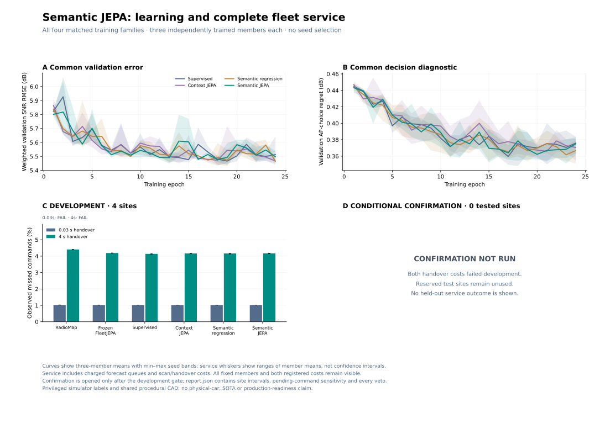
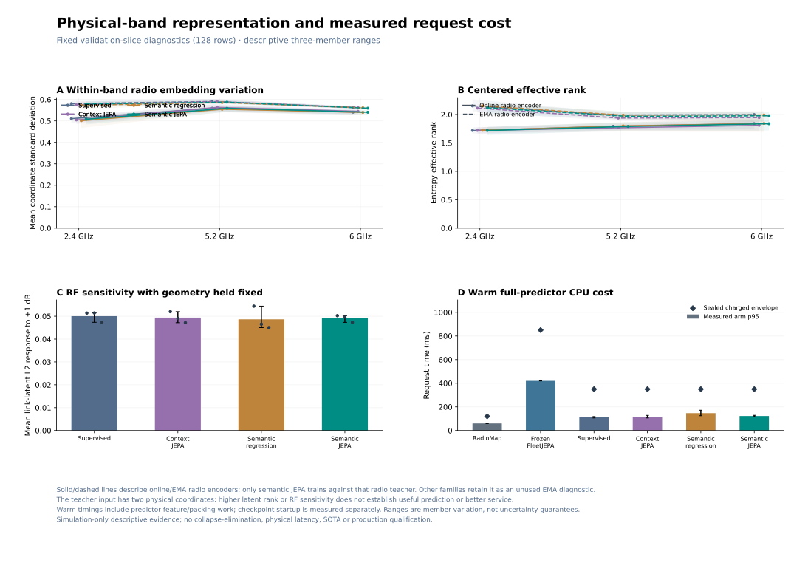

# Semantic JEPA: completed training and development rejection

**The matched supervised model has the lowest development mean command loss at both handover costs. The new semantic-JEPA candidate fails its registered comparison against the matched controls.** Its original confirmation was therefore not run. This study establishes neither a JEPA advantage nor a replacement for the application’s RadioMap default.

All **12 fits** completed: four training families, three independent training seeds, and 24 epochs per fit. All **112 development evaluations** completed on four procedural site instances with 100 simulated robots for 60 seconds per run, at assumed 30 ms and four-second handovers. There are **zero original confirmation evaluations and zero confirmation replays**. The eight reserved original sites, `2104000`–`2104007`, remain unopened.

The source and protocol were committed before collection or fitting in [`9ff5fa5`](../artifacts/semantic_jepa/registration/git.json). The runner preserves the development veto rather than changing the auxiliary weight, controller or criteria after observing outcomes.

## Actual command delivery

These are descriptive development means, including scan, reporting, handover and charged forecast costs. Lower loss is better. Each new family averages its three independently trained members within each of the four sites. Training members, robots and packets are not extra independent sites.

| Forecast family | Command loss, 30 ms handover | Command loss, 4 s handover |
|---|---:|---:|
| Optimized learned-prior RadioMap | 1.022292% | 4.406667% |
| Frozen original FleetJEPA ensemble | 1.021458% | 4.189792% |
| Matched supervised | **1.019931%** | **4.138056%** |
| Context JEPA | 1.020069% | 4.162361% |
| Direct semantic regression | 1.020139% | 4.164306% |
| Semantic JEPA | 1.020278% | 4.169722% |

The new model architecture’s supervised control is strongest on mean command loss in this cohort. Both JEPA variants have lower observed means than RadioMap and the frozen old ensemble, but they trail the matched supervised model. Development means cannot establish independent statistical superiority. These percentages are not directly comparable with the earlier managed-interference probe study, which used a different mission and workload. At 30 ms, semantic JEPA’s difference from supervised amounts to five additional misses across the balanced new-family development runs; the small ordering is not evidence of a large or robust effect.

The frozen original FleetJEPA reference runs its existing three-member ensemble as one practical comparison. The twelve new single members are evaluated separately. Those are different deployment configurations; this experiment does not attribute their difference solely to a JEPA objective.



[Standalone PDF](../artifacts/semantic_jepa/figures/learning-and-service.pdf). Shaded learning bands and service whiskers show the three-member minimum and maximum, **not confidence intervals**. The empty confirmation panel represents an unrun experiment, not zero command loss.

## Why the registered gate rejected semantic JEPA

At each cost, the candidate had to improve mean command loss over RadioMap and supervised, be no worse than context JEPA and direct semantic regression, and satisfy the declared engineering margins before confirmation could open.

| Handover assumption | Mean loss versus RadioMap | Mean loss versus matched learned controls | Engineering margins | Decision |
|---|---|---|---|---|
| 30 ms | Better observed mean | Worse than all three | Pass | Development veto |
| 4 s | Better observed mean | Worse than all three | Fail | Development veto |

At four seconds, the worst-decile margin fails against all three matched learned controls. Semantic JEPA’s observed worst-decile loss is **13.56528%**, versus **13.42014%** for supervised and **13.11944%** for context JEPA. The registered comparison conservatively counts candidate pending commands as misses. Bulk-delivery margins also fail against RadioMap and context JEPA: semantic JEPA delivers **414.968 Mbps**, versus **423.023 Mbps** and **419.407 Mbps**, respectively. Maximum-silence and original-video margins pass against all four primary references. The 30 ms engineering checks pass with the registered margins; zero-margin results remain separately available.

Development source/accounting integrity passes, and no runtime overrun was recorded. These successful software checks do not overturn the service veto. `confirmation.json` contains an empty replay list; its empty-set `all_exact` flag is **not evidence of an executed replay**.

The original report consequently contains no confirmation confidence intervals, no primary confirmation results and no test-site measurements. The [complete report](../artifacts/semantic_jepa/report.md), [machine-readable metrics](../artifacts/semantic_jepa/report.json), [raw case archives](../artifacts/semantic_jepa/cases/) and [recomputed qualification receipt](../artifacts/semantic_jepa/qualification.json) retain every member and outcome.

## Prediction quality did not settle service quality

The same validation score selects a checkpoint within every fit: weighted mean-field SNR RMSE plus 0.5 times AP-choice regret. The table averages those selected checkpoints over all three training seeds. Ranges describe seed variation on validation data used for checkpoint selection; they are not unseen-test intervals.

| Family | Validation RMSE, mean [seed range], dB | AP-choice regret, mean [seed range], dB |
|---|---:|---:|
| Supervised | 5.4516 [5.4415, 5.4650] | 0.3729 [0.3620, 0.3808] |
| Context JEPA | 5.4477 [5.4338, 5.4581] | 0.3724 [0.3605, 0.3803] |
| Direct semantic regression | 5.4442 [5.4308, 5.4609] | 0.3640 [0.3535, 0.3693] |
| Semantic JEPA | 5.4503 [5.4381, 5.4676] | 0.3646 [0.3561, 0.3782] |

Semantic regression has the lowest mean validation RMSE and AP-choice regret, while supervised has the lowest mean development command loss. The semantic-JEPA objective supplies no consistent advantage over either matched control. These findings do not prove that every JEPA target or architecture fails.

## What was actually trained

The [design](SEMANTIC_JEPA_DESIGN.md) preserves AP and band identity, a causal six-scan context, a radio-innovation path, per-AP cross-band pooling, masked fleet context and public planned-route queries. All four new families share the same inference graph and initialization for each paired seed. Their common supervised losses cover mean-field SNR, spread, route changes and relative AP scores; the auxiliary coefficient is fixed at **0.1**.

The families differ only in their additional training objective: none, an EMA future-context target, direct two-coordinate semantic regression, or an EMA radio-semantic target. The semantic teacher receives `(truth − map_mean)/10` and `(truth − 5 dB)/10`, using the same simulator future SNR labels supplied to every family’s common loss. The second coordinate is a fixed absolute SNR anchor, not relative AP gain or calibrated PHY risk. No extra actual future geometry reaches this teacher. This is **privileged supervised semantic JEPA**, not label-free pretraining.

All new members use **13,970 inference parameters**. Each full stored model contains **18,436 parameters**, including training-only components; **15,092** are trainable. EMA encoders, projection and semantic-regression heads do not run during forecasting. They remain allocated in every family, avoiding different inference architectures across the objective ablations.

Each horizon is decoded directly as `map_mean + 12 × tanh(correction)`. The model does not recursively sum predicted residuals. The pointwise 12 dB correction cap does not bound map error, prevent every bad decision or guarantee bounded cumulative missed commands.

Training uses **6,144 examples from 32 sites**, with **1,152 validation examples from six separate sites**. Future observable-context targets come from completed native collection with actual simulated scanning, outages, channel variation, successful-control report delivery and forecast completion. Mean-field simulator truth remains a separate training label. The sum of the twelve fit elapsed times is **2,008.66 seconds**, about 33.5 minutes; this is not total collection/evaluation wall time or a matched FLOP budget.

## Representation and compute evidence



[Standalone PDF](../artifacts/semantic_jepa/figures/representation-and-cost.pdf). Diagnostics use the same fixed first 128 validation rows for every fitted model. They do not create an additional site-level test.

For semantic JEPA, online radio-coordinate standard deviation ranges from **0.4839 to 0.5697** across bands and seeds, with centered effective rank **1.6377–1.9005**. EMA radio-target standard deviation is **0.5542–0.5951**, with effective rank **1.8755–2.1929**. Holding geometry fixed, a +1 dB change in genuinely heard measurements produces a positive mean radio-latent L2 response of **0.0473–0.0502**.

These probes show varying, RF-sensitive radio representations in the measured slice. They do not establish that representation concentration caused the service failure, that all relevant wireless distinctions survived, or that collapse has been eliminated. The radio teacher has two physical input coordinates; increasing latent rank is not itself a control objective. Other families’ EMA radio encoders are diagnostic copies, not the teachers used by their training objectives.

All twelve new members share the same conservatively sealed computation charges. Every arm also pays the same additional **500 ms** completion delay. Cold/refit regimes include their respective map/input work; checkpoint startup is measured separately.

| Runtime configuration | Cold charge | Warm charge | Refit charge |
|---|---:|---:|---:|
| Optimized RadioMap | 630 ms | 120 ms | 620 ms |
| Every new single member | 1,630 ms | 350 ms | 930 ms |
| Frozen original FleetJEPA ensemble | 1,460 ms | 850 ms | 1,510 ms |

Measured warm full-predictor p95 is **59.57 ms** for RadioMap and **420.26 ms** for the frozen ensemble. Across the twelve new members it ranges from **106.28 to 171.75 ms**; semantic JEPA’s three-member mean of these p95 measurements is **122.47 ms**. Identical new inference graphs and a shared charged envelope prevent interpreting incidental family timing differences as an architectural speed advantage. These CPU measurements are not physical-car deadline qualification, and no orders-of-magnitude compute claim follows.

## Scope and subsequent work

The original experiment is complete and rejected at development. A separately registered selection follow-up for context JEPA uses new `2114xxx` confirmation sites. Its outcomes are outside this original semantic-JEPA result, and it does not reopen the untouched `2104xxx` reservation. Context JEPA’s development ordering here does not establish superiority over supervised; any later claim requires that separate fresh validation.

The simulator uses shared procedural warehouse CAD, archived ns-3 PHY curves, assumed scan/handover capabilities, a conditional sixty-second warm start and out-of-band localization/planned routes. Training follows a numerical behavior policy; observation distributions can change under learned control. The current study adds no typed future MAC busy-airtime/resource forecast to planning. Mean-field truth supervision, same-layout site variation and finite one-minute episodes do not establish arbitrary-warehouse transfer or indefinite reliability.

No physical radio command was executed. The application default remains RadioMap. No hardware, production, SOTA, architectural-novelty, foundation-model or universal-JEPA claim follows from this study.

The [registered protocol](../artifacts/semantic_jepa/protocol.json), [source capsule](../artifacts/semantic_jepa/registration/source.json), [training receipt](../artifacts/semantic_jepa/training.json), [fit histories](../artifacts/semantic_jepa/fits/), [sealed latency](../artifacts/semantic_jepa/latency.json), and [figure receipt](../artifacts/semantic_jepa/figures/receipt.json) bind the actual inputs and outputs. Regenerate only the derived figures, without model evaluations, with:

```bash
MPLCONFIGDIR=/tmp/semantic-jepa-mpl \
  uv run --frozen python scripts/plot_semantic_jepa.py
```
