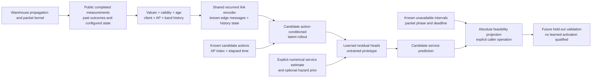

# Service world model: physical reasoning and implemented scope

**The service-world model is an untrained, inactive research prototype.** Its
source implements observation handling, numerical constraints and trainable
model mechanics. Unit tests check those mechanics and selected simulator
invariants; they do not measure trained prediction quality, calibration,
controller improvement or hardware performance. A protocol or case constructor
is not evidence that an experiment has completed.

The physical motivation is to predict whether a robot receives useful service
before its control deadline. RSSI is one cause of that outcome, alongside
contention, queues, retries, scanning and handover interruption. The numerical
controller remains the reference whose observable recovery behavior must be
preserved when testing a bounded intervention.

## Source map

| Source | Implemented responsibility |
|---|---|
| [`physics.py`](../src/wirelessjev/service_world/physics.py) | Explicit power/SINR units; exact unavailable-interval arithmetic; absolute service feasibility projection; signed paired differences. |
| [`sim.py`](../src/wirelessjev/service_world/sim.py) | A 10-ms packet kernel, public receiver/event snapshots, exact state forks, bounded focal interventions and optional pending-proposal expiry. |
| [`features.py`](../src/wirelessjev/service_world/features.py) | A public-state-only feature adapter and causal radio-history windows, preserving client/AP/band axes and validity masks. |
| [`model.py`](../src/wirelessjev/service_world/model.py) | Shared per-link recurrent memory, optional known-edge messages, pooled recurrent history, action-conditioned Gaussian latent transitions, numerical residual heads and optional JEPA objectives. |
| [`study.py`](../src/wirelessjev/service_world/study.py) and [`protocol.json`](../artifacts/service_world/protocol.json) | Source snapshot support and construction/specification of finite warehouse diagnostic cases. These do not themselves supply trained weights or performance results. |

The kernel's hidden fading and blockage are not model inputs. Future observable
windows may enter the EMA teacher during training, but not the inference API.
The projection is a separate helper: drawing it in the data path does not mean
`ServiceWorldModel.forward` automatically applies it.

## The service object and its clocks

The native Wi-Fi kernel uses 10-ms slots. Each robot generates a 600-byte control
packet every five slots, with five slots to deliver it: 20 Hz and a 50-ms relative
deadline. Video has a 150-ms deadline; bulk data queues separately. Service
priority is control, then video, then bulk. A simulated silence longer than
200 ms contributes to a modeled stop metric, with a one-second restart penalty.
Those constants are scenario assumptions, not measured safety properties of
the real SmartCars.

There are several distinct clocks:

| Process | Implemented timing |
|---|---|
| Packet transmission/queue accounting | 10 ms |
| Fading block and associated-link receiver update | 100 ms; receiver measurements are lagged by one fading block |
| Ground-truth route positions | 200-ms world samples |
| Service-world observation hook in the diagnostic profile | 100 ms |
| Forecast issue and external primary observation | Their original one-second cadence |
| Forecast availability | Only after its completion queue permits access |
| Diagnostic intervention hold / proposal lifetime | One second each, when the explicit options are enabled |

A 100-ms snapshot is not a fresh 100-ms scan of every neighboring AP. It can
contain cached measurements, current-link pilots, known configuration and past
packet outcomes. Their ages and masks carry different meanings.

## Power, interference and what the PHY approximation means

The explicit helpers use total power in milliwatts:

\[
P_{\mathrm{mW}}=10^{P_{\mathrm{dBm}}/10},\qquad
\mathrm{SINR}=\frac{S_{\mathrm{mW}}}{N_{\mathrm{mW}}+I_{\mathrm{mW}}}.
\]

Noise and interference add in linear power, rather than by adding dBm values.
The thermal-noise helper uses the conventional rounded room-temperature
density, bandwidth in hertz and a noise figure:

\[
N_{\mathrm{dBm}}=-174+10\log_{10} B_{\mathrm{Hz}}
 + NF_{\mathrm{dB}}+10\log_{10}(T/290\,\mathrm K).
\]

These helpers enforce units and valid numeric ranges. They are not a new RF
law or a replacement for measured receiver behavior.

The packet kernel loads archived **ns-3 NIST packet-success curves** through
[`native/phy.py`](../src/wirelessjev/native/phy.py), indexed by MCS and SNR.
It does not run a Sionna waveform chain for every packet. The 6-GHz table reuses
the 5-GHz success behavior and doubles rate for the assumed 160-MHz bandwidth;
that is an approximation, not a measured 6-GHz device model. Three retry
attempts, expected airtime and contention-domain sharing approximate MAC
behavior rather than simulating the full IEEE 802.11 state machine.

The warehouse world uses log-distance/rack/shadowing propagation and an
additional 6-GHz loss approximation. Hidden Nakagami fading changes in 100-ms
blocks. A hidden robot-to-site blockage process subtracts 15 dB across that
path's bands, with a configured mean duration. Optional interference and
collision models add further losses; their availability does not imply every
diagnostic case enables them. These synthetic processes do not identify the
full distribution of a physical warehouse.

No complex I/Q, subcarrier CSI, antenna phase/gauge structure, waveform
optimization or differentiable Maxwell solver exists in this service-world
model. It has no ability to invent a new QAM/PSK waveform or change a commercial
Wi-Fi device's PHY implementation.

## Exact outage/deadline reasoning

An unavailable half-open slot interval \([a,b)\) contains slots
\(a,\ldots,b-1\). A packet released at \(r\), with relative deadline \(D\),
has attempt window \([r,r+D)\). If that **entire** window has no available
service path, its failure is certain regardless of the learned prediction.
Overlapping and adjacent unavailable intervals are merged before counting,
so overlapping scan and handover outages are not counted twice.

For periodic release phase \(\phi\) and period \(P\), fully covered new
releases in one merged interval satisfy

\[
r\equiv\phi\pmod P,\qquad a\le r\le b-D.
\]

The helpers count those releases exactly, including scoring-window boundaries.
Packets released before the window count only when explicitly supplied as
known pending and unexpired; then their **remaining** attempt window must be
unavailable. This avoids inventing an already-delivered pending packet.

With the default five-slot period/deadline, a nine-slot (90-ms) unavailable
interval contains one fully blocked new release for every traffic phase.
A 400-slot interval contains 80 for phase zero and 79 for phases one through
four when only fully expiring new releases are counted. Known pending packets
can add a miss. A three-slot (30-ms) interval alone forces zero such new misses,
but this zero lower bound does not imply zero actual losses: remaining service
can fail due to radio conditions or contention.

The bound assumes the relevant service is unavailable. An independent second
radio, another usable path or packet redundancy changes that premise. It is a
lower bound on **absolute misses**, not a lower bound on the signed difference
between two policies and not a complete loss predictor.

`project_absolute_service` can clip an absolute expected miss count between
the supplied forced-miss floor and the count of released-plus-pending packets.
It can enforce explicit gap bounds and a probability-one mask for already
certain events. A single bad slot is insufficient to certify failure of an
entire command. Gap bounds must account for silence that began before the
prediction window. This is an elementwise NumPy inference helper, not a
differentiable constraint, a coherent joint distribution or a calibration
certificate.

For matched intervention comparisons, `paired_service_advantage` computes
intervention minus baseline after forming absolute predictions. Negative
miss/gap differences mean improvement and remain negative; an absolute floor
must never be applied directly to these signed differences.

## What the model may observe

`public_features(geometry, public)` has no truth-array argument. It emits
12 features per AP/band and eight client/global features:

| Feature group | Actual available information and boundary |
|---|---|
| Local scan cache | Cached converted SNR and whether the link was heard. Unknown values are masked; they are not exact low-SNR observations. Neighbor measurement ages are not supplied and remain unknown. |
| Current receiver | Associated AP identity, pilot SNR/age/validity. An unavailable receiver cannot refresh its pilot; an old AP's pilot cannot become a new AP measurement during handover. Below-sensitivity values are not exposed as exact RF observations. |
| Map and geometry | Completed forecast mean/standard deviation when available, forecast age, configured band frequency and distance to a known site. Geometry and localization are assumed public; localization uncertainty is not modeled by this adapter. |
| Configuration and fleet | Configured current-link MCS and controlled-fleet AP load. This load is not a measurement of every external transmitter or a complete interference graph. |
| Service history | Current control silence, pending packet age, known scan/handover time remaining, recent miss/delivery fractions and video/bulk queue sizes. Only outcomes preceding the snapshot slot are exposed. |

Values use fixed documented scales, such as SNR/30, map standard deviation/10
and elapsed seconds; these are numerical normalizers, not learned calibration.
The current `RadioHistory` keeps at most 20 event rows, with actual elapsed
seconds between them. A slower event stream provides less temporal information
even if its tensors have the same dimensions.

These are simulator public-state assumptions. A physical deployment must
establish which receiver, queue, load, positioning and remaining-outage fields
the actual device can expose, with its real timestamp/transport delays.

## The trainable model and what JEPA contributes

The encoder shares weights across AP/band links, carries per-link GRU memory,
mixes known nonnegative adjacency messages, and pools into a recurrent client
history state. There is no opaque learned AP-ID embedding. If adjacency is not
provided, the default is a symmetric fully connected same-band average;
it is not discovered or measured interference topology. The batch axis is
clients, not a learned robot-to-robot graph.

Candidate transitions condition on the selected AP representation, explicit
action features, elapsed time and preceding global latent. A diagonal Gaussian
is predicted in learned coordinates. The default follows latent means;
explicit noise supplies reproducible sampled paths. The encoder is a
deterministic history summary, without an identified physical observation
likelihood or a Bayesian posterior update. This is not a complete RSSM or
Dreamer agent. Selected-AP decoding pools that AP's three band embeddings;
fine band/MCS actions must be represented and validated in the action features.

The service head predicts a correction to a supplied numerical estimate:

\[
\widehat c_k=c_{\mathrm{numerical},k}+r_\theta(h_k,a_k).
\]

The residual and hazard-correction heads are zero-initialized. At construction,
their numerical means and supplied hazard priors are preserved exactly. That
identity is not learned skill; training can change it and can degrade the
baseline. A caller must declare whether count/gap targets are absolute or
signed paired values, and keep gap seconds consistent with the separate
slot-based projection helpers.

Without an explicit hazard prior, `hazard` and `survival` are `None`. With a
prior, probabilities stay within range, but calibration is unproved. The
product `cumprod(1-hazard)` has first-event survival meaning only when each
hazard is conditional on previous survival and labels have correct at-risk
and censoring masks. Arbitrary interval marginal probabilities do not acquire
that interpretation by multiplication. Neither learned latent nor service
standard deviation separates all uncertainty sources or certifies tail risk.

The supervised and JEPA families have the same inference graph. The optional
JEPA training phase predicts an EMA teacher's future observable representation;
native fine-tuning regresses service outcomes and, optionally, hazard labels.
Future observations are training targets, not inference inputs. Additional
pretraining still consumes data and compute that must be reported. Whether
this objective adds useful wireless information beyond supervised temporal
learning remains an experimental question.

The numerical service estimate anchors each output horizon directly; the
decoder does not repeatedly sum service residuals. However, the latent still
rolls forward recursively. This removes one obvious accumulation path without
proving bounded long-horizon error, calibrated tails or closed-loop stability.
Streaming state may assimilate only new nonoverlapping observation chunks;
reusing it with an overlapping sliding window counts old evidence twice.

## Counterfactuals and preserved recovery

`KernelCheckpoint` stores complete label-generation state, including queues,
RNG, callback state and proposal timers. Only its `observable()` copy is for
predictors. Resuming a no-force branch supplies the factual canonical
continuation. A forced branch changes one available focal robot's AP decision,
temporarily suppresses further primary moves for the configured hold, then
releases it to canonical recovery. It does not replace the baseline with an
artificial ten-second forced stay. The alternate branch can legitimately
change subsequent traffic, scans, deliveries and load.

The explicit proposal-TTL option also applies to canonical native proposals,
so a move queued behind failed delivery expires instead of executing long
after its evidence became stale. Expiry is a classical command-freshness
change and must be evaluated separately from a learned-model contribution.
With new options absent, predecessor semantics are retained for comparison.

The protocol specifies 100 simulated robots, 80-second diagnostic cases,
30-ms and four-second handovers, 90-ms scans, charged forecast delay and
ten-second label horizons. It marks hindsight best-action selection noncausal.
Such hindsight can diagnose available headroom; it cannot qualify an online
policy, and the specification alone is not a completed result.

## Validation boundary

Source tests exercise exact deadline arithmetic against slot enumeration,
power units, feasible projection, replay, receiver freshness, intervention
release, proposal expiry, AP relabeling, streaming equivalence, masked-data
handling, training/inference isolation and reproducible stochastic calls.
These tests establish behavior of source under their fixtures. They do not
establish trained quality, prove universal non-regression, or replace matched
multi-seed/site packet evaluation and real-device measurements.

The architecture is built from established mechanisms. In particular,
RAN-JEPA already combines action-conditioned wireless JEPA, mechanistic
residuals and matched counterfactuals; Telecom World Models explicitly covers
queues, handover interruption, predictive planning, uncertainty and rollback.
Further overlap includes coupled robot/wireless JEPA, WorldGT packet-delivery
state and baseline-preserving safe improvement. The [primary-source audit](SERVICE_WORLD_PRIOR_ART.md)
defines those boundaries. Physical motivation does not establish architectural
novelty, a universal wireless foundation model or SOTA performance.
