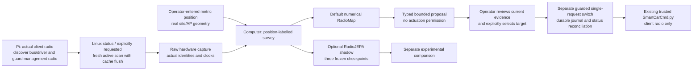

# Deploy the SmartCar workflow with a NumPy RadioJEPA shadow

The deployable bundle connects real Wi-Fi observations to a numerical map and
typed proposal on a computer. An optional RadioJEPA comparison uses inert NumPy
exports of the three exact released nested-joint checkpoints. Map and shadow
both run with NumPy/SciPy. Real switching stays separate and requires interactive
confirmation plus the car's existing guarded command
software. No part of this workflow drives the car or grants autonomous control.

## The two-machine boundary



The Pi collector uses unchanged Python standard-library code and installed
Linux tools. The computer performs fitting and inference with NumPy/SciPy.
Neither the map nor the explicit shadow runtime imports Torch, Transformers,
Hugging Face, Sionna, Chronos or camera models. Do not install the full research
repository on the Pi. The new `PC/run.py` workflow is distinct from the older
`python -m wirelessjev.onecar` diagnostic: that diagnostic's proposal scores
a visible-AP snapshot with d3-lite and does not perform this mapping workflow.

## Requirements and physical assumptions

| Component | What must actually be available |
| --- | --- |
| Parked car | Power, motors idle and a safe place for operator-positioned observations. No motion interface is supplied. |
| Pi runtime | Python 3.9 or later for the collector, Linux Wi-Fi tools, and permissions reported by `doctor`. The bundle does not install drivers or configure a hotspot. |
| Management route | A working, separately verified SSH path. The documented car uses host `192.168.1.11`, user `pi`, over its management hotspot; this is not guaranteed for another installation. |
| Host identity | The actual trusted car host key in the specified known-hosts file. Obtain/verify it through an approved trusted route. Unknown or changed keys must be investigated. |
| Computer runtime | Linux/macOS with Python 3.12 and the supplied NumPy/SciPy requirements for both map and optional shadow. POSIX primitives are required; native Windows is unsupported. ARM/Pi inference performance has not been qualified. |
| Position and site data | Measured metric coordinates in one declared frame, AP locations and the actual declared radio metadata. No built-in SLAM, GPS, odometry or motor navigation is provided. |
| Optional switching | Existing trusted `~/SmartCarCmd.py`, its role/management guards, required sudo permissions and a private local Wi-Fi configuration. The private SmartCar archive is not redistributed in this bundle. |

The documented SmartCar distinguishes a Broadcom SDIO management radio from
an Intel PCIe client radio. Verify what is actually installed rather than
assuming interface numbers prove those roles. Wi-Fi 7, 6 GHz, CSI, ranging,
Bluetooth relay and multi-link operation are not granted by a product name or
simulated experiment. Use only capabilities actually observed and supported.

## Install and verify

Extract the archive to `~/smartcar-wirelessJEV` on the car. Extract the same
archive on the computer, keeping its directory structure. Preserve earlier
site/survey/journal outputs separately and use a fresh extraction; do not mix
old bundle modules or PT weights into this release. The portable layout is:

```text
smartcar-wirelessJEV/
  README.md
  PI/wj_car_agent.py
  PC/run.py
  PC/requirements-map.txt
  PC/requirements-radiojepa.txt
  src/wirelessjev/...
  models/manifest.json
  models/nested_joint-seed0.npz
  models/nested_joint-seed1.npz
  models/nested_joint-seed2.npz
  docs/SMARTCAR_NUMPY_DEPLOYMENT.md
  site.template.json
  MANIFEST.json
  verify_bundle.py
```

After copying `smartcar-wirelessJEV.zip` to the car's home directory, extraction
needs only Python:

```bash
cd "$HOME"
python3 -m zipfile -e smartcar-wirelessJEV.zip "$HOME"
cd ~/smartcar-wirelessJEV
python3 verify_bundle.py
printf '%s\n' '{"action":"doctor"}' | python3 PI/wj_car_agent.py
```

On each machine, run `python3 verify_bundle.py` from the extracted root. Hash
verification detects disagreement with the included manifest; it is not an
independent signature or proof that the supplying machine is trusted.

On the computer, create a virtual environment and install before joining a
hotspot that may remove internet access:

```bash
python3 -m zipfile -e smartcar-wirelessJEV.zip .
cd smartcar-wirelessJEV
python3 -m venv .venv
. .venv/bin/activate
python -m pip install -r PC/requirements-map.txt
python PC/run.py --help
```

The computer launcher requires POSIX process/file primitives. Windows users
need an appropriately configured Linux/WSL environment with a working management
route, not merely a different virtual-environment activation command. Do not
assume a successful cloud x86 test establishes ARM wheel availability or timing.
Keep private Wi-Fi configuration and SSH keys outside the extracted archive and
outside Git. No model download or Hugging Face credentials are needed: the three inert
NumPy model exports are included. SSH authentication is handled by the
system SSH client, with key authentication preferred and normal terminal prompts
when needed. Do not paste passwords into chat, a command line or a survey file.
For first-time host-key provisioning, compare the computer's candidate key with
the car's actual host public key through a trusted local console or transfer.
An unauthenticated `ssh-keyscan` result alone is not proof of the car's identity.
Do not copy a host private key into the bundle or disable strict host checking.

## Check the real car

```bash
export CAR_HOST=192.168.1.11
export CAR_KNOWN_HOSTS="$HOME/.ssh/smartcar_known_hosts"
python PC/run.py doctor --host "$CAR_HOST" --known-hosts "$CAR_KNOWN_HOSTS"
```

Read the actual findings. Missing tools, missing sudo permissions, unexpected
radio roles or an unavailable management route are failed prerequisites, not
observations to simulate. Use `python PC/run.py --help` for command help; the
Pi agent's interface is one JSON request on stdin. The optional local doctor
command above reads actual hardware while
logged into the car. The collector does not substitute generated scans for
hardware failures.
`--host` is a bare hostname or IP; `--user` defaults to `pi` and `--port` to 22.
An off-hotspot or cloud client needs its own approved reachable management route;
this archive does not create one.

Doctor runs unprivileged and reports the effective UID and scan-privilege
requirements. A fresh scan needs root/CAP_NET_ADMIN. At effective UID zero the
collector invokes the fixed `iw` command directly; otherwise it makes one fixed
`sudo -n <resolved iw> dev wlan1 scan flush` attempt. The operator must already
authorize that exact noninteractive operation, or use approved root execution.
The workflow does not edit sudoers, grant capabilities, install a privileged
service or turn an unprivileged doctor into authorization. A discovered `sudo`
or `iw` binary is not proof that the scan will be permitted. Missing permission
is a reported failed capture, never a generated substitute.

Do not install or restart the private SmartCar application's services merely to
make the deployment checker pass. Establish which services own the radios and
avoid concurrent scanning/control processes during the first supervised trial.
Two physical radios reduce shared-link risk but do not guarantee that management
survives routing, driver, firmware or power failures.

## Build a site-specific map

```bash
python PC/run.py init-site --out site.json
python PC/run.py validate-site --site site.json
```

Edit the generated template before recording scientific observations. Give the
site a stable identity and one metric coordinate frame. Enter real AP/BSSID
identities, locations and carrier metadata, and document any supplied transmit
reference or geometry assumptions. Do not leave example geometry in place and
label the result as your measured warehouse. Unknown transmit power and device
bias are not identifiable as separate physical quantities from arbitrary RSSI
alone; the numerical fit is a reported-signal map under its stated assumptions.
The template starts with an empty AP list and is invalid until the operator
provides the required actual site/AP and declared receiver metadata. Coordinates
are floor-origin XYZ in metres within `[0,width] × [0,depth] × [0,height]`.
The neural adapter centers XY internally for the model's coordinate convention;
do not pre-center operator coordinates a second time.
Captures bind the validated site configuration by hash. Changing AP geometry,
carrier or receiver metadata requires a new configuration and a new compatible
survey; do not silently reinterpret old records under edited metadata.

Place the car at a measured position. Record that actual position with a
hardware capture:

```bash
python PC/run.py capture --site site.json --survey captures.jsonl \
  --xyz 2 3 0.3 --host "$CAR_HOST" --known-hosts "$CAR_KNOWN_HOSTS" --active-scan
```

An explicit active scan requests radio work and can interrupt client airtime.
It is not an impact-free status read. This workflow admits only explicitly
requested fresh scans and flushes the transient BSS cache during acquisition;
without `--active-scan`, capture is refused. Absence from a scan alone does not
establish a known sensitivity floor. Preserve the raw report, capture/delivery
clocks, actual carrier and missingness semantics. Do not invent observations
for APs or bands that were not measured.

The Pi's Unix clock is not assumed synchronized to the computer. The computer
records its SSH request-start/receive interval and uses the request start for
conservative age checks. Remote timestamps describe ordering on the remote
clock, not an invented cross-machine clock offset. A captured observation is
not available to the computer before its actual receipt.

Repeat at separated, measured positions spanning the intended area, including
turns and rack boundaries where practical. Multiple samples at one place do
not replace spatial coverage. Reserve positions or a later route for checking
predictions; do not report in-sample fit error as generalization. The workflow
does not move the car or infer these positions. A future localization method
would require its own anchors, labels, validation and uncertainty.

```bash
python PC/run.py fit-map --site site.json --survey captures.jsonl --out map.json
python PC/run.py predict --site site.json --map map.json --xyz 4 3 0.3
```

Inspect supported APs, observation counts, fitting assumptions and uncertainty.
An AP without adequate data is not a validated mapped link. A map forecast is
reported RSSI, not a calibrated packet-success probability or an independently
verified interference/occupancy model. Missing positions and scene metadata
must not be fabricated to make the fit run.
Predictions also enforce a conservative 300 s observation-age limit and 5 m
spatial support limit. An old fitted map does not become current merely because
you collected a new scan: refit it explicitly to include new evidence.

Survey capture appends records. Site-template, map, shadow and proposal output
files are created without overwriting an existing file. After adding survey
positions, refit to a new filename such as `map-v2.json` and explicitly use that
file for subsequent predictions/proposals. This is an operator-run batch
workflow, not an always-running autonomous learner or switching daemon.

## Compare the experimental model without granting it control

The NumPy/SciPy map requirements already provide this backend.
`PC/requirements-radiojepa.txt` includes the same requirements and adds no Torch.

```bash
python PC/run.py shadow --site site.json --survey captures.jsonl \
  --xyz 4 3 0.3 --models models/manifest.json --out shadow.json
```

The manifest binds all three NPZ export hashes to the exact released
`nested_joint` source-checkpoint hashes and constructor settings. Every export
preserves all eighteen state arrays, their original names, shapes and float32
values, including inactive local-kernel weights and Fourier buffers. The loader
checks a pinned full-state fingerprint, strict ZIP/NPY membership and resource
bounds, exact seed-specific gates and `allow_pickle=False`; an object/pickle
payload cannot become model state. Torch is a developer-side export dependency
only, not part of the runtime.

This is inference with fixed weights and real input observations, not on-site
training or a substitute synthetic measurement. If the model, dependencies,
schema, source identity or export hashes cannot be verified, report the failure;
do not substitute a mock prediction. Software parity compares NumPy and the
source implementation on the same declared inputs and weights. It does not
establish improved RF accuracy, reduced compute/energy, faster real-car
inference, ARM compatibility or physical transfer. Keep any separately measured
software timing results distinct from hardware and scientific accuracy claims.

The source experiment achieved sparse heard-RSSI RMSE 2.637330 dB against
2.710522 dB for its strongest validation-selected numerical reference on 24
procedural TEST geometries. It ran 15 fits and 84 fresh actual Sionna RT cases.
Those are simulated propagation results, not measured performance at your site.
Joint agreement added only 0.002226 dB over nested regression. All eight learned
local geometry feature gates were zero in the selected nested members; the
remaining local residual uses fixed Fourier features around a shared physical
model. This does not establish rich learned representations or physical SOTA.

Site geometry, material coverage, device gauge, actual carrier and scan behavior
can differ from training. Compare against independent held-out site observations
before claiming a local gain. Shadow mode must not silently replace RadioMap
or authorize a switch, and its approximate RF spread must not be labelled as
qualified outage, deadline or long-silence risk.
The deployment shadow admits only its declared 2.4–5.2 GHz source range. Carriers
outside it remain unknown, including real 6 GHz observations; a separate static
research held-6-GHz result is not deployment qualification. Source-coordinate,
device-reference and propagation assumptions remain explicit in its output.

## Produce a typed proposal

Move/place the car at the actual requested position and record a new scan
immediately before requesting the proposal:

```bash
python PC/run.py capture --site site.json --survey captures.jsonl \
  --xyz 4 3 0.3 --host "$CAR_HOST" --known-hosts "$CAR_KNOWN_HOSTS" --active-scan
python PC/run.py fit-map --site site.json --survey captures.jsonl --out map-v2.json
python PC/run.py propose --site site.json --survey captures.jsonl \
  --map map-v2.json --xyz 4 3 0.3 --out proposal.json
```

Review the actual candidates, supporting observations, current association,
reference assumptions and proposal reasons. This workflow uses the default
numerical map; experimental shadow output is a separate comparison. The
proposal is a bounded typed recommendation and sends nothing to the radio.
Its decision is `STAY`, `DEFER` or `PROPOSE_SWITCH`, using a deterministic
same-SSID RSSI comparison. Current defaults require a scan no older than 120 s,
within 0.5 m of the query, map support within 5 m and a 6 dB conservative-score
margin before proposing a change; the observed candidate must be at least
−75 dBm. The score subtracts one descriptive predicted SD and is not a calibrated
quantile. The result reports `probability: null`.
The map's `records_sha256` must match the exact normalized current admitted
survey, otherwise the proposal defers and requests a refit. A proposed switch
also requires at least 6 dB improvement in the latest actual same-SSID RSSI;
a model-score gain that disagrees with that measurement defers.

This deployable rule is distinct from the repository's research mission/MPC
controllers. It does not establish automatic language-to-safety constraints,
joint robot-motion planning, fleet scheduling or packet-head calibration.
Unknown risk stays unknown; lack of a qualified head cannot become a zero-risk
assertion.

## Optional one-request supervised action

Only proceed when the car is parked, actual management/client roles are verified,
the original connection is recorded, the intended SSID/BSSID is approved and
visible, and the pre-existing guarded SmartCar command installation is trusted.
If that private installation is unavailable, the supported stopping point is
a real survey, map and proposal; copying this archive does not install it.

```bash
python PC/run.py status --host "$CAR_HOST" --known-hosts "$CAR_KNOWN_HOSTS"
python PC/run.py switch --host "$CAR_HOST" --known-hosts "$CAR_KNOWN_HOSTS" \
  --wifi-json /private/path/WiFi.json --ssid "YOUR_SSID" --bssid aa:bb:cc:dd:ee:ff \
  --journal switch-events.jsonl
```

Replace the example with an actual observed, approved BSSID and re-type it at
the confirmation prompt. The new workflow journals the request before sending,
submits one mutation and reads status to reconcile its outcome. A timeout,
dropped reply or interruption can leave the outcome unknown. Never automatically
resend a request because a reply is missing. Read status first; if the route is
unavailable, restore approved access and inspect the journal before a new action.

Returning to the original BSSID is another separately confirmed request. No
automatic rollback, fast-roam benefit or per-stage handover-timing claim is made
by this bundle. Management recovery depends on the actual installed car setup;
do not assume a particular SmartCarGuard behavior was installed or tested here.
Model confidence never overrides management-radio protection or operator choice.

## What a completed first trial establishes

Keep the bundle/checkpoint hashes, real doctor output, edited site declaration,
raw position-labelled observations, fit/prediction artifacts, typed proposal and
any separate action/reconciliation journal. Remove private configuration and
credentials before sharing evidence; retain raw measurements locally.

Successful software tests establish parser/inference/control-boundary behavior
under their tested conditions. A successful physical trial additionally requires
actual car evidence. Neither establishes 100-car reliability, a production SLA,
arbitrary robot/environment transfer, all-protocol PHY control or specialist
SOTA. RadioMap remains the default while physical validation is accumulated.
