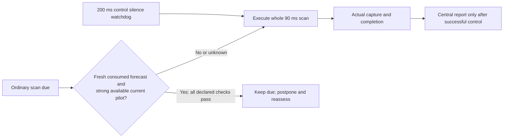

# Sensing interruptions and STR: passive stack diagnosis

**The forecaster cannot deliver a command while the only radio is scanning.** The current 90 ms whole scan can cover an entire 50 ms control opportunity even when it starts immediately after a successful delivery. This motivates testing whether a fresh forecast and strong current pilots can justify postponing an ordinary scan. It does not justify shortening the scan, inventing measurements or asserting a new JEPA gain before evaluation.

The [diagnostic script](../scripts/diagnose_stack_sensing.py), [machine-readable diagnosis](../artifacts/stack_sensing_diagnosis/diagnosis.json) and [input/output receipt](../artifacts/stack_sensing_diagnosis/receipt.json) are derived from already completed evidence in commit `1441f68089173279536afc11fc17a3926115cd5c`. The script imports no scientific package. It creates no world, forward pass, fit, timing measurement or counterfactual rollout.

## What the existing archives show

The script verifies 32 completed repair-arm confirmation archives, their receipts and their report entries: eight sites per model in the fast parent cohort and eight different sites per model in the slow child cohort. Every arm generated 960,000 commands. Cause attribution assigns a missed packet to its first highest-priority encountered condition; it does not estimate avoidable regret.

| Cohort / assumed handover | Forecaster | Misses | `no_radio_up` | Blocked | Weak link |
|---|---|---:|---:|---:|---:|
| Parent / 30 ms | RadioMap | 10,020 | 9,614 | 142 | 264 |
| Parent / 30 ms | Frozen FleetJEPA | 9,978 | 9,601 | 125 | 252 |
| Child / four seconds | RadioMap | 59,394 | 47,433 | 2,025 | 9,936 |
| Child / four seconds | Frozen FleetJEPA | 55,690 | 43,608 | 1,829 | 10,253 |

`no_radio_up` combines **scan and handover interruptions**. The first-condition attribution can also mask other simultaneous difficulties. These counts do not establish how many misses a different scanner, queue or controller would prevent. The two cohorts have different sites, so their numbers are not a paired handover-cost comparison.

The parent repair arms each started 9,600 scans. The child RadioMap/JEPA repair arms started 9,587/9,596. The nominal periodic count is `100 robots × 12 scans × 8 sites = 9,600`, but episode endpoints, overlapping outages and delayed actions prevent treating that arithmetic as an isolated missed-command count. The source mechanism and raw counts identify a plausible bottleneck; fresh native evaluations must measure the proposed remedy.

All four aggregates record zero contention-attributed misses, zero collision parameter and disabled managed interference. This helps prioritize the present experiment; it does not establish that real warehouses lack MAC contention or interference.

## Why an uninterrupted scan can consume a deadline

The [frozen kernel](../src/wirelessjev/costaware_recovery/sim.py:711) generates a command every five 10 ms slots and expires an undelivered command after five slots. A cadence-triggered scan begins after a delivered frame, sets `scan_until = k + 1 + 9`, and blocks primary-radio availability while `scan_until > slot`.

Relative to that successful delivery:

| Offset | Primary radio / control event |
|---|---|
| 0 | Control delivered; a due whole scan starts |
| 1–9 | Primary unavailable for the scan's nine slots |
| 1–5 | The next periodic command is generated at one of these offsets |
| Generation through generation + 4 | All five opportunity slots fall within 1–9 |
| 10 | Primary may become usable again |

The script checks all five possible periodic phases arithmetically. With no second usable control path, every ordinary uninterrupted nine-slot scan contains a full five-slot opportunity unless the episode boundary truncates it. This is a statement about the simulator's declared timing, not a hardware benchmark or a counterfactual estimate from the archive. A concurrent handover can make that opportunity unavailable independently of the scan.

The new study retains the whole 90 ms scan and its genuine capture, completion and delivery. **Chunked or resumable scanner hardware is not assumed.**

## STR has a real price in the current surrogate

The current kernel's simultaneous transmit/receive duplication subtracts 3 dB and halves each band's rate. Cross-link retry remains a separate mechanism; disabling STR does not remove those retries.

The earlier [native campaign](../artifacts/native/campaign.json) on six 300-second scenes reports mean command loss of **0.0188333% with STR versus 0.0100000% without it**, a descriptive 46.90% reduction. The [existing interpretation](NATIVE_STACK_RESULTS.md) explains the diversity-versus-stream/antenna penalty. This is a separate, earlier study, not a new confirmation result or a paired control for the current cohorts.

In the parent fast repair arms, pending STR occupies an average 0.2723% of all fleet slots for RadioMap and 0.2461% for JEPA. In the slow child repair arms it occupies 2.9059% and 2.9512%, respectively. These are **slot fractions**, not duplicated-command fractions. The archive does not isolate their causal effect in the present controller, so the next experiment explicitly ablates STR rather than silently removing it from both the treatment and its baseline.

## Chosen next experiment: preserve sensing; test its admission

The new four-second study uses the same fixed RadioMap and original FleetJEPA weights with four nested variants:

1. Existing actual-cost FIFO with the original STR and scan behavior.
2. Latest-only forecast admission, with original STR and scans.
3. Latest-only admission with STR disabled and cross-link retries retained.
4. The preceding variant plus admission for ordinary due whole scans.

The final variant may postpone an ordinary due scan only when **all** its declared observations support doing so: control silence is below 200 ms; the available current pilot is at least −67 dBm and its actual capture association/refresh match the current AP and 100 ms pilot cadence; a consumed forecast is no more than five seconds old with another five seconds inside its support; and one fixed band stays at least −67 dBm throughout zero to five seconds, using the current pilot plus age-aligned forecast increments. The −67 dBm threshold is the existing −75 dBm recovery threshold plus the existing 8 dB better-neighbor margin; this is a fixed heuristic, not a calibrated risk certificate.

Unknown or stale forecasts allow the original scan. A postponed scan remains due and is reassessed after five seconds. The existing watchdog at 200 ms silence can start a full due scan immediately despite the ordinary reassessment timer. An executed scan still costs the full 90 ms; only an actual scan start clears its due state. Postponement creates no observation, capture timestamp, scan report or central knowledge.



Less frequent sensing also means less new information. A stale belief can underestimate drift or hidden blockage, delay discovery of a better AP and reinforce itself. The study must therefore preserve the numerical reference, all nested arms, actual scan counts/costs, capture ages, delivered reports, paid forecast completion and every registered mean-loss and continuity check. A gain from skipping interruptions would be an enabling-stack result, not proof that JEPA pretraining is necessary.

The model inputs also lack a general partial-measurement contract. Reusing already measured pilots is a separate future opportunity: a partial pilot report must never mark unmeasured APs as below a scan bound. The current [fitter](../src/wirelessjev/fleetwm/data.py:80) and [context constructor](../src/wirelessjev/fleetwm/data.py:117) use the scan mask to interpret unheard links. That interface must be redesigned and independently tested before adding pilot reports as if they were complete scans. No such data change is included here.

## Verification and limits

The script checks the old 80/230/386/422-file scientific registrations and their current/capsule bytes, pins the old manifests and historical STR inputs to commit `1441f68`, verifies the selected raw gzip archives against manifest and receipt hashes, and checks that their result digests and aggregate command counts reproduce the reports. It rehashes every input after the diagnosis. Earlier global-document manifests still describe their original commits; they are not silently rewritten.

```bash
python scripts/diagnose_stack_sensing.py --write
python scripts/diagnose_stack_sensing.py
```

The first command explicitly writes the new derived diagnosis/receipt. The second verifies their exact contents. Neither trains, simulates, times or changes the old evidence. This remains a post-hoc diagnosis of procedural simulation with assumed scanner behavior, localization, routes, packet PHY and handover costs. No physical-car, production, arbitrary-layout, JEPA-objective or SOTA qualification follows.
