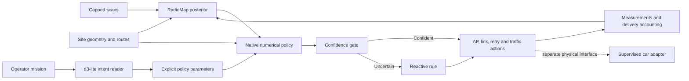

# RadioMap + WirelessJEV: current system architecture

The canonical native stack is a warehouse-connectivity prototype with an executed cross-layer simulator and separate supervised car tooling. Its central responsibility split is: **RadioMap estimates spatial radio state; WirelessJEV interprets intent and makes numerical decisions; the executor recovers and accounts for traffic.** The architecture deck is in [slides/README.md](slides/README.md).

## Why each component exists

| Requirement | Implemented mechanism | Principal code | Boundary |
|---|---|---|---|
| Learn incomplete site observations | Censored per-BSS Bayesian map, geometry features, local random Fourier features and discrepancy estimate | `native/radiomap.py` | Map uncertainty still undercovers in held-out simulation. |
| Express operator priorities | Actual d3-lite mission readings compiled into roam, load, confidence, channel, video and named-robot knobs | `native/intent_policy.py` | The native interface uses weights; the richer compositional proposal tool is separate. |
| Allocate APs and links | Near-term forecast scoring with AP-load penalties; conservative control-link selection; bulk goodput selection | `native/sim.py` | Explicit numerical heuristics, not global exact optimization. |
| Limit reliance on uncertain estimates | Gain-to-uncertainty gate and reactive fallback | `native/sim.py` | No certified physical-risk bound. |
| Recover from a dead AP path | Modeled multi-rate retries and another client association through a different AP | `native/sim.py` | Main successful arm assumes two client radios. |
| Respect application differences | Control priority, deadline-aware video demand and buffered/deferred bulk | `native/sim.py` | Queue and MAC models are simplified. |
| Close the observation loop | Lagged measurements, delivery accounting and periodic online map updates | `native/world.py`, `native/sim.py` | Simulator feedback, not measured fleet telemetry. |
| Inspect operation and evidence | Fleet replay, decision, execution and native evidence pages | `studio/app.js`, `studio_data.py` | Recorded simulations and proposal records. |
| Change a physical attachment deliberately | Read-only probes, typed confirmation, one request, explicit outcome reconciliation and timing capture | `handover.py`, `onecar.py`, `carlink.py` | Fake-car tested; management interface excluded; no real-car qualification. |

Code paths above are under `src/wirelessjev/` unless otherwise specified.

## Control cadence

The simulator uses 10 ms slots for retry and delivery accounting, 100 ms measurement/adaptation blocks, one-second native planning, ten-second online map updates, and mission interpretation on mission changes. That separation keeps language inference outside packet recovery. An eventual robot/edge deployment split remains a deployment question, not a measured result.

## Model and hardware boundaries

The RF layer uses archived ns-3 NIST VHT80/HT20 two-stream curves. Six-GHz rate behavior is extrapolated; MAC contention, association costs and application timing are simplified. The cellular comparator reuses scaled curves and idealized scheduling, rather than a full NR implementation. The separate Sionna coded-modulation study does not create a stock-Wi-Fi custom waveform.

Current numerical results support independent AP-path diversity in defined conditions. They do not prove that the stock BE200 can hold two usable client associations, that onboarding a second radio is operationally free, or that the system beats a real private-5G network. Capability probes and controlled measurement decide those questions.

The separate compositional contract proposal interface checks explicit structures and constraints. Those checks are not automatically a proof of all native-slot actions. The architecture diagrams preserve that boundary rather than inventing a fully integrated verifier.
