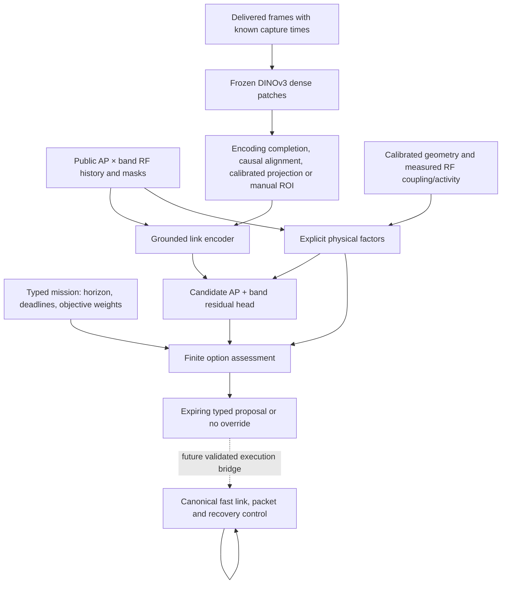

# Visual-radio mission, representation and option hierarchy

The implemented visual-radio path combines a frozen pretrained image encoder,
a trainable spatial RF adapter, explicit physical factors and a finite option
selector. It is a proposal-only research interface. It does not execute radio
commands, replace canonical fast control or establish learned warehouse gains.

The dotted connection is deliberate: `planning.py` has no radio execution API.
An option assessment is not evidence that its hardware action is implemented.
The separately frozen service simulator remains unchanged by this module.

## Mission to finite options

[`ServiceIntent`](../src/wirelessjev/visual_radio/planning.py) expresses a
planning horizon, command period/deadline and nonnegative weights for absolute
missed commands, maximum delivery gap in seconds and a caller-defined resource
cost. The default clock has 10-ms slots, a five-slot control period and a
five-slot deadline. This layer consumes a typed objective; it does not infer a
mission from generated text.

`OptionKind` defines canonical continuation, a temporary AP hold, an AP move,
scan, channel switch, redundant link and bulk deferral. By default the selector
admits only hold, move and scan as supported candidates. The larger vocabulary
does not establish channel-control, redundancy or deferral support on a real
SmartCar. A future driver adapter must declare and validate its capabilities.

`RadioOption` carries an action identity, target when relevant, issue time,
expiry, hold duration, observation time and optional absolute service estimate.
Proposal lifetime and hold are bounded to one second. A temporary hold is an
explicit candidate. Unknown or rejected advice falls back to the **unforced
canonical continuation**; uncertainty does not create a long forced stay that
disables recovery.

The baseline must be an `OptionKind.CANONICAL` option. Candidate estimates need
provenance, a numerical/empirical evidence status, and upper estimates for both
absolute misses and maximum gap. Missing estimates, missing upper values,
unsupported actions, stale/unknown observation times and proposals expiring
before completion are rejected. A status string records the asserted source;
it cannot establish that an estimate is accurate or calibrated.

The selector admits a candidate only if its upper-estimate weighted cost plus
the requested minimum advantage is strictly less than the baseline mean cost.
Equality retains the baseline. Admitted ties use option identity. This is a
numerical/empirical admission rule, rather than a theorem that regret,
cumulative excess loss or physical risk cannot increase.

`HierarchyDecision.available_slot` records inference completion.
`proposal_at(slot)` returns nothing before that time or after the absolute
expiry. A returned hold is clipped to the lease remaining at publication: a
proposal issued at slot 500, completed at 550 and expiring at 600 can request
at most 50 further hold slots, provided its observation remains fresh. The
selector checks freshness at completion, and publication also clips the lease
to the observation's remaining age allowance. A future execution bridge must recheck association and
capabilities at use time. Canonical fast control must keep running during
computation. This module supplies no measured end-to-end latency or physical
intervention guarantee.

## Absolute physical floors and unknown service

`exclusive_unavailable` contains absolute half-open slot intervals during which
**all relevant service paths** are unavailable. Overlapping or adjacent coverage
is merged once. The selector reuses the exact deadline-window arithmetic in
[`service_world/physics.py`](../src/wirelessjev/service_world/physics.py): a
command must miss when its whole remaining opportunity to meet the deadline is
unavailable. Unknown PHY failure can add more misses.

With a five-slot period/deadline, a nine-slot exclusive scan forces one miss for
every traffic phase. A 400-slot interruption forces 79–80 misses, depending on
phase; a three-slot interruption forces none by itself. With unknown phase, the
selector uses the minimum across phases as a guaranteed floor. Explicit pending
commands require their actual phase and unexpired release times. This does not
claim total loss equals that floor.

Known exclusive interruption duration also supplies a lower bound on maximum
silence within the horizon. Floors apply to **absolute** service quantities
before objective comparison. A signed intervention-minus-baseline advantage
must retain negative improvements and must not be clamped to an absolute
outage floor. An optimistic neural residual cannot erase a known interruption.
Conversely, one radio's interruption is not exclusive unavailability while an
independently usable service path remains.

Unknown service produces no admitted override. None of these floors invents a
probability of unknown interference or future fading. The
[RF factor module](VISUAL_RADIO_PHYSICS.md) separately preserves incomplete
interference, measured versus assumed coupling and calibrated silhouette
geometry. Optical appearance does not identify material attenuation, transmitter
activity or an unseen interferer.

## Dense observations and causal alignment

[`dino.py`](../src/wirelessjev/visual_radio/dino.py) loads a checksum-pinned real
pretrained DINOv3 ViT-S/16 through a pinned timm conversion. The backbone remains
frozen. At the configured 256-pixel processed resolution it returns a 16 × 16
grid of 384-dimensional patch features, excluding prefix/register tokens. It
retains patch boxes mapped through resize/crop back to original-image pixel
coordinates, validity masks and provenance. Features are not depth, RF
measurements or a complete temporal world model.

[`events.py`](../src/wirelessjev/visual_radio/events.py) distinguishes capture,
sensor delivery and feature-computation completion. `select_dino_observation`
requires per-frame `feature_available_seconds` and rejects a completion earlier
than sensor delivery. A selected frame must have a known capture time, completed
encoding before the decision, bounded capture age and an optional matching
calibration identity. Out-of-order arrival cannot expose an unreceived/future
frame. Clock synchronization and camera/RF offsets are external requirements;
the helper cannot verify a caller's timestamp against hardware.

The bridge returns dense tokens, patch validity, original-image normalized
patch centres and explicit capture ages. Unknown capture time is ineligible.
The downloaded warehouse/robot photographs have **unknown capture times, no
calibrated pose and no paired temporal RF labels**. Their real pretrained
forward probes establish access and tensor behavior only. Fetch/ingestion time
must not substitute for capture time to make them appear to be fresh robot
observations.

## Grounded RF/patch fusion and physical bypass

[`GroundedLinkEncoder`](../src/wirelessjev/visual_radio/representation.py)
accepts radio history with axes `batch × time × AP × 3 bands × feature` and a
mask for every feature. Visual input retains individual patches, normalized
image coordinates, capture ages and masks. Shared RF queries cross-attend to
patches using explicit link-to-patch grounding weights.

Grounding provenance is `calibrated_camera_geometry`, with a calibration
identity, or `manual_image_regions`. A manual ROI supplies image locality,
rather than metric depth, Fresnel geometry or attenuation. The ingestion layer
must validate actual calibration and align image/camera/radio coordinate frames;
an identifier alone does not do so. Hidden simulated blockers are not legitimate
grounding inputs. Capture ages are mandatory per patch, finite and nonnegative
where observed; the causal bridge must align them before encoder use.

Masked RF features are zeroed with their masks retained. Unavailable patches
are excluded from attention; an empty ROI yields zero visual attention rather
than NaN or invented support. Shared recurrent memory processes each AP/band
history separately, preserving those axes. Token-locality tests apply at this
adapter boundary: DINO uses global image attention, so pixels outside an ROI
can still change pretrained tokens inside it.

The encoder returns cleaned `physical_history` and the original
`physical_observed` mask alongside the latent. This is an exact measured-feature
bypass for consumers that retain it. It does not force a latent to use those
measurements; the current service head reads selected link latents rather than
directly consuming that returned history.

`GroundedServiceHead` indexes both candidate AP and band, combines the latent
with action features, and adds a two-output residual to a supplied numerical
reference. Its zero-initialized final layer preserves that reference exactly.
The caller must declare output units and distinguish absolute values from
paired differences. In particular, `ServiceEstimate.expected_max_gap_slots`
requires slots: a gap prediction in seconds needs conversion before planning.
Preserving a reference does not prove that it equals expected service. The head
returns no calibrated risk and establishes no trained quality.

Structure, masks, numerical anchoring and a bypass reduce specific ways to
discard information. They do **not** prove latents cannot collapse, that visual
semantics transfer to RF, or that a trained model improves on RadioMap. DINOv3's
dense-feature pretraining also provides none of those downstream guarantees.
Representation probes, matched RF-only/geometry-only/fusion ablations and
held-out predictive/control evaluation remain separate requirements.

## Current evidence boundary

Structural tests exercise the hierarchy, fusion and event bridge. The real
pretrained access probe uses downloaded weights and licensed images. These
checks are not a trained visual-radio model, a closed-loop hierarchy result or
a physical 100-SmartCar deployment. They establish no visual/RF accuracy,
novelty or SOTA result.

The separately running future-head repair fits use service-world data. They
are a different experiment: they do not train DINO, fit this fusion adapter or
qualify this hierarchy. See the [visual-radio research review](VISUAL_RADIO_RESEARCH.md)
for hypotheses and matched comparisons, and the [physical assumptions](VISUAL_RADIO_PHYSICS.md)
for link-budget and Fresnel boundaries.
