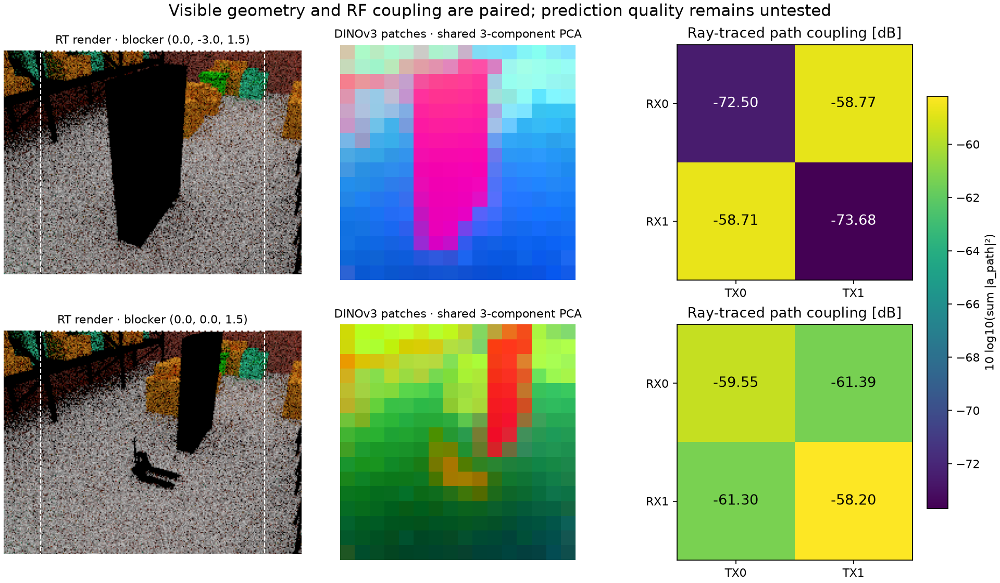
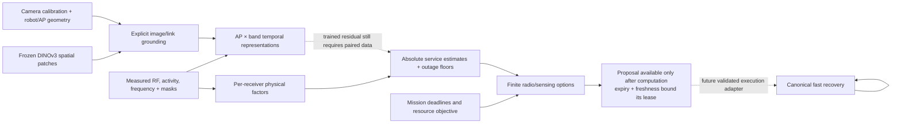

# Physical representations, DINOv3 and decision hierarchy

The current evidence supports **latent concentration and a weak auxiliary
prediction interface**, rather than a constant JEPA representation. It also
shows that improving auxiliary future matching alone does not improve packet
service consistently. The useful target is a representation that retains the
physical distinctions needed for a particular intervention and deadline.

## What was measured and built

| Component | Actual evidence | Limit |
|---|---|---|
| [Frozen representation audit](REPRESENTATION_COLLAPSE_AUDIT.md) | Six trained critics, 744 archived training actions and 72 native diagnostic windows; centered spectra, matched action responses and diagnostic probes | Readout folds do not make previously trained encoders unseen-site models |
| [Separate future projection](REPRESENTATION_REPAIR_RESULTS.md) | Six new preregistered 40-epoch fits; normalized validation future MSE averages 1.623 → 0.580 while teacher variance/rank remain | Miss MAE averages 23.322 → 23.710 commands; service gate fails; no control qualification |
| [DINOv3 frontend](DINOV3_ACCESS.md) | Real frozen 21,586,944-parameter checkpoint; two licensed warehouse/robot photographs yield 256 spatial tokens × 384 features each | Static photographs have unknown capture times and no paired RF labels |
| [Coupled warehouse ray tracing](VISUAL_RADIO_RT.md) | Actual Sionna RT/Mitsuba full 53-object warehouse, two metal-blocker poses, nonzero desired/cross-link couplings and DINOv3 features from the same rendered scenes | Static paired simulation only; assumed materials, bounded paths, no trained estimator or measured transfer |
| [Physical RF factors](VISUAL_RADIO_PHYSICS.md) | Receiver-specific coupling, transmit power, activity, spectral overlap and incomplete-inventory handling; calibrated Fresnel geometry separately | Scalar propagation/filter assumptions; visual appearance does not supply measured RF parameters |
| [Spatial fusion and hierarchy](VISUAL_RADIO_HIERARCHY.md) | AP/band-preserving RF queries, grounded patch attention, capture-age masks, measured-feature bypass, finite typed options and bounded proposal leases | Fusion weights are untrained; planner proposes actions and does not execute radio commands |

The projection experiment uses radio data only. It does not train DINOv3 or the
new fusion encoder. The 23,860-parameter packet critic, 68,021-parameter service
prototype and 21.6-million-parameter visual backbone are different components;
their separate checks do not establish a jointly trained foundation model.

The dashed boxes show DINO's actual image crops. A common three-component PCA
colors the dense features; colors are not object labels, metric depth or RF
predictions. The right panels show simulated incoherent path couplings. The
render uses four samples per pixel, so visual sampling noise remains.

## Why the physical abstraction matters

The receiver needs the joint factors

\[
I_r=\sum_j P_j G_{jr}a_j\eta_{jr},\qquad
\gamma_r=\frac{S_r}{N_r+I_r}.
\]

Separately averaging activity and coupling loses which transmitter is active.
The [reproducible analytic example](../scripts/check_visual_radio_abstractions.py)
keeps the same two transmitters, mean activity, power and mean free-space
coupling. Switching activity between the near and far interferer changes SINR
by approximately **20 dB**. This is an analytic identifiability example, not a
warehouse measurement or a learned-model score. It does not prove that every
pooled neural representation has this ambiguity: a suitable encoder could
compute the joint products before pooling.

DINOv3 can describe visible local structure. It cannot observe an invisible
transmitter's activity or uniquely recover dielectric material properties.
Patch coordinates, calibrated geometry and RF observations must retain their
own provenance, masks and times. An optical blocker and a co-channel interferer
can call for different actions even when aggregate RSSI drops similarly.

No branch reconstructs hidden future fading or paints an RF label into a
camera image. The previous packet simulator generates blockage independently
of visible object motion, so its hidden blockage labels cannot become visual
training targets without a new physically coupled observation process.
The new ray-tracing fixture supplies that coupling for two static simulated
poses. It preserves the initial zero-path placement as excluded evidence and
does not claim a timed sequence, a converged propagation model or RF prediction.

## Generalization that follows from structure, and what still needs evidence

The physics tests preserve link budgets under transmitter relabeling and joint
rigid coordinate transforms. Fusion tests preserve AP relabeling when action
indices and grounding are remapped. Band identity remains explicit, including
physical frequency and bandwidth in the RF budget. These are implementation
invariances, not evidence of transfer to a new warehouse, device or band.

Cross-warehouse claims require synchronized RGB, pose/calibration, RF activity
and packet outcomes, split by whole site/session before making windows. Compare
RF-only, geometry+RF, CLS+RF and dense+geometry+RF with matched information and
compute, then compare the same estimator under flat and hierarchical planning.
Hold out materials, layouts, lighting, AP positions and their combinations;
include hidden interferers, stale cameras and independent fading. See the
[primary-source review and evaluation design](VISUAL_RADIO_RESEARCH.md).

Neither collapse elimination, unique architecture, SOTA, physical 100-car
performance nor superiority over RadioMap is established. The active
application and original sealed results remain unchanged.

All **400 software tests pass**, including the real cached pretrained DINOv3
integration and exact recomputation from all six repair checkpoints. The
[verification record](../artifacts/visual_radio/verification.json) links current
source/tests and evidence hashes. Test discovery excludes frozen historical
test-source copies. The explicitly documented reuse-registration migration
preserves original protocol bytes and completed training evidence; it adds no
optimizer steps or new independent evaluation scenes.
