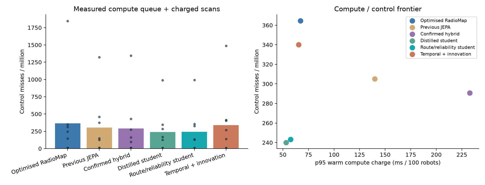

# Warehouse world-model optimisation frontier

Development selected **Temporal + innovation**. On eight fresh primary warehouses, with compute and scan costs charged, it reaches **340.10** control misses per million versus **364.58** for optimised RadioMap. Paired difference: -24.48 ppm, 95% site-bootstrap interval [-128.13, 42.71].
The prespecified primary control-superiority interval includes zero; the superiority claim fails.

## Implemented optimisation axes

- Rolling fleet sufficient statistics, eliminating repeated full-minute reconstruction.
- BLAS covariance projection for RadioMap itself, so the reference benefits from the numerical optimisation too.
- Three compact single-member families: teacher distillation, route/reliability loss, and GRU history plus causal innovation correction. Each has three independent fits; validation fixes one checkpoint per family.
- Absolute report count, AP-local cross-band pooling, variable fleet density and sparse-scanning training.
- Route-change and ns-3 MCS0 failure-surrogate losses. The surrogate is not end-to-end native packet supervision.
- Independently selected native versus saturated-margin planners for every reference and candidate.
- An asynchronous FIFO of measured processing costs, forecast-age interpolation, and actual scan outages in the packet kernel.

## Fresh results

| Condition | Optimised RadioMap | Previous JEPA | Confirmed hybrid | Distilled student | Route/reliability student | Temporal + innovation |
|---|---:|---:|---:|---:|---:|---:|
| main | 364.58 | 305.21 | 290.62 | 240.10 | 243.23 | 340.10 |
| drift | 866.67 | 343.06 | 598.61 | 341.67 | 394.44 | 583.33 |
| sparse | 177.78 | 180.56 | 105.56 | 123.61 | 120.83 | 141.67 |
| slow | 141989.58 | 161237.50 | 150300.00 | 145954.17 | 147618.75 | 145735.42 |

Missed control commands per million; eight primary sites, six each drift/sparse and four slow-hardware stress sites. All have 100 robots.

## Forecast and timing quality

| Model | Forecast RMSE | Route-change RMSE | AP-choice regret | Warm charge (ms) | Cold charge (ms) |
|---|---:|---:|---:|---:|---:|
| Optimised RadioMap | 6.61 | 2.27 | 0.270 | 67.20 | 559.76 |
| Previous JEPA | 8.36 | 2.50 | 0.268 | 139.86 | 340.21 |
| Confirmed hybrid | 4.54 | 2.16 | 0.190 | 232.74 | 929.10 |
| Distilled student | 4.82 | 2.23 | 0.221 | 53.05 | 253.40 |
| Route/reliability student | 5.50 | 2.23 | 0.228 | 57.56 | 252.07 |
| Temporal + innovation | 5.67 | 2.24 | 0.279 | 65.46 | 262.88 |

Timing is measured in a quiet single-thread CPU profile on validation inputs, including tensor packing. Sparse scans use their own profile. Cold has one probe and refit has two; the latter includes a seventeen-timestamp catch-up probe, so its processing budget is deliberately larger than an ordinary cached update. This is a microbenchmark envelope, not a production latency guarantee or a monotonic bound on packet losses.

## Timing-free ablation

This replay removes forecast delay and restores the former 30-second unscheduled background-scan policy. It changes both timing assumptions together, not inference alone.

| Model | Charged misses / million | Former timing assumptions | Difference |
|---|---:|---:|---:|
| Optimised RadioMap | 364.58 | 378.65 | -14.06 |
| Temporal + innovation | 340.10 | 338.54 | 1.56 |

## Evidence, limits and remaining options

Nine real fits, 96 native development runs and 160 test runs on 24 fresh sites. Every reference is recomputed with the same strictly past inputs, charged timing and scan cadence. Earlier evidence is preserved; these are new scenarios and cannot be compared directly with the old 167/133-ppm cohort.

The kernel models 30 ms scans and 30 ms handovers normally. Slow stress uses 90 ms scans, four-second handovers and an added 500 ms compute delay. These durations are assumptions, not hardware measurements. Scanner report phases are idealised; attached-link measurements remain idealised; robot trajectories and warehouse CAD are fixed; forecast targets include planned-versus-realised route mismatch. No physical fleet or arbitrary-layout qualification follows.

This is a finite search, not exhaustion of all world-model options. Remaining work includes native counterfactual packet-loss training, varied CAD layouts, calibrated joint uncertainty, live observation/scan coupling, measured hardware timing and resource-aware fleet scheduling. Negative results and failed promotion checks remain evidence.

Reproduce with `bash scripts/run_world_frontier.sh`. Audit with `uv run --frozen python scripts/audit_world_frontier.py`.
