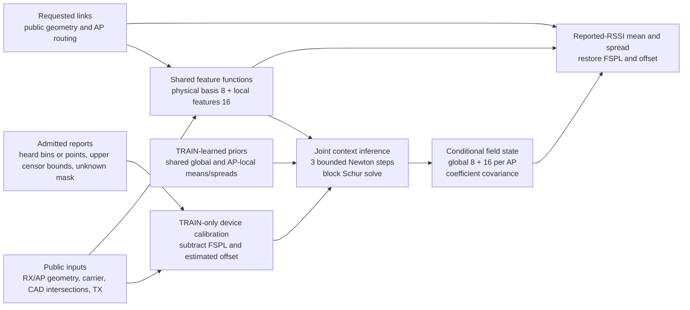

# Shared physics and AP-local radio fields

The implemented model predicts reported RSSI at requested receiver positions,
APs and carriers from a finite set of actual radio reports and public geometry.
It learns a reusable spatial representation and coefficient priors, then
conditions a new field posterior on the admitted reports. The registered
experiment in [PLAN.md](PLAN.md) determines whether this structure improves
prediction and simulated warehouse decisions. This document describes the
implementation; it contains no experimental result or superiority claim.

## The representation

For a link to AP `a`, the residual field is the sum of a shared physical term
and an AP-local spatial term:

`RSSI = FSPL_received_power + estimated_offset + g(query) · global_state + l(query) · local_state[a]`.

The eight fixed global features describe distance, public box crossings,
distance inside boxes, log carrier and their frequency interactions. The local
features combine eight fixed Fourier features of physical RX-minus-AP XYZ
with eight bounded learned features. A shared `13 → 32 → 16 → 8` network reads
public propagation geometry and relative XYZ; its outputs use `tanh / sqrt(8)`.
AP integers route posterior blocks and never enter a learned ID embedding.
Fourier coordinates use metres rather than room-normalized distances.

There is one shared eight-dimensional state and a sixteen-dimensional state
for each AP. Local prior parameters are shared across APs. This permits a
different AP count without allocating new learned identities. It does not
establish invariance to arbitrary warehouses, scales, radios or protocols.
The implementation scales residual-state coordinates by ten internally and
returns means in dBm and standard deviations in dB.

## Conditioning and uncertainty

The [data adapter](../../src/wirelessjev/hierarchical_radio/data.py) preserves
the reporting event: a heard quantization bin intersects the detector floor;
a ranked-out report supplies its actual upper bound; unresolved paths stay
unknown. Continuous native reports use a point Gaussian likelihood. Device
calibration uses TRAIN pairs only, with device zero fixing the assumed gauge.
Query RSSI, query reporting cutoffs and material labels never become features.

The [model](../../src/wirelessjev/hierarchical_radio/model.py) assimilates one
admitted view once into a joint global/local posterior. It does not first fit
a current-report prior and count those reports again. Three interval-likelihood
Newton steps use a fixed backtracking rule; a step that increases the context
objective is rejected. Schur complements retain global/local coupling while
factoring small AP blocks. Gaussian point conditioning is exact for the stated
linear Gaussian model; interval MAP and observed-information covariance are
finite-step approximations.

Predictive spread combines coefficient uncertainty and a shared
geometry-dependent discrepancy bounded between 1 and 15 dB. Small-probe
covariance, limited to 512 queries, describes the coefficient field; it does
not invent cross-link discrepancy correlation. Large forecasts render marginal
variances without constructing a query-by-query covariance matrix. Correlated
reports, latent non-identifiability and approximate inference remain limits;
bounded features and positive priors are not proof against representation
collapse or proof of calibrated packet risk. Predictions never become evidence.

## What the controls isolate

Five [training cells](../../src/wirelessjev/hierarchical_radio/training.py)
receive matched data and optimizer budgets, with three seeds per cell:

| Cell | Purpose |
| --- | --- |
| `hier_reg` | Hierarchical posterior with two-view target likelihood. |
| `hier_joint` | Same model plus fixed predictive agreement on common, AP-supported query probes. |
| `global_reg` | Same features and learned parameter count, pooled into one 24-dimensional posterior state. |
| `global8_reg` | Supplementary eight-state physical capacity control. |
| `hier_erased` | Hierarchy retaining genuine detection events but erasing context amplitudes. |

The global-24 comparison tests how state is shared, beyond merely adding
features or trainable weights. The hierarchy still has more *per-scene inferred
state*: `8 + 16 × AP_count` versus 24. Joint-view agreement is trained together
with regression; it has no EMA teacher and is not claimed equivalent to classic
JEPA. The three material assignments are static counterfactual fields, not a
learned temporal transition model.

The [numerical references](../../src/wirelessjev/hierarchical_radio/baselines.py)
include a TRAIN-learned AP/carrier-local RadioMap operator with 48 spatial
Fourier features plus physical/geometry features, and a fixed-feature
hierarchical control. They receive the same admitted A context. The former
uses proper interval/censor inference and three predeclared spatial scales;
it is not bit-identical to the native RadioMap implementation.

## Selection, costs and scope

[Study orchestration](../../src/wirelessjev/hierarchical_radio/study.py) locks
each checkpoint using sparse validation interval NLL at four fixed epochs.
The hierarchy branch uses all three members' validation scores; numerical
scale selection also uses validation alone. TEST and native outcomes never
select a model. Whole-layout comparisons keep queries, APs and material states
nested; reported intervals are conditional on the three trained members.

The finite budget is 186 actual RT cases, 15 neural fits of 480 committed
updates, and a separate 34-run native diagnostic. Context budgets are 192 or
96 reports. With global width `g=8`, local width `l=16` and `A` APs, conditioning
factors `A` local blocks and one global Schur block rather than a dense
`(g + A·l)` matrix. This avoids cubic growth of a dense AP-wide factorization;
feature evaluation, context assembly and query rendering still incur real
compute. [Native integration](../../src/wirelessjev/hierarchical_radio/native.py)
records actual prediction and support-preparation time and charges completion
and transport delays in the unchanged warehouse kernel.

Primary RF data uses four APs and 2.4/5.2 GHz; held 6.0 GHz and eight-AP transfer
are descriptive. The separate native diagnostic uses 100 simulated robots,
16 APs, a different physical scale and 6.5 GHz. It compares full-history
RadioMap with matched-context numerical, global and hierarchical predictors,
using the same support guard for the matched methods. This is static
reported-RSSI modeling and simulated control transfer. It is not validated
hardware operation, temporal world modeling, protocol-independent PHY control,
production qualification or a universal foundation model.
