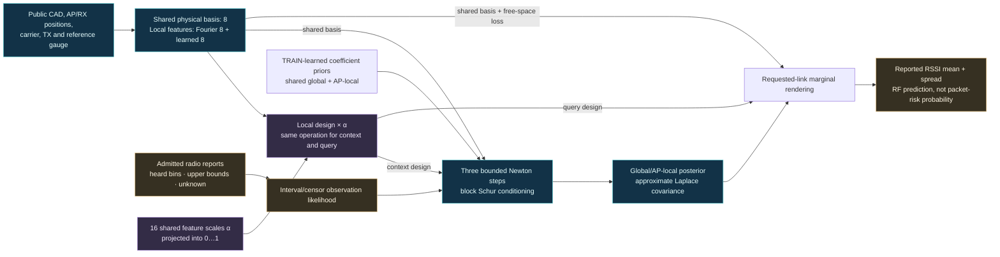
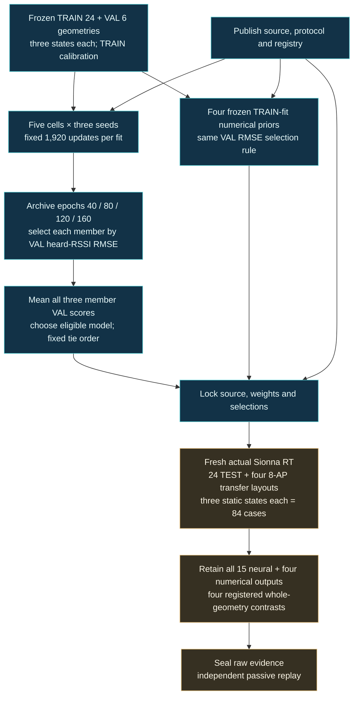

# A radio field with optional local structure

The model combines eight shared propagation coefficients with sixteen spatial
coefficients per AP. Sixteen learned feature scales let the local channel
switch fully off. The same scales act on observation and query designs, so
conditioning, predicted means and covariance describe one coherent field.
The [registered plan](PLAN.md) tests this representation and a larger training
budget without assuming that either improves prediction.

The [model implementation](../../src/wirelessjev/nested_radio/model.py) reuses
the unchanged interval-Newton/Schur solver. Public geometry defines the
design; coefficient priors are learned from TRAIN. AP integers route posterior
blocks rather than indexing a learned AP identity table. New AP counts can
therefore be represented without adding identity parameters. Their accuracy,
calibration and cost still require evaluation.

Heard reports retain their real quantization intervals. Ranked-out reports
retain an upper censor bound; unresolved numerical paths remain unknown.
Neither becomes an invented floor-valued measurement. Query reporting cutoffs,
private materials and private channel coefficients are excluded from model
features. Relative calibration uses TRAIN reports and assumes a device-zero
reference gauge; it does not identify an arbitrary radio's absolute bias.

## What exact fallback means

For a fixed set of remaining weights, setting every local scale to zero
recovers global-eight means, marginal deviations and coefficient-field
covariance up to floating-point roundoff. Setting every scale to one recovers
the legacy hierarchical forward calculation. Zero design does not require a
singular coefficient prior. Predictions are never inserted as measurements.

This is a function-class inclusion property. It does not guarantee that a
trained nested model matches an independently trained global control, that
optimization finds the zero solution, or that held-out error cannot increase.
The optimizer projects direct finite gate parameters into [0,1] after every
update; forward evaluation rejects an unprojected state. There is no second
forward clamp or straight-through gradient. Reactivating a zero channel is not
guaranteed.

## Regularize the effective prior, not the gate alone

The local coefficient prior keeps its trainable mean and standard deviation
`sigma = 0.2 + softplus(raw_sigma)` in residual units scaled by ten when
rendered in dB. A small gate alone does not establish shrinkage: a larger
coefficient mean or SD can compensate for it. The nested cells therefore add
the fixed penalty

`0.01 × mean(alpha × sqrt(mu_local² + sigma_local²) / 0.5)`.

Reciprocal gate/prior rescaling cannot reduce this penalty while preserving
the same effective coefficient prior. Report gated means, SDs and RMS values
alongside the gates. These are coefficient-prior diagnostics before
conditioning and numerical jitter. They are neither a predictive-SD floor nor
a universal field-variance bound; query features are correlated and the prior
scales remain trainable. No gate is identified as a material or scatterer.

## Controls and training are explicit

| Cell | Local design | Added objective |
| --- | --- | --- |
| `global8_reg` | Disabled | Two-view supervised interval/censor likelihood |
| `global8_joint` | Disabled | Same likelihood + predictive agreement |
| `hier_reg` | Fixed unit scales | Same likelihood |
| `nested_reg` | Learned scales, initialized at 0.1 | Same likelihood + effective-prior RMS penalty |
| `nested_joint` | Same learned scales | Same likelihood + same penalty + predictive agreement |

Joint cells use a fixed 0.1 variance-normalized agreement term at supported
common query probes. Both means receive gradients; the variance normalizer is
detached. There is no EMA teacher or classic-JEPA equivalence claim. The
nested-versus-legacy comparison changes gate initialization, gate learning and
regularization together; it tests that package rather than one isolated cause.

Nested cells allocate 1,562 trainable parameters; controls allocate 1,546.
With four APs, hierarchical inference uses 72 scene coefficients (8 + 4 × 16)
versus eight for the small global control. These comparisons do not match all
forms of capacity. The global controls' local kernel features are unused;
their raw variation must not be called a trained representation.

The [trainer](../../src/wirelessjev/nested_radio/training.py) fits three seeds
per cell: fifteen fits, each with 160 epochs and 1,920 committed updates.
Atomic optimizer/RNG snapshots preserve the same trajectory after interruption.
Weights and actual validation predictions are archived at epochs 40, 80, 120
and 160. Each member selects the first minimum sparse view-A heard-RSSI RMSE,
with states and geometries weighted equally. NLL is reported separately.
Selecting the last checkpoint does not certify convergence.

The [selection and evaluation implementation](../../src/wirelessjev/nested_radio/study.py)
chooses among global-eight regression, global-eight joint, nested regression
and nested joint using the mean of all three selected member scores, with that
order breaking exact ties. Legacy hierarchy remains a control. The numerical
reference is the validation-best of RadioMap-operator scales 5/10/20 m and the
fixed-feature hierarchy, not a reference selected from TEST. All four are
retained without refitting their priors. If the selected cell is global-eight
regression, the selected-versus-base comparison is an exact alias/null rather
than evidence of a residual gain.

## Evidence boundary

The [data adapter](../../src/wirelessjev/nested_radio/data.py) reuses only the
immutable TRAIN/VAL inputs and calibration. Fresh geometry fingerprints are
disjoint from all 240 previous public geometry records. Full/sparse source
contexts contain 192/96 tokens; eight-AP transfer keeps the same total cap.
Source carriers are 2.4/5.2 GHz and 6.0 GHz is held out of fitting/selection.
All 84 cases are static material counterfactuals, not chronological episodes.

Primary intervals resample 24 whole TEST geometries with members and states
nested inside them. Four-family adjusted central 98.75% intervals use 20,000
paired draws and are conditional on three trained members. Full context,
material deltas, held-band, stale-context, eight-AP stress and coverage remain
descriptive. Validation feature diagnostics distinguish fixed Fourier eight,
ungated learned geometry eight and gated local sixteen; rank alone diagnoses
neither collapse nor physical observability.

This phase performs zero new warehouse simulations and zero hardware actions.
The interface predicts RSSI and approximate marginal uncertainty; it does not
learn event-time transitions or calibrated command/deadline/silence risk.
Packet transfer, physical radios and specialist-SOTA comparisons need separate
evidence. RadioMap remains the application default and original SERVICE
holdouts remain closed.
