# Current radio model and warehouse decision system

WirelessJEV turns validated missions and radio forecasts into typed, bounded
association proposals. The system combines causal report memory, explicit
observation budgets, a forecast interface, mission-aware planning, independent
admission and paid command transport. RadioMap is the application default.
An experimental RadioJEPA RF branch adds optional AP-local structure and
predictive agreement to a physical radio field.

The selected experimental model reaches **2.637330 dB** sparse heard-RSSI RMSE
versus **2.710522 dB** for the strongest validation-selected numerical reference,
with an adjusted improvement interval. Fifteen seeded fits and 84 fresh actual
Sionna RT cases are complete; the first independent replay passes. This is
**RF-only** evidence: these new weights have zero new warehouse simulations or
hardware trials. The joint-view contribution is just 0.002226 dB. All learned
local geometry channels are gated off in the selected nested members; the gain
is compatible with a shrunk fixed-feature local residual, not evidence of a
rich learned geometry representation. The [complete results](../nested_radio/RESULTS.md)
retain all controls and tradeoffs.

```mermaid
flowchart LR
    RADIO["Radio and packet process"] --> SCAN["Paid client scans<br/>actual capture/completion clocks"]
    SCAN --> CACHE["Completed local cache<br/>heard bins · bounds · unknowns"]
    CACHE -->|"actual report delivery"| MEMORY["Causal server memory<br/>AP · carrier · device gauge · clocks"]
    MEMORY --> SELECT["Matched causal selector<br/>explicit report budget"]
    CAD["Public CAD, TX, carrier<br/>and planned receiver positions"] --> SELECT
    SELECT --> EXP["Experimental RF field<br/>shared physical 8 + optional 16/AP<br/>static learned feature scales"]
    CAD --> EXP
    MEMORY --> DEFAULT["Default full-history RadioMap"]
    CAD --> DEFAULT
    EXP -.->|"future integration:<br/>nested native adapter required"| BRIDGE["Existing RSSI-to-SNR bridge<br/>declared reference and noise assumptions"]
    DEFAULT --> QUEUE["Paid FIFO forecast queue<br/>actual completion and overruns"]
    BRIDGE --> QUEUE
    QUEUE --> OUTCOME["Typed PHY outcome adapter<br/>supported actions · available heads"]
    MISSION["Validated mission costs"] --> PLANNER["WirelessJEV bounded planner"]
    OUTCOME --> PLANNER
    PLANNER --> GUARD["Independent eligibility and admission"]
    MEMORY -->|"delivered-evidence refresh"| GUARD
    GUARD --> COMMAND["Paid command creation<br/>actual later delivery · expiry"]
    COMMAND --> SWITCH["Charged association handover"]
    SWITCH --> RADIO
    CACHE -.-> LOCAL["Separate client-local recovery<br/>off in the retained native diagnostic"]
    LOCAL -.-> SWITCH
```

This shows the built interfaces and a dashed future integration for the nested
RF branch. The earlier hierarchy's native bridge is implemented and tested;
the nested model still needs its own adapter and warehouse validation.
Forecasts and proposals never grant their own permission to actuate physical
hardware.

## RF representation and report likelihood

The [optional local field](../nested_radio/ARCHITECTURE.md) predicts reported
RSSI means and approximate marginal spreads at requested receiver positions,
APs and carriers. Public CAD intersections, positions, TX and carrier define
physical propagation features. TRAIN-only relative calibration assumes a
device-zero gauge. Heard quantization bins, genuine upper censor bounds and
unknown paths remain distinct; query reporting cutoffs, private materials and
private channel coefficients never become features or invented measurements.

Eight shared propagation coefficients combine with sixteen spatial coefficients
per AP: eight fixed Fourier and eight learned geometry features. AP integers
route posterior blocks without learned identity embeddings. Sixteen learned
feature scales are shared across APs/queries and fixed during inference; they
are not context-dependent AP vetoes. The same scales act on context and query
designs, keeping conditioning and rendering consistent.

With the other weights held fixed, setting every local scale to zero reproduces
the global-eight field up to numerical roundoff. Setting them to one reproduces
the unit-scale hierarchy. Function-class inclusion does not guarantee equal
independently trained weights, optimization success or held-out noninferiority.
Direct finite scales are projected into [0,1] after each update; zero-channel
reactivation is not guaranteed.

The nested objective regularizes effective coefficient-prior RMS,
`0.01 × mean(alpha × sqrt(mu_local² + sigma_local²) / 0.5)`, so shrinking a gate
cannot evade the penalty by inflating its trainable prior. The original positive
prior SD floor stays. This coefficient-space penalty depends on basis scale;
it is not a physical field-energy penalty. Effective coefficient RMS is not
predictive SD or an identified material. Nested cells allocate 1,562 parameters
versus 1,546 for controls; four-AP hierarchical inference uses 72 coefficients
versus eight for the small global control. These are different capacity counts.

Three bounded interval-likelihood Newton steps use block Schur conditioning
and approximate Laplace covariance; the shared solver also supports genuine
continuous point reports. Requested-link forecasts render marginal spreads
without requiring a dense query covariance. Predictions never enter memory as
measurements. The model is a context-conditioned spatial field, not a trained
temporal transition, identified scatterer model or calibrated packet-risk head.

The joint cell adds fixed-weight, variance-normalized common-probe agreement
to the same two-view supervised interval/censor likelihood. Both means receive
gradients and the variance normalizer is detached. It has no EMA teacher or
classic-JEPA equivalence claim. All eight learned local feature gates are
exactly zero in each selected nested regression/joint member; 5/5/6 fixed-Fourier
channels remain active across their seeds. Raw learned-geometry rank is near one,
but those channels are inactive. Pruning can reflect the declared regularizer;
its cause is untested. This is neither whole-model collapse nor evidence that
learned local representations deliver the gains. Global controls' local kernels
are unused and untrained.

## Evidence for the current RF branch

The [registered plan](../nested_radio/PLAN.md) fixes five cells × three seeds,
1,920 updates each and sparse heard-RSSI RMSE selection at epochs
40/80/120/160. All fits finish 160 epochs; selected epochs are 80 or 120.
Only 24 TRAIN/six VAL geometries and TRAIN calibration fit/select the models.
All four frozen numerical priors use the same VAL point-error selection rule;
fixed hierarchy wins that selection. The fresh assay contains 24 four-AP TEST
and four eight-AP transfer geometries, each with three static material states.
Source carriers are 2.4/5.2 GHz; 6.0 GHz is held out.

| Primary sparse contrast | Candidate minus reference RMSE, dB | Central adjusted 98.75% interval |
| --- | ---: | --- |
| Selected nested joint versus best numerical | −0.073192 | [−0.126150, −0.023013] |
| Selected nested joint versus global-eight regression | −0.014339 | [−0.023057, −0.005348] |
| Nested regression versus unit-scale hierarchy | −0.188225 | [−0.233787, −0.147843] |
| Nested joint versus nested regression | −0.002226 | [−0.004345, −0.000883] |

Whole-geometry bootstrap uncertainty is conditional on three trained members;
member and material-state metrics are nested inside 24 geometries. The
nested-versus-unit-scale comparison tests a gate/init/regularizer package,
not isolated removal of a prior floor. Joint agreement's very small primary
benefit does not extend to every stress group or interval likelihood. Fixed
hierarchy slightly outperforms the selected field on static material-difference
error. No cross-study point-estimate comparison supplies a paired gain.

The seal binds 578 source and 2,770 evidence files. The independent passive
audit checks all ten study closures and replays raw selections, predictions,
diagnostics and intervals without model execution or scientific reruns.
[Software verification](../../artifacts/nested_radio_review/software_suite_importlib.json)
records 3,633 passing tests across 153 modules, with 575 source/config/test files
unchanged. This is hash-bound provenance, not a signature or physical-device
validation. The [3D viewer](../../artifacts/nested_radio_review/viewer/index.html)
retains actual geometry/reported targets, all controls, checkpoint trajectories
and effective gate/prior products.

## Causal memory, paid forecasting and typed planning

Server memory sees completed scans only after actual report delivery; a local
scan can remain unavailable during an outage. The built
[192-report selector](../../src/wirelessjev/hierarchical_radio/native.py) uses
public planned positions and declared ages rather than RSSI amplitude to choose
history. Post-warm reports need matching measurement, completion and arrival
payload evidence; warm bins preserve unknown arrival clocks. Support refresh
uses delivered evidence even while a forecast is queued.

The forecast queue charges declared cold/warm/refit floors plus shared work,
including actual elapsed overruns. Forecasts become available on completion.
Scans, support preparation, planning, central command creation, packet delivery
and handovers remain separate costs. This is simulator/wall-time accounting,
not a matched inference-compute or energy benchmark. Closed-loop actions can
change future connectivity and observations; equal selection rules do not
force identical realized histories.

The [typed boundary](../../src/wirelessjev/worldmodel/interface.py) separates
forecasts, candidate actions and outcome distributions from missions and
actuation handles. The [RF-to-service adapter](../../src/wirelessjev/adaptive_radio/service.py)
declares carrier/TX references, receiver noise, linear-power interference and
reciprocity assumptions. Its current rate/outage mapping uses declared PHY and
retry surrogates. Missing latency or silence heads remain unavailable; an RF
calibration receipt cannot qualify packet risk or grant gate permission.

Validated mission costs rank finite supported association candidates. The
built [multistep planner](../../src/wirelessjev/adaptive_radio/planning.py)
searches a capped association tree over exogenous forecasts with explicit
candidate, horizon, evaluation and time budgets. It advances known association
and handover state, rather than learning action-conditioned propagation or
jointly optimizing motion, interference, routes and queues.

Independent eligibility/admission checks remain downstream of planning. The
retained native diagnostic's matched branches use a source-band support guard
refreshed from delivered evidence. This is a declared support heuristic, not
held-band calibration. Commands pay creation time, require a later-created
delivered frame and expire; repeating a target does not renew its lifetime.
Receiver availability and execution conditions are checked separately.

Client-local recovery is a separate capability with own-client scans/current
pilots, paid delayed decisions and revalidation. It is off in the retained native
diagnostic. [Recovery evidence](SPATIAL_CONTROL.md) includes harms; preinstalled
software does not establish safe default behavior or physical actuation authority.

## Service and production limits

The separate [native-system assay](../hierarchical_radio/RESULTS.md) has 34
warehouse executions using different frozen checkpoints. It retains 100-robot
simulation results, two handover costs, command-miss harms and an 8.89-second
gap. Full-history RadioMap has lower mean misses than its selected hierarchy.
Those executions validate a different comparison and cannot establish service
benefit for the new nested weights. Native carriers 2.4/5.2/6.5 GHz also differ
from the RF held-6.0-GHz assay; geometry, gauge and PHY assumptions remain explicit.

Complex-CSI, phone calibration and DINO/camera components remain scoped studies
or readers, not one validated fused representation in this RSSI model. No
specialist-SOTA, protocol-independent PHY optimization, identified dynamics,
production qualification or universal foundation-model claim is established.
[Remaining validation](../nested_radio/REMAINING.md) covers a separately
registered warehouse transfer, independent training/site/device evidence,
observation-driven dynamics, calibrated service tails and actual hardware
rollback tests. RadioMap stays the application default, original SERVICE
holdouts stay closed and the new model's physical-hardware count remains zero.
