# Current radio world model and decision system

WirelessJEV supplies typed missions, bounded planning and an independent gate.
The experimental RF model supplies a geometry-conditioned field posterior from
reported measurements. The built [spatial-control stack](SPATIAL_CONTROL.md)
adds causal report memory, source-band support and separately authorized
client-local recovery around the **unchanged validation-selected regression
checkpoint and 64-token encoder**. RadioMap continues its ordinary numerical
history fits and remains the application default.

The fixed [spatial-control diagnostic](../spatial_control/PLAN.md) completed
48 fresh simulations and two disabled-extension parity simulations. Its
canonical audit, 543-source/224-evidence seal and independent passive review
pass. Results below describe this finite controller
experiment, not new RF representation training or production qualification.

```mermaid
flowchart LR
    CAD[Public CAD, AP positions,<br/>carrier, TX and planned route] --> FIELD[Fixed physical-field model<br/>shared geometry operands]
    RADIO[Native radio and packet process] --> SCAN[Paid own-client scan<br/>90 ms interruption]
    SCAN --> CACHE[Actually completed local cache<br/>values, bounds and capture clocks]
    CACHE -->|successful report transport| SERVER[Causal delivered-report history]
    SERVER --> TOKENS[Unchanged 64-token selection]
    TOKENS --> FIELD
    SERVER --> MEMORY[Spatial report memory<br/>AP, band, gauge, position and time]
    MEMORY --> SUPPORT[Optional latest-own source-band support<br/>regression support/both arms]
    FIELD --> QUEUE[Measured-completion forecast queue]
    QUEUE --> WM[Typed RF outcomes]
    MAP[Independent full-history RadioMap] --> WM
    WM --> PLANNER[Bounded association planner]
    MISSION[Validated mission cost] --> PLANNER
    PLANNER -->|support enabled| SUPPORT
    PLANNER -->|support disabled| CENTRAL
    SUPPORT --> CENTRAL[Paid central command creation<br/>expiry and delivery ledger]
    CENTRAL -->|later delivery of eligible control frame| MOVE[Charged handover]
    CACHE --> LOCAL[Preinstalled own-client watchdog<br/>paid decision and revalidation]
    PILOT[Valid own current-link pilots] --> LOCAL
    LOCAL --> MOVE
    MOVE --> RADIO
```

The server guard can refresh its evidence with payload-matched reports that
actually arrive while a forecast is queued. A completed local scan that was
not delivered remains unavailable to the server. The separate preinstalled
client capability can use its own completed cache during an outage. These
are different information and execution-authority paths.

## What the model and memory actually compute

The adaptive model learns a geometry/status prior and conditions eight global
propagation coefficients on heard centers, context-estimated quantization
variance and a censored Gaussian EM update. Training scores detector-truncated
intervals and censor events. This is an approximate Gaussian field posterior,
not an exact interval-likelihood posterior or identified material/scatterer
state. The decoder combines free-space loss, a propagation basis and bounded
local geometry correction. Forecasts are rendered afresh; predicted RF is not
inserted as a new observation. The joint and regression variants share the
architecture; cross-view agreement is the controlled training difference.

The new memory stores explicit points, intervals, upper censor bounds and
missing reports with AP/carrier/gauge, position and measurement/arrival clocks.
Unknown measurement ages cannot pass strict freshness. General retrieval can
reserve eligible own evidence and rank remaining rows by age and distance.
The current controller uses this memory for **admission**, not a new encoder
context or learned AP/region hierarchy. Support indexing is charged inside
forecast issue/completion; exact shared geometry operands are reused by all
learned arms. The earlier 2.831× operand-call result is not a full-model or
service speedup claim.

The support rule checks the newest own report on each measured source band
before the spatial cut: a newer censor or distant report cannot resurrect an
older nearby positive. At least one 2.4/5.2 GHz report must be heard at
−80 dBm or better, at most six seconds old and within five metres of the public
planned query position. A second actually measured source band can qualify
the AP. This does not qualify 6.5 GHz, all AP bands, actual localization, SINR
or packet risk. Refresh and admission costs remain inside the paid central
allowance. Additional delivered history is separate from the 64 encoder tokens.

## Execution, recovery and the remaining model boundary

Both simulated handover costs now require paid central command creation,
a control packet created no earlier than that command, and actual later
delivery before expiry. Creation has a 100 ms allowance; pending commands
expire after one second, and repeating the same target does not renew them.
Every fresh arm uses these semantics. Its comparison with the older native
diagnostic cannot isolate one intervention.

The separately preinstalled local watchdog sees only its own completed paid
scans, valid current-association pilots and past delivery status. Its 200 ms
silence trigger, five-second scan age, −75 dBm target floor, conditional 8 dB
margin and five-second dwell/backoff are engineering heuristics. Without a
fresh current-link measurement it uses the absolute target floor without
inventing a switching gain. Autonomous/background scans share five-second
start spacing and each costs 90 ms. Local decisions pay a 10 ms minimum delay;
the whole-fleet tick and delayed-validation batch each have a separate five-
millisecond compute budget. Late work is discarded, actual completion delays
subsequent work, and delayed actions revalidate their evidence and single-use
authorization. UNKNOWN lifecycle states remain unresolved. Warm bins do not
create exact local scan-completion clocks. Realized observations can differ
between arms as a consequence of their actions.

Measured work uses elapsed wall time while running on CPU, not process CPU
consumption. Paid forecast time combines declared profile floors with actual
elapsed overruns; an arm's mean charge is not a bound on every episode.

This is implemented simulator control, not learned temporal dynamics,
authenticated physical authority or proof of reachable safe connectivity.
AP/region latent hierarchy, observation-driven slow/mid/fast transitions and
trained protocol-supervised deadline/retry/silence heads remain proposed
research in [NEXT_MODEL.md](NEXT_MODEL.md). RF-model spread is not calibrated
command risk. Current typed outcomes retain declared PHY/retry surrogates and
known handover costs; latency/silence heads remain unavailable. The separate
bounded multistep planner advances associations over exogenous RF forecasts;
its software tests do not establish joint fleet-control benefit.

## Evidence boundaries

The completed spatial-control comparison retains both handover mechanisms.
These are four-episode means; maximum silence is the mean of each episode's
maximum, not a fleet-wide guarantee. The full registered contrast and harm
table is in [the execution ledger](EXECUTION_LEDGER.md#spatial-control-contrasts).

| Handover | Forecaster/control | Command miss, % | Worst-decile miss, % | Mean episode maximum silence, ms |
|---|---|---:|---:|---:|
| 0.03 s | RadioMap | 1.044375 | 1.468750 | 285.0 |
| 0.03 s | RadioMap + local recovery | 1.044375 | 1.468750 | 285.0 |
| 0.03 s | Regression | 1.635625 | 7.350000 | 5,817.5 |
| 0.03 s | Regression + support | 1.107500 | 2.100000 | 570.0 |
| 0.03 s | Regression + local recovery | 1.306250 | 4.056250 | 2,585.0 |
| 0.03 s | Regression + both | 1.079375 | 1.812500 | 355.0 |
| 4 s | RadioMap | 1.406875 | 4.925000 | 2,110.0 |
| 4 s | RadioMap + local recovery | 1.629375 | 7.150000 | 4,237.5 |
| 4 s | Regression | 1.362500 | 4.493750 | 1,042.5 |
| 4 s | Regression + support | 1.346875 | 4.337500 | 992.5 |
| 4 s | Regression + local recovery | 1.630625 | 7.175000 | 4,237.5 |
| 4 s | Regression + both | 1.629375 | 7.168750 | 4,237.5 |

At 0.03 s, support/local recovery/both improve regression's mean, with
1/0/0 episodes harmed on misses and none on maximum gap. Regression + both
still misses more than RadioMap + recovery in all four episodes. At 4 s,
support alone has no miss/gap harms versus regression; recovery and both
harm all four episodes on both metrics. RadioMap recovery also harms all
four slow-handover episodes. Equal slow mean loss between regression + both
and RadioMap + recovery hides three episodes with more misses. These
descriptive controller outcomes establish no JEPA-objective or general benefit.

| Track | Established scope | Boundary |
|---|---|---|
| Adaptive RF-state assay | Sealed 24-layout static-condition assay supports RF-dependent regression gains over RadioMap/RF-erased controls | Joint alignment is worse; pooled Bayes nearly ties; no dynamics, physical-device or packet guarantee |
| Spatial support and recovery | Built memory/support, causal central commands and separately preinstalled paid own-client recovery; all 48+2 simulations, seal and independent review complete | Mixed handover-dependent gains/harms; same encoder/weights, no representation or service-head claim |
| Completed native bridge | 18 simulated executions with measured cost and raw delivery evidence | All four fast-handover episodes harmed; 9.74-second recovery outlier retained; no SmartCar or SLA qualification |
| Measured complex CSI | Actual DICHASUS same-packet masked completion and observability analysis | Negative learned result; no identified scatterers, temporal dynamics or cross-array phase alignment |
| Measured phone transfer | Real five-phone localization/calibration on TUJI | No isolated session/device inverse or RadioJEPA encoder-transfer claim |
| E7 calibrated-map planning | Sealed 225-pair oracle-conditioned diagnostic on opened environments | Better map accuracy gives mixed utility, not consistent planning benefit or promotion |
| Sensing-design mathematics | Target ambiguity and prior-conditioned information per cost | No executed on-air acquisition policy or qualified fleet value of information |

Native carriers remain 2.4/5.2/**6.5 GHz**; the RT held-band assay uses **6.0 GHz**.
Extruded warehouse CAD, zero device-gauge assumptions and PHY-table proxies
remain simulator approximations. Motion is exogenous. No new physical radio
action or original SERVICE opening follows from these software paths.

The source-bound [software proof](../../artifacts/spatial_control_review/final_software_suite.json)
records **2,978 passing tests**, 138 test modules and 436 unchanged source files.
The 543-file spatial-control source, protocol and finite plan were published
before execution. The [report](../../artifacts/spatial_control/report.json) and
[manifest](../../artifacts/spatial_control/verification/manifest.json) and
[independent review](../../artifacts/spatial_control_review/result.json) retain all
48 fresh rows, pending-command bounds, video/bulk, scan interruptions and paid
compute. Software success and these four short simulated episodes do not
establish physical service; [REMAINING.md](REMAINING.md) retains those gaps.
