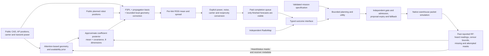

# Current radio world model and decision system

WirelessJEV supplies the mission, planner and independent trust gate. The
experimental adaptive radio model supplies a geometry-conditioned field
posterior from actual reported RF measurements. RadioMap remains the default.
The experiments below determine which parts of the proposed architecture are
supported; they are not a completed universal wireless foundation model.

The diagram describes the opt-in simulation path. The model never receives a
mission, material-condition label, private ray-traced channel or future RF
measurement. Plans are public inputs. Robot motion is exogenous in this probe;
the packet/controller loop does not establish coupled motion safety.

## What the model actually computes

The adaptive model learns a geometry/status prior. It conditions eight propagation
coefficients on heard report centers, context-estimated quantization variance and a censored
Gaussian EM update. Training scores the actual detector-truncated intervals
and censor events. This is an approximate Gaussian coefficient posterior,
not an exact interval-likelihood Bayesian update. Its decoder
combines free-space loss, a propagation basis and a bounded local geometry
correction. Every forecast is rendered from the current posterior; predicted
RF is not fed back as a new observation. The native candidate re-encodes its
latest delivered context for each forecast job; it does not run a learned
temporal transition or the separately implemented event-time filter. This
avoids one source of recursive
residual feedback, but does not prove long-horizon error stability.

The joint and matched supervised variants share architecture and training
budget. The controlled addition is cross-view posterior consistency. Separate
controls erase RF amplitudes while retaining availability, or remove RF status
entirely. The experiment can therefore distinguish geometry, signal availability,
measured amplitudes and consistency training. None is assumed to win.

The posterior spread is an RF-model output. It is not a calibrated probability
of a command missing its deadline. The service interface has explicit risk
calibration and abstention machinery; no qualified packet-risk head follows
from an RSSI fit alone.
Current typed outcomes use the declared PHY/retry surrogate and known handover
costs; rate is a PHY proxy, while latency and silence heads remain unavailable.
The native comparison uses the shared held-action utility. A bounded multistep
planner is implemented separately over exogenous RF and known associations;
its software tests do not establish multistep native-control improvement.

## Evidence boundaries

| Track | What it tests | What it does not establish |
|---|---|---|
| Adaptive RF-state assay | Fresh layouts with three hidden material states; full/sparse attempted observations; true censoring; three training seeds; matched controls and a test gate | Dynamic obstruction, real device transfer, packet reliability or all environments |
| Native bridge | Same planner/gate and actual simulated packet kernel, swapping the RF predictor; 100 robots; explicit costs and raw delivery evidence | Real SmartCars, a fleet SLA, long-horizon stability or production promotion |
| Measured complex CSI | Same-packet masked channel completion on actual DICHASUS recordings | Identified scatterers, temporal dynamics, cross-array phase coherence or a fused CSI/RSSI world model |
| Measured phone transfer | Real five-phone localization and small-support calibration on TUJI | A device inverse isolated from day/body/environment effects or RadioJEPA encoder transfer |
| Sensing-design mathematics | Target ambiguity under a declared linear operator/prior; candidate information per cost | A measured on-air sensing policy or calibrated fleet value of information |

The native bridge uses actual 6.5 GHz queries. It does not rename the RT assay's
6.0 GHz endpoint. The approximation of the native warehouse as public extruded
rack boxes, transfer beyond the RT geometry scale, zero hardware-gauge
assumptions and the native PHY table proxies all remain unqualified.

Registered source and preflight receipts must precede each scientific execution.
Only completed prediction/packet records, passive arithmetic audits and immutable
byte manifests support a result; the diagram alone establishes no performance.
Detailed results and remaining qualification work
live beside this document; these boundaries apply even when an individual
benchmark improves.
