# Current radio model and warehouse decision system

WirelessJEV turns validated missions and predicted radio outcomes into typed,
bounded association proposals. Its forecast boundary can use the default
**RadioMap** or an experimental shared/AP-local RSSI field model. Causal report
memory, measured forecast completion, independent admission and paid command
transport connect these components to the warehouse simulator. A forecast or
proposal never supplies its own permission to actuate physical hardware.

The current experiment has completed 186 actual Sionna RT cases, 15 seeded
fits and 34 warehouse simulations. Its selected hierarchy is worse on the
primary prediction metric than both the global control and numerical map.
Its warehouse mean command misses also exceed global-24 and full-history
RadioMap. The canonical seal binds 567 source and 4,900 evidence files, and
the first independent actual-data audit passes.
[Results and exact status](../hierarchical_radio/RESULTS.md) retain all
comparisons; this page describes the built system without promoting it.

```mermaid
flowchart LR
    RADIO["Simulated radio and packet process"] --> SCAN["Paid own-client scans<br/>90 ms interruption"]
    SCAN --> CACHE["Completed local cache<br/>values, bounds and capture clocks"]
    CACHE -->|"actual report delivery"| MEMORY["Causal server memory<br/>AP, carrier, gauge, position and clocks"]
    MEMORY --> SELECT["Matched causal selector<br/>192 source reports"]
    CAD["Public geometry, actual carriers,<br/>TX, noise and planned positions"] --> SELECT
    SELECT --> EXP["Experimental RF branches<br/>shared 8 + 16 per AP<br/>global 24 or matched numerical map"]
    CAD --> EXP
    MEMORY --> DEFAULT["Default full-history RadioMap"]
    CAD --> DEFAULT
    EXP --> BRIDGE["RSSI-to-SNR bridge<br/>declared reference and noise assumptions"]
    DEFAULT --> QUEUE["Paid FIFO forecast queue<br/>actual completion and overruns"]
    BRIDGE --> QUEUE
    QUEUE --> OUTCOME["Typed PHY outcome adapter<br/>supported action and horizon"]
    MISSION["Validated typed mission cost"] --> PLANNER["WirelessJEV bounded planner"]
    OUTCOME --> PLANNER
    PLANNER --> GATE["Independent eligibility and admission<br/>source-band guard for matched arms"]
    MEMORY -->|"payload-matched refresh"| GATE
    GATE --> COMMAND["Paid central command creation<br/>actual later packet delivery and expiry"]
    COMMAND --> SWITCH["Charged association handover"]
    SWITCH --> RADIO
    CACHE -.-> LOCAL["Available client-local recovery<br/>OFF in current diagnostic"]
    LOCAL -.-> SWITCH
```

The server sees completed scans only after actual report delivery. A completed
local scan can remain unavailable to it during an outage. Server refresh uses
payload-matched delivery events even while a forecast is queued. The separate
client-local capability has different information and authority; its dotted
path is not active in the current registered comparison.

## What the RF model computes

The [shared/AP-local model](../hierarchical_radio/ARCHITECTURE.md) predicts
reported RSSI at requested receiver positions, APs and carriers. Public
geometry, carrier, CAD intersections and TX define free-space and propagation
features. TRAIN-only relative device calibration preserves an explicitly
assumed device-zero gauge. Heard quantization bins, genuine upper censor
bounds and unknown reports remain distinct; query RSSI, reporting cutoffs and
private materials never become model features.

A shared eight-dimensional physical state is combined with a sixteen-dimensional
spatial state per AP. Shared neural and fixed Fourier functions express local
variation in physical coordinates; AP IDs route blocks without learned ID
embeddings. The four-AP hierarchy therefore infers 72 scene coefficients,
versus 24 in the parameter-matched global control. Each allocates 1,546
trainable parameters. Equal parameter counts do not imply equal inferred
state capacity. Priors come from TRAIN or public geometry, and current reports
are assimilated once rather than counted again as an independent prior.

Three bounded interval-likelihood Newton steps use block Schur conditioning
and approximate Laplace covariance. Continuous native heard reports use genuine
point updates. Shared features permit a different AP count without new learned
identities; this is not evidence of arbitrary-environment transfer. Large
forecasts render marginal spreads rather than a dense query covariance.
Predictions never become new measurements.

The joint cell adds variance-weighted predictive agreement to the same
supervised two-view likelihood. It has no EMA teacher and is not equivalent
to classic JEPA. The model is a context-conditioned spatial field, not a
trained temporal transition or identified scene/scatterer representation.
Approximate RF spread does not supply calibrated command-risk probabilities.

The numerical RF references use the same archived view-A inputs during RT
evaluation: a TRAIN-fit RadioMap operator and a fixed-feature hierarchy.
Their interval EM/Laplace inference is approximate too. The operator is not
bit-identical to the application's full-history native RadioMap. Strong
numerical references remain separate from the learned model, with explicit
information budgets and carrier transport assumptions.

## Causal memory, selection and paid computation

The matched native branches use a [192-report selector](../../src/wirelessjev/hierarchical_radio/native.py)
from actual delivered history. Public planned positions and declared report
ages drive a deterministic coverage heuristic; RSSI amplitude does not choose
which scans enter. Post-warm observations require matching measurement,
completion and server-arrival payload evidence. Warm bins preserve their
measurement intervals and explicitly unknown arrival clocks.

The current comparison has four forecasters:

| Forecaster | Information and admission |
| --- | --- |
| Full-history RadioMap | Ordinary numerical history fits; source-band support wrapper off. This is the application default and strong reference. |
| Matched numerical map | Fixed 192-report budget and shared selector; source-band support wrapper on. |
| Global 24-state model | Same budget, selector and support rules; fixed validation-selected seed-zero checkpoint. |
| Shared/AP-local model | Same budget, selector and support rules; fixed seed-zero checkpoint of the validation-selected hierarchy branch. |

Shared rules do not force identical realized observations: actions can change
connectivity, scans and later delivered histories. RT prediction comparisons
receive byte-identical archived context; native comparisons evaluate the
closed loop under the declared rules. The full-history reference has more
information. Neither difference should be credited to a latent representation.

The FIFO queue charges declared cold/warm/refit floors of 1/0.25/1 seconds,
plus 0.5 seconds shared work, with actual elapsed overruns charged. Forecasts
become available only after completion. Scans cost 90 ms and share five-second
start spacing. Support preparation, planning, command creation and delivery
remain separate measured costs. These are wall-time and simulator accounting,
not an inference-compute or energy-efficiency benchmark.

## WirelessJEV planning and execution

The [typed boundary](../../src/wirelessjev/worldmodel/interface.py) separates
RF forecasts, candidate actions and outcome distributions from missions and
actuation handles. The [RF-to-service adapter](../../src/wirelessjev/adaptive_radio/service.py)
declares actual carriers, TX reference changes, receiver noise, linear-power
interference and reciprocity assumptions. Its current rate/outage outputs use
declared PHY/retry surrogates. Unavailable latency or silence heads remain
unavailable rather than becoming zero risk. An RF calibration receipt cannot
qualify a packet head or grant gate permission.

Validated numeric mission costs rank finite supported association candidates.
The native diagnostic uses the bounded typed held-action utility. The built
[multistep planner](../../src/wirelessjev/adaptive_radio/planning.py) can also
search a capped association tree over exogenous RF forecasts, with explicit
candidate, horizon, evaluation and time budgets. It advances known association
and handover state; it does not learn action-conditioned propagation or jointly
optimize robot motion, fleet interference, queues and routes. Its software
checks do not establish a multistep service gain.

Matched native proposals also pass a source-band support guard refreshed only
from delivered evidence. The guard is a declared support heuristic, not a
6.5 GHz calibration or packet-risk certificate. Every current native arm pays
100 ms central command creation, uses an actually later-created and delivered
control frame, and expires pending commands after one second. Repeating the
same target does not renew its lifetime. Receiver availability and execution
conditions are checked separately from planning.

Association handovers cost either 0.03 or 4 seconds in the two declared
conditions. Local recovery is **off** in this comparison. Its separately
preinstalled simulator software remains available, with own-client completed
scans/current pilots, delayed paid decisions and revalidation. The retained
[recovery evidence](SPATIAL_CONTROL.md) includes harm in all four slow-handover
episodes when recovery is enabled; it is not an assumed safe default or
physical recovery authority.

## Current evidence and limits

The primary RF endpoint averages member metrics and material states inside
24 procedural TEST geometries. Four fixed contrasts use whole-geometry,
20,000-draw bootstrap central 98.75% intervals, conditional on the three
trained members. Full findings and all descriptive transfer groups remain
in [RESULTS.md](../hierarchical_radio/RESULTS.md).

| Fixed primary comparison | Mean sparse heard-RSSI RMSE, dB | Candidate minus reference, dB |
| --- | --- | --- |
| Selected hierarchy versus global 24-state | 3.088402 versus 2.995352 | +0.093050; adjusted interval [+0.030280, +0.162483]. |
| Selected hierarchy versus numerical map | 3.088402 versus 2.951064 | +0.137338; adjusted interval [+0.049191, +0.230937]. |
| Joint agreement versus hierarchy regression | 3.053663 versus 3.088402 | −0.034739; adjusted interval [−0.052060, −0.020327]. |
| Hierarchy regression versus value-erased hierarchy | 3.088402 versus 5.794196 | −2.705794; adjusted interval [−3.986364, −1.510921]. |

This supports RF-amplitude dependence and a modest matched agreement benefit,
while rejecting the selected hierarchy's primary improvement hypothesis.
The global-eight and fixed-feature numerical controls are strong. All 15 fits
select the final registered checkpoint; neither convergence, collapse nor the
cause of the losses is established. The validation rule remains locked;
TEST does not select a replacement branch.
The [source-backed interpretation](../hierarchical_radio/INTERPRETATION.md)
notes that the local prior cannot switch off exactly: each local coefficient
has a 2 dB prior-SD floor and fixed Fourier features remain active. This is
neither a final predictive-SD floor nor proof of the observed losses' cause.

The native protocol fixes four fresh 20-second procedural warehouse episodes,
100 simulated robots, 16 APs, two handover costs and four methods: 32 fresh
runs plus two numerical round-trip wiring controls. All 34 executions and exact
wiring parity are complete. Four-episode means are:

| Forecaster | Misses at 0.03 s handover, % | Misses at 4 s handover, % | Mean episode maximum silence at 0.03 s, ms | At 4 s, ms |
| --- | ---: | ---: | ---: | ---: |
| Full-history RadioMap | 1.165000 | 2.372500 | 1,127.5 | 3,300.0 |
| Matched numerical map | 1.600000 | 2.817500 | 2,452.5 | 5,222.5 |
| Selected hierarchy | 1.278125 | 2.778125 | 2,480.0 | 3,575.0 |
| Global 24-state | 1.265000 | 2.659375 | 2,580.0 | 3,590.0 |

The hierarchy improves mean misses over the matched numerical map, while
full-history RadioMap has lower mean misses and forecast work. Against the
global-24 control, the hierarchy has more misses in three of four fast and
all four slow episodes, despite slightly lower mean maximum silence. Against
the full-history map, fast misses worsen in all four; slow mean harm includes
one episode with 691 extra misses, one with 42 fewer and two ties. An 8.89 s
gap remains for the hierarchy and matched controls in both handover conditions.
These are descriptive simulator results, not qualified service for 100 cars.
The full report retains all paired harms, actual/paid work and end-pending
control-packet bounds; those bounds are not confidence bounds or SLAs.

The canonical seal and [independent actual-data review](../../artifacts/hierarchical_radio_review/independent.json)
pass. The [interactive viewer](../../artifacts/hierarchical_radio_review/viewer/index.html)
retains the model geometry, all comparisons and every native episode.
Native 2.4/5.2/6.5 GHz differs from the RT held 6.0 GHz assay; geometry scale, rack
extrusion, device gauge and PHY are declared simulator assumptions. Motion
remains exogenous, and the current diagnostic disables interference.

The [software receipt](../../artifacts/hierarchical_radio_review/software_suite_importlib.json)
records 3,416 passing tests across 149 modules, with 564 source/config/test
files unchanged. The published experimental source binds 567 files. Software
success, RF error and four short simulated episodes are different evidence
levels. Measured complex-CSI, phone calibration and DINO/camera components
remain scoped studies or readers; this RSSI model does not claim to fuse them
into one validated representation.

RadioMap remains the application default. Original SERVICE holdouts remain
closed, and no real radio is actuated. [Remaining validation](../hierarchical_radio/REMAINING.md)
includes observation-driven dynamics, device/site transfer, protocol-supervised
service heads, calibrated tails and hardware/rollback evidence. This is not
protocol-independent PHY optimization, production qualification or a universal
foundation model.
