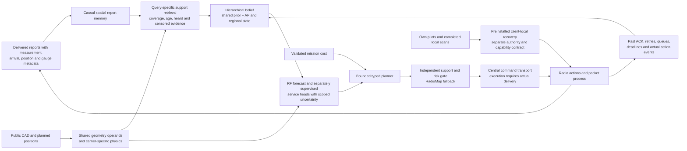

# Proposed next model: spatial support, hierarchical belief and executable recovery

This is a **design proposal**, not a new implementation or experiment. The
[current system](CURRENT_SYSTEM.md) tracks implemented behavior separately.
No new fit, model forward, packet case or hardware action accompanies this
document, and the running adaptive TEST/audit remains unchanged.

## Evidence that determines the design

| Observation | Design implication, not a demonstrated fix |
|---|---|
| The CSI views each observe 16 of 64 Fourier rows; their union leaves the odd targets ambiguous. [Analysis](CSI_INTERPRETATION.md). | Certify target observability and disclose the prior before changing model capacity. More consistency loss cannot create missing measurements. |
| At native decision 0, 16 AP3/5.2 GHz reports lay within 5 m of robot 7, but none entered its context. The two retained reports were 54.81/74.26 m away. [Passive review](NATIVE_CONTEXT.md). | Retrieve for the query's spatial support, age and actual link, rather than only allocating two newest rows per AP/band. Distance alone is insufficient: the nearest report was 45 s old. |
| All history-dependent mean changes pass through eight global coefficients; the query-local correction is fixed after training. | Compare a hierarchical per-AP/region memory with the global state. The trace does **not** prove eight dimensions insufficient, diagnose collapse or establish that hierarchy will repair the outage. |
| Robot 7 moved onto AP3 and later recovery remained pending without successful delivery. The model also transfers from two-AP RT rooms to a 16-AP warehouse without native risk calibration. [Results](NATIVE_RESULTS.md). | Separate support/calibration admission from command execution. An independent veto does not supply an offline recovery mechanism. |
| Sharing band-independent geometry produced exact operand bytes and a **2.831× median operand-call speedup**. [Profile](NATIVE_PERFORMANCE.md). | Reuse this separate optimization where applicable and charge remaining work. It is not a full-model or service speedup and was not substituted into the frozen native run. |

Decision 1 contained robot 7's newer target bound, delivered at 0.45 s and
0.617 m from its query, but did not select it. That forecast completed at
2.30 s, after the initiating 1.50 s move. A proposed memory must preserve
both facts; it cannot retroactively insert this report into decision 0.

## Proposed integration

The diagram proposes wiring; existing physics operators and typed interfaces
can be reused. It does not imply that these new memory, hierarchy, service
heads or recovery components have been built or validated together. Mission
text remains outside the RF encoder.

**Memory before a larger latent.** Preserve receiver/AP/band association,
measurement time, arrival time, position uncertainty, frontend gauge and
actual report semantics. At issue time retrieve only already available rows,
balancing nearby coverage with age and obstruction geometry. Retain useful
own-link evidence without privileging a stale reading over fresher support.
Heard values, quantization intervals, upper censor bounds and missing scans
remain distinct. An unheard AP crowded out of a scan is not a measured
−90 dBm point. Output a support footprint and missingness/age summary with
each forecast; proximity does not itself qualify that forecast.

**Hierarchy as a testable hypothesis.** Retain a shared geometry/frequency
prior, then condition AP-specific and spatial-region state on permitted RF.
Use shared functions across APs rather than a learned identity table that
cannot accommodate a new AP. A query would combine shared physics with its
local posterior and unresolved uncertainty. Start with interpretable linear,
spatial Bayesian and matched supervised controls. More states are justified
only by held-out gains under the same information and compute budget; they
are not automatically physical scatterers, materials or independent factors.
Group queries by AP/region and reuse event-updated state where valid, rather
than running a fresh encoder for every query point. Cache construction and
invalidation still count toward the measured budget.

**Wireless physics determines support.** Shadowing varies over space; carrier
wavelength, bandwidth and phase/time gauges determine which CSI observations
can constrain a target. Free-space frequency transport is only one part of
material/antenna response. Keep actual carrier, TX, noise and linear-power
interference explicit. Relative frontend inversion does not establish an
absolute SINR reference. Use the existing operators and censor likelihoods;
do not infer universal device or calibration validity from shared geometry.

For CSI, report ambient target nullspaces separately from identifiability
under a named low-rank or stochastic prior. Irregular pilots may break the
observed comb alias, but 16 observations still cannot identify 64 arbitrary
coefficients. The [sensing-design mathematics](SENSING_DESIGN.md) supplies a
costed expected-variance heuristic, not measured on-air value of information.
Charge extra observations and require actual driver/protocol support before
calling a pilot design an executable radio action.
Its certificates cover declared linear targets; nonlinear RSSI power and
packet outcomes need their own observation and uncertainty models.

**Time and service need real protocol supervision.** Update belief from actual
events, not previous forecasts. Preserve measurement/arrival/compute-completion
clocks, pending commands and receiver availability. Train supported deadline,
retry and silence heads from observed protocol outcomes under declared MAC,
traffic, action and device scopes. Calibrate on separate whole episodes or
sites; correlated packets are not independent calibration units. RF-model
spread is not command-risk calibration, and a static condition-change assay
does not validate temporal transitions or stable long rollouts.

**Admission and recovery are different systems.** An external support/risk
guard may reject unsupported or optimistic moves and retain RadioMap as
fallback. It cannot deliver a central recovery command across a failed link.
Central actions must follow a ledger proving delivery after command creation.
A separately preinstalled client-local recovery would see only its own
available pilots, completed scan cache and permitted local state during an
outage. Its actions, interruption costs and authority require explicit
capabilities and tests. Neither path may receive free server information or
instantaneous execution, and no reachable safe link is guaranteed.

## Ablations needed before choosing the architecture

| Comparison | Hold fixed to isolate the change |
|---|---|
| Query-aware retrieval versus current selection | Same checkpoint/global state, permitted history, token cap, clocks, planner/gate and paid budget. Include age-only, distance-only and combined support controls. |
| Hierarchical versus global belief | Same retrieval and observations; matched supervised architecture/parameter and compute controls, plus strong per-AP numerical references. |
| Combined retrieval and hierarchy | Cross both factors; retain amplitude-erased, stale-context and exact consistency-on/off controls. Do not call a retrieval gain a latent-capacity or JEPA gain. |
| Operand construction and rendering | Use the byte-preserving operator for comparable neural arms; preserve Map's efficient reference path. Measure complete cold/warm inference, memory, invalidation and queue age, rather than extrapolating the 2.831× operand ratio. |
| Admission and client-local recovery | Separate registered controller experiments with fixed forecasts where appropriate. Equal sensing/command/compute costs, actual central delivery versus declared local capability, and raw action/packet evidence are required. |

Use a strong full-history RadioMap and an explicitly matched-context numerical
control to distinguish representation from information-budget effects. First
check attribution on identical causal snapshots, then evaluate closed-loop
capture under equal budgets, where actions can change subsequent observations.
Report mean and worst-decile misses, maximum gaps, per-device support,
calibration failures, rates and total paid latency; keep handover mechanisms
separate. Fresh splits/cases and a published finite protocol are prerequisites.

These are proposed follow-ups to completed diagnostics. They establish no
JEPA superiority, SOTA, novelty, production eligibility or hardware benefit.
The original SERVICE holdouts remain closed, and no actuation is authorized.
