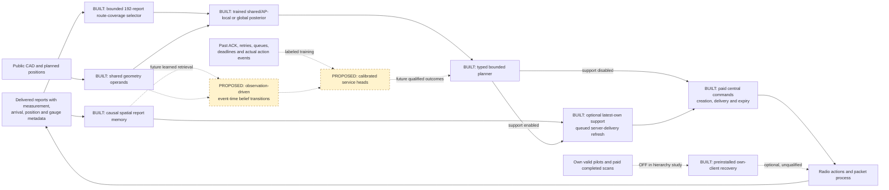

# Next model: tested spatial belief, open event-time dynamics

The [shared/AP-local spatial model](../hierarchical_radio/RESULTS.md) and
bounded 192-report route-coverage selector are now built and evaluated: 186
actual RT cases, 15 fits and 34 native simulations, with canonical seal and
independent replay passed. The selected hierarchy loses its primary field
comparisons and has higher mean native misses than full-history RadioMap.
The matched agreement gain is modest; no new model is promoted. The current
[architecture](CURRENT_SYSTEM.md) describes the implemented system.

The [interpretation](../hierarchical_radio/INTERPRETATION.md) identifies a
testable limitation: the fixed Fourier channel and positive local prior floor
cannot recover an exact global-only submodel. It does not prove that this
caused the losses. All fits selected the budget's last checkpoint, which
does not establish convergence. Any successor must choose budget and
shrinkage on TRAIN/VAL and confirm on fresh cases.

The separate fixed-weight [spatial-control stack](SPATIAL_CONTROL.md) implements causal report
memory, latest-own source-band support, causal central command execution and
separately preinstalled paid own-client recovery. It reuses the fixed regression
checkpoint and unchanged 64-token encoder. Its [registered 48-fresh + two-parity
diagnostic](../spatial_control/PLAN.md) is complete, with canonical seal and
independent passive review passed. [All handover-specific contrasts and harms](EXECUTION_LEDGER.md#spatial-control-contrasts)
remain visible. This is an enabling-stack/controller result with fixed neural weights; RadioMap still performs its ordinary numerical history fits.

**Learned query-specific retrieval, event-time transitions and qualified
protocol-supervised service heads remain research targets.** Static AP-local
conditioning is now implemented; it does not constitute those models. The
[current system](CURRENT_SYSTEM.md) and architecture page separate these levels.

## Evidence that determines the design

| Observation | Design implication, not a demonstrated fix |
|---|---|
| The CSI views each observe 16 of 64 Fourier rows; their union leaves the odd targets ambiguous. [Analysis](CSI_INTERPRETATION.md). | Certify target observability and disclose the prior before changing model capacity. More consistency loss cannot create missing measurements. |
| At native decision 0, 16 AP3/5.2 GHz reports lay within 5 m of robot 7, but none entered its context. The two retained reports were 54.81/74.26 m away. [Passive review](NATIVE_CONTEXT.md). | Retrieve for the query's spatial support, age and actual link, rather than only allocating two newest rows per AP/band. Distance alone is insufficient: the nearest report was 45 s old. |
| The motivating fixed baseline adapted through eight global coefficients; the new shared/AP-local comparison is complete and negative on its primary endpoint. | More inferred state is not sufficient. Preserve the strong small-global and numerical controls; test genuine shrinkage and data/budget adequacy without diagnosing collapse from error alone. |
| Robot 7 moved onto AP3 and later recovery remained pending without successful delivery. The model also transfers from two-AP RT rooms to a 16-AP warehouse without native risk calibration. [Results](NATIVE_RESULTS.md). | Separate support/calibration admission from command execution. An independent veto does not supply an offline recovery mechanism. |
| Sharing band-independent geometry produced exact operand bytes and a **2.831× median operand-call speedup**. [Profile](NATIVE_PERFORMANCE.md). | Reuse this separate optimization where applicable and charge remaining work. It is not a full-model or service speedup and was not substituted into the frozen native run. |
| The sealed adaptive assay selects regression; joint agreement is worse, and pooled Bayes nearly ties its primary metric. E7 calibration improves map RMSE with mixed planning utility. [Adaptive](ADAPTIVE_RESULTS.md), [E7](E7_CALPLANNING_RESULTS.md). | Preserve strong numerical and exact matched-supervision controls. Better field error or a larger latent cannot be assumed to improve service or establish a JEPA benefit. |

Decision 1 contained robot 7's newer target bound, delivered at 0.45 s and
0.617 m from its query, but did not select it. That forecast completed at
2.30 s, after the initiating 1.50 s move. The built memory/refresh path preserves
measurement, arrival and admission clocks; it cannot retroactively insert a
report into an earlier forecast. These historical diagnostics remain unchanged.

## Built boundary and proposed integration

Solid paths describe built software; dashed paths describe future model work.
The bounded route selector now conditions the spatial model; latest-own support
adds separate admission evidence. Its 2.4/5.2 GHz rule does not calibrate a 6.5 GHz forecast or
packet-risk head. Mission text remains outside the RF encoder. The completed
controller diagnostic has mixed, handover-dependent outcomes.

**Memory before a larger latent.** The built index preserves receiver/AP/band
association, measurement/arrival intervals, position uncertainty, gauge and
report semantics. Admission refresh joins only payload-matched server
deliveries; a completed undelivered local scan is not server knowledge. Its
guard selects the newest own source-band report before spatial filtering,
so a newer negative/distant report cannot resurrect an older nearby positive.
Unknown measurement age cannot pass freshness. Query-aware retrieval into
the encoder on a per-query basis, obstruction-aware ranking and learned
event-time updates remain separate changes requiring matched tests.
Heard values, quantization intervals, upper censor bounds and missing scans
remain distinct. An unheard AP crowded out of a scan is not a measured
−90 dBm point. Output a support footprint and missingness/age summary with
each forecast; proximity does not itself qualify that forecast.

**A successor to the tested hierarchy.** Retain a shared geometry/frequency
prior, then condition AP-specific and spatial-region state on permitted RF.
Use shared functions across APs rather than a learned identity table that
cannot accommodate a new AP. A query would combine shared physics with its
local posterior and unresolved uncertainty. Start with interpretable linear,
spatial Bayesian and matched supervised controls. More states are justified
only by held-out gains under the same information and compute budget; they
are not automatically physical scatterers, materials or independent factors.
Group queries by AP/region and reuse event-updated state where valid, rather
than running a fresh encoder for every query point. Cache construction and
invalidation still count toward the measured budget.

**Wireless physics determines support.** Shadowing varies over space; carrier
wavelength, bandwidth and phase/time gauges determine which CSI observations
can constrain a target. Free-space frequency transport is only one part of
material/antenna response. Keep actual carrier, TX, noise and linear-power
interference explicit. Relative frontend inversion does not establish an
absolute SINR reference. Use the existing operators and censor likelihoods;
do not infer universal device or calibration validity from shared geometry.

For CSI, report ambient target nullspaces separately from identifiability
under a named low-rank or stochastic prior. Irregular pilots may break the
observed comb alias, but 16 observations still cannot identify 64 arbitrary
coefficients. The [sensing-design mathematics](SENSING_DESIGN.md) supplies a
costed expected-variance heuristic, not measured on-air value of information.
Charge extra observations and require actual driver/protocol support before
calling a pilot design an executable radio action.
Its certificates cover declared linear targets; nonlinear RSSI power and
packet outcomes need their own observation and uncertainty models.

**Time and service need real protocol supervision.** Update belief from actual
events, not previous forecasts. Preserve measurement/arrival/compute-completion
clocks, pending commands and receiver availability. Train supported deadline,
retry and silence heads from observed protocol outcomes under declared MAC,
traffic, action and device scopes. Calibrate on separate whole episodes or
sites; correlated packets are not independent calibration units. RF-model
spread is not command-risk calibration, and a static condition-change assay
does not validate temporal transitions or stable long rollouts.

**Admission and recovery are different systems.** The built support guard
uses additional delivered history and payload-matched admission refresh. Its
latest-own source-band rule is an engineering support test; packet-risk heads
remain unavailable. The built central path pays 100 ms creation, one-second
expiry and actual later transport, without refreshing same-target lifetimes.
The separately preinstalled own-client controller uses only its completed paid
scans/current valid pilots during an outage. It pays scan/interruption costs,
a 10 ms decision floor, a five-millisecond whole-fleet tick budget and a
separate five-millisecond delayed-validation budget. Neither path receives
free server information or instantaneous execution, and no reachable safe link
is guaranteed. Local simulator authority is not authenticated hardware authority.

At 0.03 s, support and both reduce regression's mean miss fraction from
1.635625% to 1.107500% and 1.079375%; support harms one of four episodes on
misses, while both harms none versus regression. The combined package still
loses to RadioMap + recovery (1.044375%) in all four episodes. At 4 s,
support alone changes regression from 1.362500% to 1.346875% without miss/gap
harm, while local recovery and both worsen all four episodes on misses and
maximum gaps. RadioMap recovery also harms all four slow episodes. Mean
slow loss ties between both packages while three episodes have more misses
for regression + both. These outcomes motivate new cost/support hypotheses;
they do not authorize retuning the completed cases or explain every cause.

## Ablations needed before choosing the architecture

| Comparison | Hold fixed to isolate the change |
|---|---|
| Query-aware retrieval versus current selection | Same checkpoint/global state, permitted history, token cap, clocks, planner/gate and paid budget. Include age-only, distance-only and combined support controls. |
| Hierarchical versus global belief | Same retrieval and observations; matched supervised architecture/parameter and compute controls, plus strong per-AP numerical references. |
| Combined retrieval and hierarchy | Cross both factors; retain amplitude-erased, stale-context and exact consistency-on/off controls. Do not call a retrieval gain a latent-capacity or JEPA gain. |
| Operand construction and rendering | Use the byte-preserving operator for comparable neural arms; preserve Map's efficient reference path. Measure complete cold/warm inference, memory, invalidation and queue age, rather than extrapolating the 2.831× operand ratio. |
| Further controller or recovery policy changes | The fixed support/recovery comparison is already complete; retain every gain and harm. New thresholds, cost-aware decisions or risk models require a separate protocol and fresh cases, with central transport distinguished from preinstalled own-client authority. Shared sensing budgets do not force identical realized observations. |

Use a strong full-history RadioMap and an explicitly matched-context numerical
control to distinguish representation from information-budget effects. First
check attribution on identical causal snapshots, then evaluate closed-loop
capture under equal budgets, where actions can change subsequent observations.
Report mean and worst-decile misses, maximum gaps, per-device support,
calibration failures, rates and total paid latency; keep handover mechanisms
separate. Fresh splits/cases and a published finite protocol are prerequisites.

Static hierarchy has been tested, with its losses retained. Learned retrieval,
event-time transitions and qualified service heads remain follow-ups. The
small matched predictive-agreement RF gain does not establish a RadioMap
replacement, classic JEPA, SOTA, novelty, production eligibility or hardware benefit.
The original SERVICE holdouts remain closed, and no actuation is authorized.
