# Next model: tested zero-capable spatial belief, open representations and dynamics

The [nested spatial model](../nested_radio/RESULTS.md) now implements an exact
global-eight fallback: its complete local design can be zeroed in both
conditioning and rendering without making the coefficient prior singular.
The fitted gates are projected after optimizer updates, and infeasible states
are rejected before evaluation. The effective coefficient-prior RMS penalty
accounts for gate, prior mean and prior SD together; a small gate alone is not
an identified small physical effect. These are built and tested model
properties, rather than proposed fixes.

The completed study trains 15 members for 1,920 updates each, **28,800 updates
in total**. It reuses the 90 TRAIN/validation RT cases and evaluates **84 fresh
RT cases**: 24 TEST geometries and four eight-AP transfer geometries, each with
three static material states. Model and numerical-reference selection use
TRAIN/validation only. The [retained report](../../artifacts/nested_radio/report.json)
selects `nested_joint`: sparse heard-RSSI RMSE is **2.637330 dB**, versus
**2.710522 dB** for the validation-selected best numerical reference, a
fixed-feature hierarchy, and **2.651669 dB** for the global-eight regression
control. All four predeclared candidate-minus-reference intervals are
negative, supporting lower error under their stated conditions. The matched
joint-versus-regression gain is only **0.002226 dB**; its small magnitude must
remain visible.

These are whole-geometry comparisons conditional on three trained members.
They do not establish arbitrary retraining performance, classic EMA-JEPA,
specialist SOTA or an inference-compute advantage. The experiment contains
**no new warehouse simulations**. Its new weights have not been shown to
improve packet deadlines, silence or physical SmartCar connectivity. RadioMap
remains the application default. The [architecture](CURRENT_SYSTEM.md) and
[nested-model architecture](../nested_radio/ARCHITECTURE.md) distinguish the
implemented predictor from those qualification requirements.

## What the retained representation diagnostics change

The [validation-only diagnostics](../../artifacts/nested_radio/validation_representation.json)
were not used to choose the model and contain no scientific TEST inputs.
All eight learned-local feature gates are **exactly zero in all six selected
nested regression/joint member checkpoints**. In the selected joint cell,
only five, five and six of the eight fixed Fourier channels remain active
for seeds zero, one and two respectively. Thus the observed winner uses a
shared physical field with a small gated fixed spatial residual. It does not
validate useful learned local geometry abstractions merely because the neural
feature generator is present in the code.

Zero effective columns do not prove that their raw feature functions became
constant, that physical RF has no useful learned representation, or that the
full model collapsed. Nor do they identify the cause of pruning. Gate
initialization, the regularizer, feature scale, available observations and
finite optimization can all matter. The coefficient-prior RMS penalty avoids
the simple gate/prior reciprocal-scaling loophole, but remains **basis
dependent**: feature functions with different units or norms are not made
comparable by a coefficient penalty alone. The diagnostic is a reason to test
this interaction, not a causal explanation of the current result.

The separate [unshrunk hierarchy study](../hierarchical_radio/RESULTS.md)
remains negative on its primary endpoint: selected sparse RMSE is 3.088402 dB
versus 2.995352 for global-24 and 2.951064 for its numerical map. Its native
hierarchy mean misses also exceed full-history RadioMap at both handover
costs, with an 8.89-second silence outlier. Those outcomes remain frozen; the
new RT gain does not replace them or establish that the new weights repair
the same controller failures. Different fresh evaluation layouts also prevent
attributing a cross-study error change solely to shrinkage or training budget.

## Built boundary and future qualification

```mermaid
flowchart LR
    OBS["Reported values, intervals, censor bounds<br/>and declared public geometry"] --> SPATIAL["BUILT: shared eight-state posterior<br/>plus zero-capable AP-local design"]
    SPATIAL --> RF["EVALUATED: fresh static RF fields<br/>selected gated Fourier residual"]
    LEARNED["Learned local feature generator<br/>present but gated off in selected fits"] -.-> SPATIAL
    SPATIAL -. "new-weight transfer not evaluated" .-> OUTCOMES["Typed RF-to-service adapter"]
    MAP["Application default: RadioMap"] --> OUTCOMES
    OUTCOMES --> PLANNER["BUILT: WirelessJEV bounded planner<br/>and independent admission"]
    MEMORY["BUILT: delivered-report memory<br/>measurement and arrival clocks"] --> SUPPORT["BUILT: source-band support<br/>and payload-matched refresh"]
    PLANNER --> SUPPORT
    SUPPORT --> COMMAND["BUILT: paid central command creation<br/>actual later delivery and expiry"]
    COMMAND --> RADIO["Charged radio action and packet process"]
    RADIO --> MEMORY
    MEMORY -. "future learned retrieval and transitions" .-> DYNAMICS["PROPOSED: event-time shared belief"]
    PROTOCOL["Actual ACK, retry, queue<br/>and deadline observations"] -.-> HEADS["PROPOSED: calibrated service heads"]
    DYNAMICS -.-> HEADS
    HEADS -. "future qualified outcomes" .-> PLANNER
    LOCAL["Available preinstalled client-local capability"] -. "separate authority and qualification" .-> RADIO
    classDef proposed fill:#fff3cd,stroke:#9a6700,stroke-dasharray:5 5
    class DYNAMICS,HEADS proposed
```

The solid RF evaluation path is not a learned temporal transition. Forecasts
are not reinserted as observations, removing one self-feedback path without
proving nonaccumulating field, trajectory or control errors. The dashed path
from the new weights to service is intentionally unvalidated. Existing typed
interfaces and bounded search do not supply calibrated packet-risk heads or
hardware authority.

## Three bounded checks before another representation claim

1. **Diagnose feature scale and optimization on TRAIN/validation.** Compare raw
   and effective feature variation, observation sensitivity and prior amplitude
   in their declared units. Inactive global-control neural features are not
   trained representations. A rank statistic alone establishes neither useful
   information nor collapse. Choose any budget, normalization and initialization
   with TRAIN/validation only, retain all learning curves, and freeze the next
   finite comparison before fresh evaluation. Do not retune this TEST or call
   the current budget an optimization-exhaustion certificate.

2. **Compare feature normalization and priors on functions.** Test a shared
   TRAIN-only reference measure for normalizing learned and fixed features,
   or a regularizer/prior on their induced RF functions rather than coefficient
   scales alone. Preserve context/query coherence, exact zero fallback and
   nonsingular inference. Include fixed-gate and fixed-basis controls so a
   change in initialization, regularization or basis scale is not credited
   solely to adaptive gate learning. Retain the global-eight, fixed numerical
   hierarchy and numerical-map references, the same observations and budgets,
   and matched joint-on/off supervision. Shared object/path factors are a
   separate hypothesis; they are not identified materials or scatterers without
   an observability argument. Any architecture chosen after these outcomes
   needs a new protocol and fresh TEST cases.

3. **Establish event-time and service capability separately.** Use actual
   ordered sequences, revisits, moving blockers or interferer activity, with
   measurement, arrival, compute-completion and action clocks. First check
   whether observations distinguish future-relevant states; retain uncertainty
   or abstain when they do not. Compare last-observation, fresh RadioMap and
   time-filter baselines, separating filtering from prediction. New-weight
   warehouse transfer needs whole-episode/site calibration, paid scans and
   transport, both handover costs, packet/deadline/silence labels and retained
   tails. Correlated packets are not independent calibration units, and RF
   spread is not a service-risk probability.

## Information, physics and control constraints that still apply

The built memory preserves receiver/AP/carrier, gauge, position and measurement
and arrival intervals. A completed but undelivered scan is not server
knowledge. The newest own source-band report is considered before spatial
filtering, so an older nearby positive cannot replace a newer negative or
distant report. Unknown age cannot pass strict freshness. The bounded
192-report route-coverage selector is built; learned per-query retrieval and
paid value-of-information sensing remain separate experiments. Equal closed-loop
budgets and selector rules do not force identical realized observations.

Heard values, quantization intervals, censor bounds and unknown reports remain
distinct. A ranked-out AP is not a fabricated −90 dBm measurement. Geometry
and proximity do not themselves qualify an RF forecast. Actual carrier, TX,
noise, power-domain interference and receiver assumptions must stay explicit;
2.4/5.2 GHz support does not calibrate a 6.5 GHz forecast. Relative frontend
calibration does not establish an absolute SINR reference or arbitrary-device
transfer.

The [CSI analysis](CSI_INTERPRETATION.md) retains an observation-nullspace
limitation: 16 Fourier samples cannot identify 64 arbitrary coefficients, and
consistency cannot create missing measurements. Irregular pilots may remove
one comb alias while leaving the general identifiability problem. The
[sensing-design mathematics](SENSING_DESIGN.md) is a prior-conditioned,
costed heuristic, not measured on-air sensing benefit or an executable driver
action. DINOv3 features alone do not make hidden RF materials, activity or
packet risk observable; RF–vision alignment still requires calibrated geometry,
clock evidence and matched endpoint experiments.

Admission and recovery remain different systems. The central path pays command
creation, expiry and actual later delivery. Separately preinstalled client-local
recovery can use its own completed scans/current valid pilots, with paid sensing,
decision and validation costs. The completed [fixed-weight support/recovery
study](SPATIAL_CONTROL.md) retains its fast-handover mean improvements, while
the combined regression package remains worse than Map plus recovery in all
four episode pairs.
At four-second handovers local recovery harms all four episodes for both
forecasters. The new nested RF study neither reruns that policy nor repairs
those outcomes. No reachable safe link, authenticated hardware authority or
physical fleet benefit follows from the simulator's software capability.

A successor should preserve strong full-history and equally budgeted numerical
references, use identical causal snapshots when attributing a forecast change,
and then evaluate the full closed loop where actions change later observations.
Report means, worst-decile misses, maximum gaps, support failures and total
paid latency. Keep handover mechanisms and the separate original E experiments
explicit. The [remaining-work matrix](REMAINING.md) records the broader program:
learned event-time dynamics, qualified service heads and physical transfer are
still unfinished. Original SERVICE holdouts remain closed, and a model's
forecast does not supply permission for hardware actuation.
