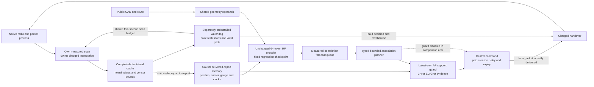

# Causal warehouse control: support and executable recovery

This experimental stack addresses missing observation support and recovery
execution. It reuses the fixed validation-selected regression model; it does
not retrain its representation or establish a JEPA-objective improvement.
RadioMap remains the application default. The [finite plan](../spatial_control/PLAN.md)
defines the comparison; all numerical findings below come from its complete sealed report.
The [standalone explorer](../../artifacts/spatial_control_review/index.html)
shows both handover conditions, every arm and their separate information paths.

The server guard can incorporate a newly delivered negative report while a
forecast is queued. Locally completed but undelivered observations remain
unavailable to that guard. The client watchdog can use its own completed
cache during an outage without pretending a central command was delivered.
These are separate information and authority paths.

## What is implemented

| Boundary | Implemented behavior | Scope |
|---|---|---|
| Measurement memory | Typed points, intervals, upper censor bounds and missing reports; actual AP/carrier/gauge, measurement intervals, arrival clocks and position. Unknown measurement ages fail freshness. | Retrieval and support, not identified scatterers or learned dynamics. |
| Own target support | The newest own report is selected before spatial filtering, preventing an older positive from replacing a newer censor. Payload-matched server arrivals refresh queued admission. | At least one measured source band must meet −80 dBm, six seconds and five metres. This does not qualify all bands or packet risk. |
| Forecast computation | Fixed checkpoint and unchanged 64-token selection, with byte-equivalent shared geometry operands. Support preparation is included in measured issue time. | Additional guard information is distinct from representation quality. |
| Central execution | Both handover costs require command creation, a subsequently created control packet and its actual delivery before expiry. Repeating the same pending target does not refresh its lifetime. | Simulated reserved transport, not authenticated physical authority. |
| Local recovery | Explicit preinstalled authority; own completed paid scans/current valid pilots; silence trigger, target floor, conditional margin, dwell/backoff and UNKNOWN reconciliation. | No guaranteed reachable link or safety certificate. Warm bins do not establish exact scan-completion clocks. |
| Sensing cost | Autonomous and background scans share a five-second start-spacing budget; each scan interrupts the radio for 90 ms, including missing captures. | Realized observations and costs may differ across arms. |
| Availability and compute | Lagged observations require the actual association/receiver at capture; action revalidation is single-use. Late work is discarded and subsequent work waits for measured completion. | Synchronous simulator accounting, not physical real-time qualification. |

## Fixed comparison

Four fresh procedural episodes each contain 100 robots for 20 seconds after
60 seconds of shared warm history. The 0.03 s and 4 s handover conditions are
analyzed separately. Each condition includes all six arms:

| Forecaster | AP support guard | Client-local recovery |
|---|---|---|
| Full-history RadioMap | Off | Off |
| Full-history RadioMap | Off | On |
| Frozen regression | Off | Off |
| Frozen regression | On | Off |
| Frozen regression | Off | On |
| Frozen regression | On | On |

All 48 fresh simulations use the same revised central-command semantics.
Two additional disabled-extension runs check exact forecast, completion and
packet parity against the predecessor before comparisons begin. The older
native diagnostic remains unchanged; differences between that diagnostic and
this one cannot isolate a single intervention.

Per-episode misses, worst-decile loss, maximum silence, end-pending bounds,
video/bulk, scan interruptions and actual compute are retained. The study
does not select thresholds, seeds or weights from those outcomes. Four
episodes from one warehouse family are descriptive evidence, not production
qualification or a generalization guarantee. Original SERVICE layouts and
physical SmartCars remain outside this run.

## Completed results

All **48 fresh simulations and two exact disabled-parity simulations** completed. The seal binds **543 source and 224 evidence files**. The [independent passive audit](../../artifacts/spatial_control_review/result.json) passes all case/array/clock/cost reductions and preserves 19,325 prior named repository files. The final [software proof](../../artifacts/spatial_control_review/final_software_suite.json) records **2,978 passing tests**, 138 test modules and unchanged hashes for 436 source/config/test files. Targeted counts overlap this total.

The fast-handover result repairs much of the learned controller's loss without beating RadioMap: support + recovery reduces its mean misses by **34.0%**, from **1.635625% to 1.079375%**; RadioMap remains lower at **1.044375%**, with fewer misses in all four pairs. Mean episode maximum silence falls from **5.8175 s to 0.355 s**; the largest single episode gap falls from **16.11 s to 0.61 s**. RadioMap's mean episode maximum is 0.285 s and largest is also 0.61 s.

The four-second result is adverse for recovery: it increases misses and maximum gaps in **every episode** for both forecasters. The fixed trigger is not a qualified cost-aware recovery policy. The support-only regression arm has a small descriptive gain without increasing misses relative to unguarded regression in these four episodes. None of these outcomes changes an application default.

Each table entry averages four episode metrics. Worst decile means the ten worst robots within each 100-robot episode, then an episode average. Mean episode maximum silence is distinct from the largest observed gap across all four episodes. There are no confirmatory intervals or training-seed uncertainty estimates in this diagnostic.

### 0.03-second handovers

| Arm | Missed commands, % | Worst-decile misses, % | Mean episode maximum silence, s | Largest episode gap, s | Forecast elapsed time per 20 jobs on CPU, s |
|---|---:|---:|---:|---:|---:|
| RadioMap | 1.044375 | 1.46875 | 0.2850 | 0.610 | 1.448 |
| RadioMap + recovery | 1.044375 | 1.46875 | 0.2850 | 0.610 | 1.391 |
| Frozen regression | 1.635625 | 7.35000 | 5.8175 | 16.110 | 2.230 |
| Regression + support | 1.107500 | 2.10000 | 0.5700 | 0.930 | 3.229 |
| Regression + recovery | 1.306250 | 4.05625 | 2.5850 | 5.260 | 2.223 |
| Regression + both | 1.079375 | 1.81250 | 0.3550 | 0.610 | 3.279 |

### 4-second handovers

| Arm | Missed commands, % | Worst-decile misses, % | Mean episode maximum silence, s | Largest episode gap, s | Forecast elapsed time per 20 jobs on CPU, s |
|---|---:|---:|---:|---:|---:|
| RadioMap | 1.406875 | 4.92500 | 2.1100 | 4.000 | 1.425 |
| RadioMap + recovery | 1.629375 | 7.15000 | 4.2375 | 4.250 | 1.422 |
| Frozen regression | 1.362500 | 4.49375 | 1.0425 | 1.690 | 2.257 |
| Regression + support | 1.346875 | 4.33750 | 0.9925 | 1.690 | 3.303 |
| Regression + recovery | 1.630625 | 7.17500 | 4.2375 | 4.250 | 2.261 |
| Regression + both | 1.629375 | 7.16875 | 4.2375 | 4.250 | 3.281 |

### Registered paired contrasts

Negative miss/gap differences favor the candidate. Harm counts retain episode pairing; packets and robots are not additional independent sites.

| Handover, s | Candidate − reference | Mean miss difference, percentage points | Episodes with more misses / 4 | Mean maximum-gap difference, ms | Episodes with larger maximum gap / 4 |
|---:|---|---:|---:|---:|---:|
| 0.03 | Frozen regression − RadioMap | +0.591250 | 4 | +5532.5 | 4 |
| 0.03 | Regression + support − Frozen regression | -0.528125 | 1 | -5247.5 | 0 |
| 0.03 | Regression + recovery − Frozen regression | -0.329375 | 0 | -3232.5 | 0 |
| 0.03 | Regression + both − Frozen regression | -0.556250 | 0 | -5462.5 | 0 |
| 0.03 | RadioMap + recovery − RadioMap | +0.000000 | 0 | +0.0 | 0 |
| 0.03 | Regression + both − RadioMap + recovery | +0.035000 | 4 | +70.0 | 2 |
| 4 | Frozen regression − RadioMap | -0.044375 | 2 | -1067.5 | 0 |
| 4 | Regression + support − Frozen regression | -0.015625 | 0 | -50.0 | 0 |
| 4 | Regression + recovery − Frozen regression | +0.268125 | 4 | +3195.0 | 4 |
| 4 | Regression + both − Frozen regression | +0.266875 | 4 | +3195.0 | 4 |
| 4 | RadioMap + recovery − RadioMap | +0.222500 | 4 | +2127.5 | 4 |
| 4 | Regression + both − RadioMap + recovery | +0.000000 | 3 | +0.0 | 0 |

### Costs, censoring and interpretation

Every fresh arm has 40,000 control releases. Across all 48 arms the ledger contains **1,920,000 releases**, not 1.92 million independent warehouses or independently reset episodes. End-pending packets remain separate; including all pending packets as possible misses gives 1.08125% versus RadioMap's 1.04625% for the fast combined arm and 1.635625% versus 1.41125% for the slow combined arm. This does not turn unfinished packets into observed successes. Handover/scan interruptions extending beyond the 20-second observation window remain right-censored.

Forecast elapsed time includes history preparation, feature construction, rendering and output handling on this cloud CPU, measured with `perf_counter`; it is not process CPU-consumption time. Arm-mean paid forecast allowances are about 5.75–5.85 seconds per 20 jobs (individual episodes reach 5.89267 s), plus ten seconds of cumulative assumed shared queue/transport delay. Actual elapsed time is separately measured, and the support path increases it. This study establishes no inference-compute superiority or physical SmartCar timing. Central/local overruns, validation and blocked work remain in the raw ledgers; overrun proposals are rejected.

The passive audit verifies **737 central commands (729 executed), 44 local handovers and 19,178 actual fresh scan attempts**. Local recovery has different realized sensing and interruption costs under the common cadence limit; it does not receive free observations. These totals include every fresh arm, not extra replicate sites.

No neural weights were trained or selected from these outcomes. RadioMap still performs its ordinary numerical fit on permitted history. The new controls do not isolate a JEPA objective, train hierarchical or action-conditioned dynamics, calibrate packet-risk heads, or validate arbitrary devices/protocols. Association transitions are deterministic after their declared simulator interruption; driver/authentication failures and real rollback remain untested. A cost-aware recovery model and fresh subsequent evaluation remain research work, especially at four-second switching cost.

### Audit and reuse

- [Sealed report](../../artifacts/spatial_control/report.json), [all episode metrics CSV](../../artifacts/spatial_control_review/episode_metrics.csv) and [source/evidence seal](../../artifacts/spatial_control/verification/manifest.json).
- [Independent review](../../artifacts/spatial_control_review/result.json) and [binding receipt](../../artifacts/spatial_control_review/seal_binding.json). Manifest SHA-256: `f652af5c0c1671a978ad0b2ebefcf35d7e5a7474dc36b373d63b4f60aa41d28f`; independent result: `5f79df8dd60f4e45eb3ac300813a00d2c5a8fd8f724c4d380ce16fa2b2461df3`.
- [Published source](../../artifacts/spatial_control/registration/git.json), [fixed protocol](../../artifacts/spatial_control/protocol.json), [actual runtime](../../artifacts/spatial_control/runtime.json), and [kernel changes](../../artifacts/spatial_control_review/kernel_changes.patch).

The original studies and SERVICE holdouts remain unchanged. All registered workers have finished; negative results are completed evidence.
