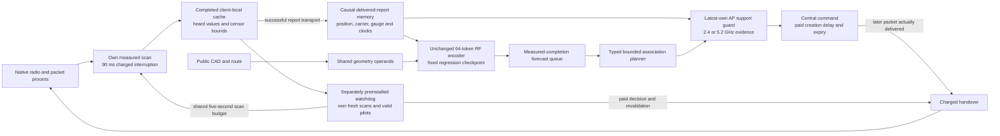

# Causal warehouse control: support and executable recovery

This experimental stack addresses missing observation support and recovery
execution. It reuses the fixed validation-selected regression model; it does
not retrain its representation or establish a JEPA-objective improvement.
RadioMap remains the application default. The [finite plan](../spatial_control/PLAN.md)
defines the comparison; numerical findings require its complete sealed report.

The server guard can incorporate a newly delivered negative report while a
forecast is queued. Locally completed but undelivered observations remain
unavailable to that guard. The client watchdog can use its own completed
cache during an outage without pretending a central command was delivered.
These are separate information and authority paths.

## What is implemented

| Boundary | Implemented behavior | Scope |
|---|---|---|
| Measurement memory | Typed points, intervals, upper censor bounds and missing reports; actual AP/carrier/gauge, measurement intervals, arrival clocks and position. Unknown measurement ages fail freshness. | Retrieval and support, not identified scatterers or learned dynamics. |
| Own target support | The newest own report is selected before spatial filtering, preventing an older positive from replacing a newer censor. Payload-matched server arrivals refresh queued admission. | At least one measured source band must meet −80 dBm, six seconds and five metres. This does not qualify all bands or packet risk. |
| Forecast computation | Fixed checkpoint and unchanged 64-token selection, with byte-equivalent shared geometry operands. Support preparation is included in measured issue time. | Additional guard information is distinct from representation quality. |
| Central execution | Both handover costs require command creation, a subsequently created control packet and its actual delivery before expiry. Repeating the same pending target does not refresh its lifetime. | Simulated reserved transport, not authenticated physical authority. |
| Local recovery | Explicit preinstalled authority; own completed paid scans/current valid pilots; silence trigger, target floor, conditional margin, dwell/backoff and UNKNOWN reconciliation. | No guaranteed reachable link or safety certificate. Warm bins do not establish exact scan-completion clocks. |
| Sensing cost | Autonomous and background scans share a five-second start-spacing budget; each scan interrupts the radio for 90 ms, including missing captures. | Realized observations and costs may differ across arms. |
| Availability and compute | Lagged observations require the actual association/receiver at capture; action revalidation is single-use. Late work is discarded and subsequent work waits for measured completion. | Synchronous simulator accounting, not physical real-time qualification. |

## Fixed comparison

Four fresh procedural episodes each contain 100 robots for 20 seconds after
60 seconds of shared warm history. The 0.03 s and 4 s handover conditions are
analyzed separately. Each condition includes all six arms:

| Forecaster | AP support guard | Client-local recovery |
|---|---|---|
| Full-history RadioMap | Off | Off |
| Full-history RadioMap | Off | On |
| Frozen regression | Off | Off |
| Frozen regression | On | Off |
| Frozen regression | Off | On |
| Frozen regression | On | On |

All 48 fresh simulations use the same revised central-command semantics.
Two additional disabled-extension runs check exact forecast, completion and
packet parity against the predecessor before comparisons begin. The older
native diagnostic remains unchanged; differences between that diagnostic and
this one cannot isolate a single intervention.

Per-episode misses, worst-decile loss, maximum silence, end-pending bounds,
video/bulk, scan interruptions and actual compute are retained. The study
does not select thresholds, seeds or weights from those outcomes. Four
episodes from one warehouse family are descriptive evidence, not production
qualification or a generalization guarantee. Original SERVICE layouts and
physical SmartCars remain outside this run.
