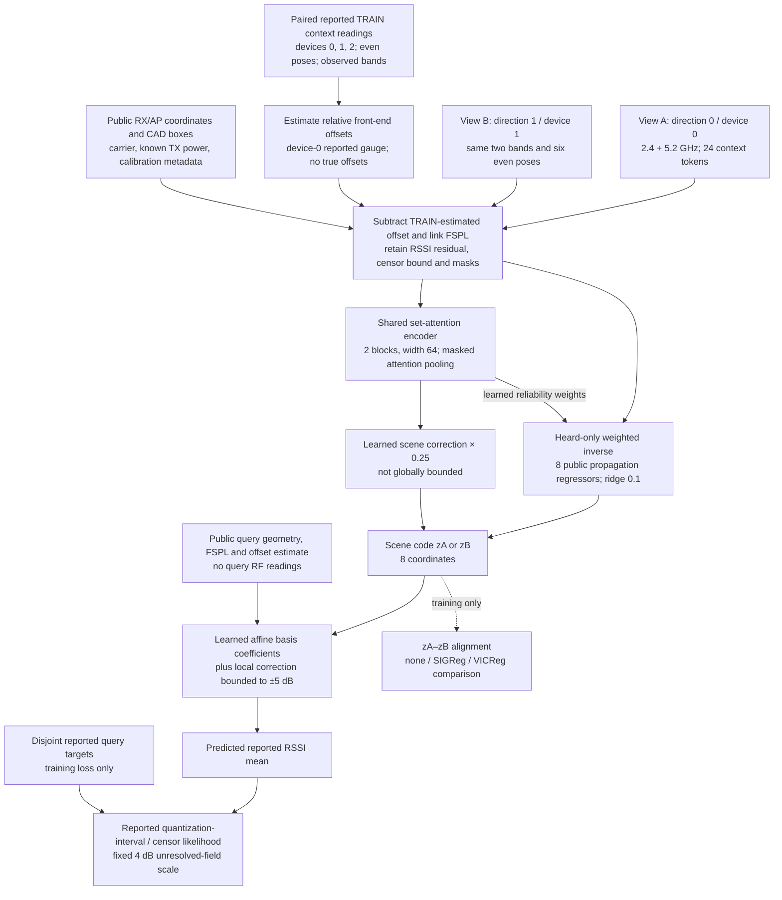
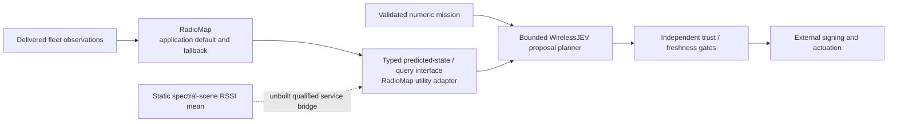

# Current spectral-scene architecture

This is a **static reported-RSSI field model**, not a packet-service or temporal world model. Its source was published at `58f004ad4d3864b975afd0bef9cd302a15a6e231`; the final preflight reports **2,144 tests passed, one expected warning**, with 475 bound source files. All 84 registered scenes and 15 fits have completed, including the 24-layout FIELD comparison. The [results](RESULTS.md) confirm spatial, p95 and same-link 6 GHz improvements over the RadioMap-operator control. Exact matched regression ties the joint model within the adjusted interval, and the geometry/availability control is close; JEPA-specific benefit and service improvement are not established.

## Observation → scene → reported field

Both views use the **same encoder and renderer weights**. Each view independently forms its code and predicts the query field; losses are averaged. Main inference uses view A alone, matching the numerical references' context budget. A context has six even receiver poses × two APs × two observed bands. Each token has four RF/status coordinates and sixteen public geometry/calibration coordinates.

The inverse explicitly estimates field coefficients from measurements. For context basis (B), heard-reading weights (W), and FSPL/offset residual (r) in units of 10 dB:

\[
z_{\mathrm{inverse}}=(B^\top W B+0.1I)^{-1}B^\top Wr,
\qquad z=z_{\mathrm{inverse}}+0.25f_{\mathrm{attention}}.
\]

The eight regressors encode an intercept, distance, CAD-box crossings/path length, log frequency and frequency–geometry interactions. They are **not identified scatterers or materials**. The renderer predicts

\[
\mu(q)=P_{\mathrm{FSPL}}(q)+\widehat{o}_d
+B(q)^\top[10a(z)]+5\tanh(g(z,q)).
\]

Only the local decoder correction is bounded to ±5 dB; the scene correction and affine basis coefficients are not globally bounded. This static experiment does not test recursive residual accumulation.

Raw RF tokens, a separate mean-power channel, query RF and RadioMap predictions cannot bypass the scene code into the decoder. The analytic inverse is an explicit RF-to-code path, not a claim that attention alone learned propagation. Materials, generator offsets, scene IDs, seeds and private RT channels are excluded from student features. Censors can inform attention/likelihood, but are never inserted into the inverse as invented point readings.

Calibration uses co-observed **TRAIN context pairs only**, relative to device 0. It does not identify device 0's absolute hardware bias or an absolute SNR gauge. Quantization and unknown-calibration metadata remain explicit. Unsolved finite-budget RT paths are **missing**, not censored or verified weak links. The fixed 4 dB likelihood scale is not a calibrated posterior, sensor variance or noise figure.

## Exact comparisons and query boundaries

| Cell/reference | Changed factor and common information budget |
|---|---|
| `joint_none`, `joint_sigreg`, `joint_vicreg` | Same inverse/attention/renderer, reported targets and two training views; change the prior regularizer only. Three seeds each: nine initial fits. |
| `matched_regression` | Same validation-selected prior, model, targets, views and training budget; remove cross-view code alignment. Three fits isolate the alignment objective. |
| `geometry_only` | Same selected prior/model/budget; erase the four RF/status token values. Public geometry, calibration metadata and the reported availability mask remain, so this is a **value-erased** control, not a strictly CAD-only predictor. Three fits. |
| `operator_only` | Declared free-space/receiver operators and TRAIN-reported front-end calibration; no learned hidden-material correction. |
| `radiomap_operator`, `bayesian_operator` | TRAIN-learned numerical priors, adapted with the same permitted view-A context. Neither receives query RF or private materials/offsets. |

All neural fits use three independently trained seeds, 60 epochs and eight masked updates per epoch on the 48-scene training batch. Validation selects the prior/checkpoint under the frozen rules. PPR is ineligible because named phase/path/material factors are not identified. Alignment has no EMA or stopped target; its and the prior's weights use the registered detached TRAIN-gradient balancing rule.

Main in-band prediction queries the six **odd, spatially withheld poses** at 2.4/5.2 GHz. The separate held-6-GHz assay queries the **even context poses on the same physical links**, isolating frequency transport rather than also changing position. Held band/device targets never enter fitting or validation. Device-3 onboarding at 0/1/4/16 genuine context pairs is a separate descriptive condition.

Point RMSE/p95 condition on heard reported RSSI; heard/censored/missing counts and censor likelihood must accompany them. The 24 conditional FIELD geometries are new static generated configurations, separate from the original unopened 24 SERVICE specifications. No field result implies interference, non-LOS completeness, deadline or silence performance.

## WirelessJEV remains a separate boundary

The existing adapter/planner has software parity and rejection tests. It does not turn reported RSSI into a calibrated command-service distribution. The new model reads no mission text and has no signing/actuation authority. A learned service head, delivered-observation filter and independent qualification are required before replacing the default RadioMap path.

| Status | Current scope |
|---|---|
| Implemented and preflight checked | Observation/calibration separation, physical basis/inverse, attention correction, likelihoods, matched controls, source/publication gates and static-field evaluation machinery. |
| Trained and evaluated | All 48 TRAIN / 8 VAL / 4 DEV / 24 FIELD scenes, 15 fits and 1,512 prediction records completed; the passive raw audit passes. Three registered RadioMap contrasts pass; matched alignment benefit is unconfirmed. |
| Not established by this model | Complex-CSI scatterer recovery, physical materials/phase identification, slow/mid/fast filtering, action-conditioned dynamics, multi-step planning, RF–vision learning, real-device transfer, interference/MAC/queue forecasts, 100-robot service gains or hardware/production qualification. |

Source: [model](../../src/wirelessjev/spectral_scene/model.py), [data/calibration](../../src/wirelessjev/spectral_scene/data.py), [operators](../../src/wirelessjev/spectral_scene/operators.py), [training](../../src/wirelessjev/spectral_scene/training.py), [numerical references](../../src/wirelessjev/spectral_scene/baselines.py). See the [frozen plan](PLAN.md), [prediction boundary](../RADIOJEPA_PLANNER.md) and broader [remaining-work matrix](REMAINING.md).
