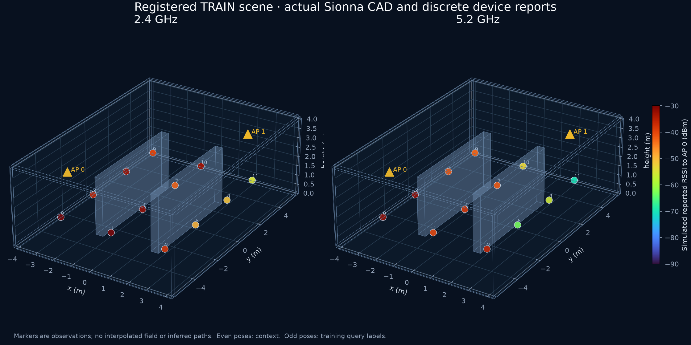

# Physics-structured RadioJEPA: static field results

The new scene model lowers spatial held-out-layout RF RMSE from **4.843 to
3.622 dB** against the RadioMap-operator control, a **25.2% reduction**, across
24 independent simulated geometries. Its mean within-layout 95th-percentile
absolute error falls from **9.500 to 6.920 dB**. Same-link 6 GHz error falls
from **4.604 to 3.734 dB**. These three registered comparisons pass their
four-comparison-adjusted confidence checks.

**Joint-embedding alignment adds no confirmed accuracy benefit.** Exact
matched regression achieves **3.631 dB**, and the RF-value-erased geometry and
reported-availability control achieves **3.660 dB**. The evidence supports
the physics-structured field architecture; it does not isolate JEPA as the
cause of the gain, establish dependence on rich RF representations, or qualify
a learned fleet controller.

Audit completion is recorded in the [verification directory](../../artifacts/radiojepa_spectral/verification/).
The [machine-readable report](../../artifacts/radiojepa_spectral/report.json)
and [per-layout/member predictions](../../artifacts/radiojepa_spectral/results/field_test.json)
are the numerical authority.

The final byte closure passes **475 sources and 5,161 evidence files**.
The passive audit replays all 216 DEV and 1,296 FIELD records without fitting,
models or ray tracing. An [independent read-only review](../../artifacts/scene_field_review/independent.json)
also reproduces the raw FIELD targets, context/calibration bindings, metrics
and four bootstrap comparisons. Its [retained script](../../artifacts/scene_field_review/audit_independent.py)
records this workspace's paths and writes its review outside the sealed study.

## What was executed

- **84 actual Sionna RT scenes:** 48 TRAIN, eight VAL, four DEV and 24 FIELD;
  two procedural CAD families, three obstacle materials, two APs, 12 client
  poses, three carriers and independently solved link directions.
- **15 neural fits:** none/SIGReg/VICReg joint models with three seeds each;
  validation chose **no added latent-prior penalty**, followed by three exact
  matched-regression and three RF-value-erased control fits with that choice.
  Every fit has 60 epochs, 480 updates and the same data/checkpoint rule.
- **1,296 FIELD prediction records:** individual models and numerical controls,
  latent zero/shuffle interventions, same-link held-band transfer and four
  simulated-device onboarding budgets. These records are not independent sites.
- Fixed source-view-A inference, with both observed bands at six even poses.
  Main queries use odd poses at 2.4/5.2 GHz. The separate 6 GHz assay queries
  the same even physical links; it is not a 6 GHz unseen-position result.

The [architecture](ARCHITECTURE.md) combines a differentiable eight-coefficient
inverse propagation estimate with shared set attention. The decoder sees the
scene code and public query geometry; observed power and receiver tokens have
no decoder bypass. Paired TRAIN reports estimate relative device offsets in
device 0's report gauge. The calibrated reference convention is an assumption,
not a hardware calibration discovery.

The illustration shows one actual TRAIN cache, not a predicted continuous
field, a held-out accuracy plot or a physical warehouse capture.

## All registered controls

Values are mean per-layout RMSE in dB. For neural rows, each member's metric
is calculated first and the three metrics are averaged; predictions are never
ensembled. Numerical controls have one deterministic fit per condition.

| Model | Spatial 2.4/5.2 GHz | Same-link 6 GHz |
|---|---:|---:|
| Joint model, no added prior penalty | **3.622** | 3.734 |
| Exact matched regression | 3.631 | **3.711** |
| RF-value-erased geometry + availability | 3.660 | 3.736 |
| Pooled Bayesian operator | 3.834 | 3.963 |
| RadioMap operator | 4.843 | 4.604 |
| Public FSPL operator | 5.725 | 5.009 |

The RadioMap control calls the actual native Bayesian/Tobit fitter through a
public-CAD feature adapter, with TRAIN-learned priors and proper same-link
frequency transport. This is a static-field adaptation of that fitter, not
the native 100-robot application endpoint. Its training admission, context
budget and noise treatment are documented in [BASELINES.md](BASELINES.md).
The pooled Bayesian control is a useful stronger numerical reference;
its comparison was descriptive, not one of the four primary tests.

## Four predeclared comparisons

Intervals are central **98.75% paired whole-layout bootstrap intervals** for
candidate minus reference, using 20,000 resamples and the four-test budget.
They condition on the three trained members; they do not capture all possible
training-run variability. Negative differences favor the joint model.

| Endpoint/reference | Difference, dB | Adjusted interval | Confirmed improvement |
|---|---:|---:|---|
| Spatial RMSE / RadioMap | −1.221 | [−1.621, −0.837] | Yes |
| Spatial RMSE / exact matched regression | −0.009 | [−0.078, +0.063] | No |
| Spatial p95 absolute error / RadioMap | −2.581 | [−3.999, −1.387] | Yes |
| Same-link 6 GHz RMSE / RadioMap | −0.870 | [−1.486, −0.231] | Yes |

The three joint members' spatial means are **3.592 / 3.675 / 3.598 dB**.
Their 6 GHz means are **3.619 / 3.825 / 3.757 dB**. The direct same-link
5.2→6 GHz operator records **4.275 dB** on the same 1,728 genuinely paired
heard queries; this additional comparison is descriptive.

## Device onboarding and representation limits

| Paired context reports for simulated device 3 | Joint model RMSE | RadioMap RMSE | Layouts available |
|---:|---:|---:|---:|
| 0 | 7.063 | 7.687 | 24/24 |
| 1 | 3.683 | 4.869 | 24/24 |
| 4 | 3.699 | 4.899 | 24/24 |
| 16 | 3.696 | 4.889 | 24/24 |

This measures inversion of an explicitly simulated RSSI offset/quantizer.
The encoder continues to use the known-device context; there is no neural
fine-tuning or demonstrated transfer of an encoder to a new physical radio.
More pairs are not monotonically better in this curve. Supports are nested
and correlated, and no independent onboarding superiority test is claimed.

All three FIELD code matrices have numerical centered rank eight, but their
participation ranks are **1.686 / 3.615 / 2.438**. The states remain anisotropic.
Full numerical rank is not proof that representational collapse is solved.
The near-tie with the geometry/availability control makes that distinction
especially relevant. Comparisons with the earlier power-only CSI pilot also
change task, inputs and scene units, so they cannot isolate an architecture effect.

## Scope, provenance and what remains

All **3,456 in-band and 1,728 held-band primary queries were heard**; there
were zero censored or unresolved primary queries. The likelihood's censoring
branch is covered by analytic tests, not exercised by these primary results.
This cohort cannot validate deep fades, sparse delivered scans, interference,
unheard distant paths, arbitrary layouts, heterogeneous real devices or MAC load.
The fixed 4 dB likelihood scale is not calibrated outage uncertainty.

The 475-file scientific snapshot was remotely published before new scene
generation and training. Its preflight has **2,144 passing tests** with one
expected multiprocessing warning. A separately published execution amendment
has **36 passing tests**. It reuses only the original fully verified DEV gate
after checking all bound bytes and membership; the original numerical DEV
predicate runs again before the original passive raw audit and seal. The
amendment was published after all 84 RT scenes and 15 fits, before FIELD
prediction, and changes no model, data, endpoint or acceptance rule. See the
[execution amendment](../../artifacts/radiojepa_spectral_ops/README.md).

The failed [measured-power pilot](../RADIOJEPA_RESULTS.md) and its
[diagnosis](../scene_pilot/INTERPRETATION.md) remain intact. Its negative
result is not replaced by these simulated results. Licensed CSI/RSSI/FTM
acquisitions, theory components and frozen DINOv3 features are separate
evidence; they are not all inputs to this model.

**RadioMap remains the application default.** The original 24 SERVICE
confirmation specifications remain unopened. A complex-CSI model, observation-
driven dynamic filter, action-conditioned rollout, calibrated packet/service
heads, native same-planner comparison, real-device transfer and scaling runs
are still required. The [remaining-work matrix](REMAINING.md) maps these to
the full user plan. No SOTA, universal foundation-model, inference-speed,
100-car service or hardware qualification follows from this field experiment.
